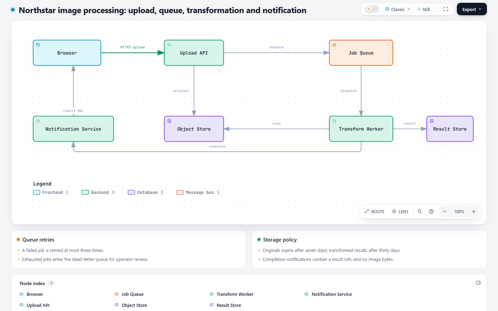
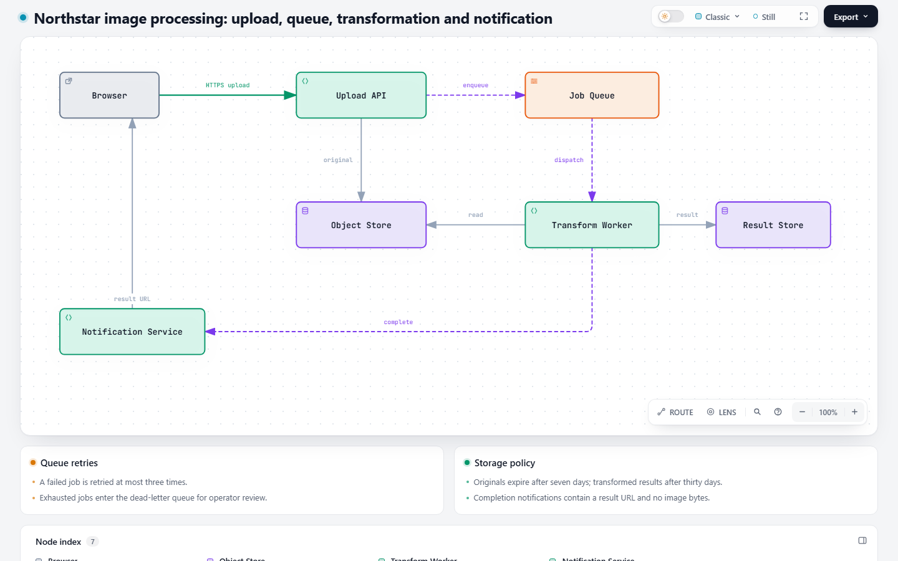
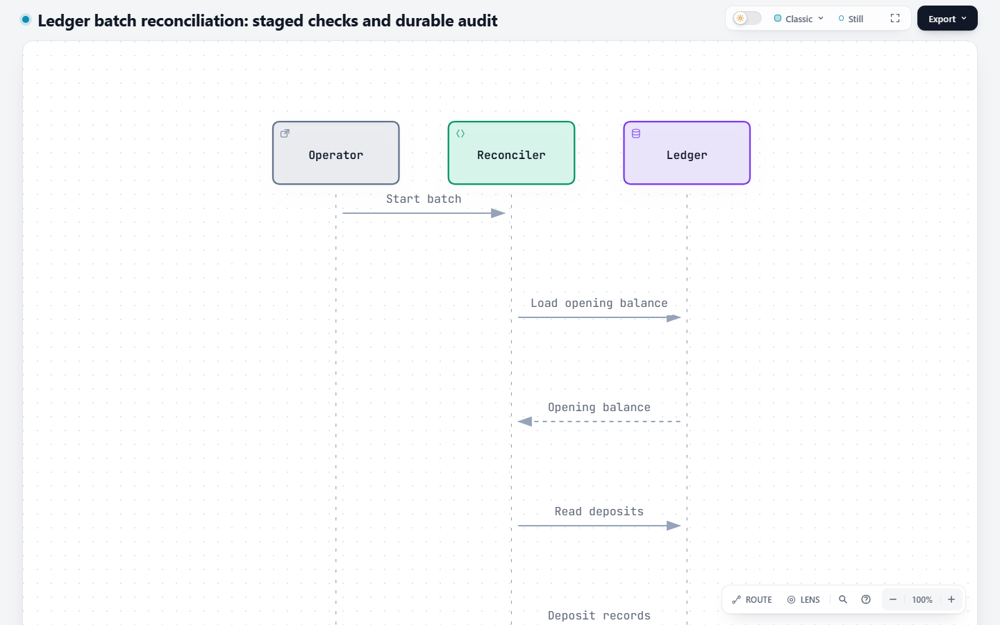

# Viewport-height guidance: paired authoring evidence

Four fresh first drafts passed `finalize` without a content or geometry repair. Both instruction versions preserve the supplied content, and both accept the long sequence's readable vertical page scroll. **This small comparison does not demonstrate fewer repairs or a causal improvement in fit.** It supplies practical authoring examples and a preservation check, rather than a general generation-quality claim.

## Comparison conditions

| Condition | Value |
| --- | --- |
| Old instructions | `744d8e10bda445ef1aebbf63d72ceca7445b069b` (latest `dev` at experiment start) |
| Revised instructions | `96ceea70197183673594567bc0c9e252eef14c9d` (rebased PR, before adding this evidence) |
| Runtime | Identical in both worktrees; the only `archify/` differences are `SKILL.md` and `references/authoring-contract.md` |
| Generation | Four isolated subagents, one per task/arm, `fork_turns=none`; same inherited parent model and reasoning configuration, no overrides |
| Sampling limitation | The host does not expose its exact model identifier, sampling seed or temperature; no claim of deterministic generation or a version-pinned model benchmark |
| Host/toolchain | Windows, official Node 22.23.2; same installed Chrome executable for all four runs |
| Target/screenshot state | 1440×900 CSS pixels, device scale factor 1, light theme, classic preset, default Reader/camera at 100%, `read` detail, motion paused, scroll top 0 |
| Source | The same public fictional task text within each pair; no repository-backed or private source material |
| Preservation | First draft frozen before its first `finalize`; first and final JSON bytes are identical in every session |

[Protocol](protocol.json), [results](results.json), [artifact hashes](artifact-hashes.json), and [ZIP verification](package-verification.json) record identities and measurements. This is a scoped paired authoring exercise, not a replay of the project's frozen renderer benchmark. Agents could inspect only their selected Skill and task before drafting; no draft was selected from multiple attempts.

The four authoring commands use the selected worktree's CLI, `--quality showcase`, and the ordinary `finalize` path. Each session's `execution.json` retains the command, recorded read/write/exec actions and environment-retry count; `stdout.txt`, `stderr.txt`, `finalize-summary.json` and `browser-check.json` retain the results. Local paths are replaced with placeholders and line endings normalized in informational log/receipt copies. The local attributes preserve exact first-draft JSON and delivered HTML bytes, including generated whitespace, so their published hashes remain valid after checkout. Their hashes still identify the unchanged generated JSON/HTML, but these redacted copies are not portable strict-provenance sidecars: rerun `finalize` to obtain fresh bound evidence. Agent notes predate the parent screenshot/visual inspection below.

## Fixed-viewport Architecture

[Unchanged task and source](task-fixed-viewport.md): seven separately named roles, eight labeled directed relationships, the exact requested title, two policy cards, and an explicit 1100-unit canvas width. Aim for title, diagram and supporting facts in the first 1440×900 screen.

| Target-viewport measure | Old instructions | Revised instructions |
| --- | ---: | ---: |
| First `finalize` / all four gates | Pass | Pass |
| Content/geometry repair rounds | 0 | 0 |
| Authored viewBox | 1100×420 | 1100×460 |
| Measured SVG height | 514px | 563px |
| Gate's first-screen `scrollHeight` / `innerHeight` | 900 / 900px | 900 / 900px |
| Horizontal / vertical overflow | false / false | false / false |
| Minimum projected semantic / non-edge text reported by gate | 8 / 11px | 8 / 11px |
| Roles / directed labeled relationships / policy cards | 7 / 8 / 2 | 7 / 8 / 2 |

[Old JSON](fixed-viewport/base/first-draft.json), [old HTML](fixed-viewport/base/diagram.html), [old browser result](fixed-viewport/base/browser-check.json), [old author notes](fixed-viewport/base/author-notes.md).

[Revised JSON](fixed-viewport/candidate/first-draft.json), [revised HTML](fixed-viewport/candidate/diagram.html), [revised browser result](fixed-viewport/candidate/browser-check.json), [revised author notes](fixed-viewport/candidate/author-notes.md).

[Generated-input diff](fixed-viewport/generated-input.diff) keeps independently authored differences visible. The revised agent explicitly reports reading the viewport-budget section before choosing its canvas. Its Notification Service uses a third row rather than the old draft's second row; node sizes/positions, role styling, endpoint pins, asynchronous route variants and automatic legend treatment also differ. The candidate SVG is **49px taller**, while both drafts fit. These are authoring differences, not a fixed-input renderer comparison or evidence of a height reduction caused by the guide.

Matched default-Reader screenshots, old then revised:





Parent visual inspection: all seven roles and eight directions can be followed, relationship labels are visible, and the title plus both complete policy cards fit in the first screen in both arms. The cards preserve the three-retry/dead-letter rule, both expiry periods, result URL and no-image-bytes condition. Neither layout clips a required node or policy card. The screenshots show different spacing/styling, so they do not establish which layout readers would prefer. `cardsPx=0` in the gate denotes bottom reading-rail exclusion, not missing cards; their visibility was checked in the screenshots separately.

## Readable-scroll Sequence

[Unchanged task and source](task-readable-scroll.md): three ordered participants, 18 ordered directed messages, and 18 required notes. Page-level vertical scrolling is explicitly acceptable. Both agents omit `meta.viewBox`, as requested, and preserve every message and note verbatim.

| Target-viewport measure | Old instructions | Revised instructions |
| --- | ---: | ---: |
| First `finalize` / all four gates | Pass | Pass |
| Content/geometry repair rounds | 0 | 0 |
| Intrinsic SVG viewBox | 560×2002 | 560×1832 |
| Authored message interval | 100 units | 90 units |
| Rendered SVG width / height | 840 / 3003px | 840 / 2748px |
| Gate's `scrollHeight` / `innerHeight` | 3145 / 900px | 2890 / 900px |
| Horizontal overflow | false | false |
| `verticalScrollAccepted` | true | true |
| `overflowDisposition` | readable-vertical-scroll | readable-vertical-scroll |
| Minimum projected semantic text reported by gate | 11px | 11px |
| Participants / ordered messages / verbatim notes | 3 / 18 / 18 | 3 / 18 / 18 |

[Old JSON](readable-scroll/base/first-draft.json), [old HTML](readable-scroll/base/diagram.html), [old browser result](readable-scroll/base/browser-check.json), [old author notes](readable-scroll/base/author-notes.md).

[Revised JSON](readable-scroll/candidate/first-draft.json), [revised HTML](readable-scroll/candidate/diagram.html), [revised browser result](readable-scroll/candidate/browser-check.json), [revised author notes](readable-scroll/candidate/author-notes.md).

[Generated-input diff](readable-scroll/generated-input.diff): message spacing is 100 versus 90 SVG units; One message ID and the output filename also differ; participant order, message labels, notes and variants are unchanged. The 17 intervals account for the 170-unit intrinsic-height difference and 255px rendered/page-height difference at the same 1.5 enlargement. No message or note was deleted, shortened or summarized. The revised agent read the new viewport guidance, but the old agent already accepted scrolling. **A 255px shorter result in one stochastic pair is an observation, not proof that the guide caused it.** Neither arm required a viewport repair.

Matched default-Reader screenshots, old then revised:




[Old complete page](readable-scroll/base/full-page.png) and [revised complete page](readable-scroll/candidate/full-page.png) preserve all 18 readable message labels without forcing the timeline onto one screen. Parent visual inspection found no label collision or horizontal clipping in these default views. The final commit/confirmation/completion remains present at the bottom.

Fine sequence notes are intentionally hidden at the default `read` detail level in **both** arms. The browser's 11px semantic-text result is not a measurement of those hidden annotations. A separate actual Viewer interaction (four zoom-in clicks to `FULL 200%`) confirmed all 18 rendered notes are displayed with the exact supplied text: [old observation](readable-scroll/base/full-detail-observation.json), [revised observation](readable-scroll/candidate/full-detail-observation.json). This supplemental camera state needs panning and is not used to claim default-state containment or a complete one-screen view. JSON/HTML and rendered-text auditing establish note preservation; no user study or exhaustive fine-annotation perceptual acceptance is claimed.

## Automated evidence, visual review and limitations

- All four first `finalize` calls exit 0. `validate`, `deliver`, strict `check` and real `browser-check` pass; no diagnostics or repair rounds. All four checked desktop viewports pass. Browser theme/readability/chrome results are retained in each receipt, while screenshots and the parent visual inspection cover the matching light 1440×900 state.
- Each subagent had one sandbox process-identity retry before authoring, separate from diagram repairs; the old-sequence metadata script also needed a syntax correction. No candidate or finalize retry was used to conceal those support failures. The action logs record them.
- Source-to-JSON auditing checks every Architecture role, relationship direction/label and policy fact, and all 18 Sequence participant directions, message labels and notes. First-to-final byte identity and finalize's specification/artifact hashes are verified. Actual `FULL` rendered note text matches the source as well.
- Fresh screenshots use settled fonts/layout, identical viewport/theme/preset/camera and still motion. Browser checks, default-state parent visual inspection, and supplemental note-preservation observations are distinct evidence.
- Two fictional tasks, one run per arm, already successful old drafts: there is no demonstrated repair reduction, no reproduced old-guidance failure, no production-repository coverage, no model-version-pinned experiment, and no statistical or broad improvement claim. The new guide was applied without observed content loss or default-state readability regression in these examples.

The 23 focused budget/Skill/delivery checks were rerun after rebase and passed. They complement this authoring evidence; they do not substitute for it. No new test freezes these particular generated coordinates or screenshots.

## Replay the delivered inputs

Check out the recorded revisions in separate worktrees. Use Node 22.23.2 and set `ARCHIFY_CHROME` to an installed Chrome executable. From a fresh output directory for each input, run the selected worktree's CLI:

```text
node <worktree>/archify/bin/archify.mjs finalize <type> <absolute-first-draft.json> <output.html> --quality showcase --json
node <worktree>/archify/bin/archify.mjs visual-check <output.html> --out-dir <fresh-capture-directory> --json
```

| Input | Type | Output name from original authoring |
| --- | --- | --- |
| fixed-viewport/base/first-draft.json | architecture | northstar.html |
| fixed-viewport/candidate/first-draft.json | architecture | northstar.html |
| readable-scroll/base/first-draft.json | sequence | ledger-batch-reconciliation.html |
| readable-scroll/candidate/first-draft.json | sequence | ledger-reconciliation.html |

This reproduces finalization/capture from the retained actual inputs, not identical new model generations. To repeat authoring, use the unchanged task texts and the same isolated-agent settings described above; new drafts can differ. Do not overwrite retained evidence or use the redacted receipts as live provenance.
