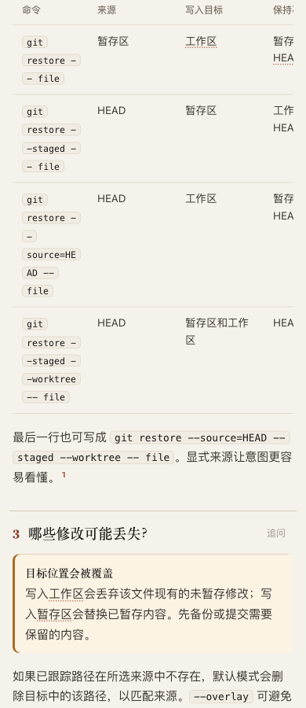
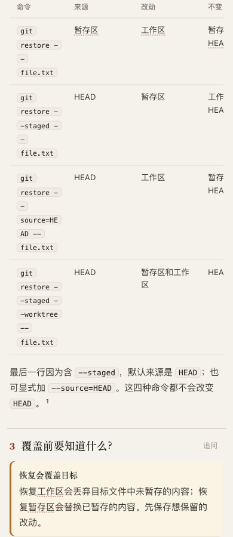

# Git restore: short labels versus useful table structure

This is round 4 of the continuous explainer reading exploration. Runtime: `3a8636145`; refreshed `origin/dev`: `5ecbd1bfdbf83ea747072112493c940e707569cb`.

## Frozen comparison

Two independent gpt-6.1-terra / medium authors received the same question, Git v2.50.0 manual at `16bd9f20a403117f2e0d9bcda6c6e621d3763e77`, runtime, guide and 15-minute budget. The candidate alone received this instruction:

> Use short column headings and row labels; put shared defaults or long signatures in prose immediately above the table. Keep exact names and local exceptions in the relevant cells or nearby explanation.

[Base prompt](base-prompt.txt), [candidate prompt](candidate-prompt.txt), [identities and hashes](pair.json). Both ran concurrently; no speed comparison is claimed. Neither saw the other arm or the parent's subsequent repair.

Both authors finalized twice. Each first attempt passed with one warning about three “的” modifiers in a sentence; each split the sentence and finished with no diagnostics. First drafts, revision receipts and author notes remain in their arm directories. No finalize failed. This is one paired case, not the project generation benchmark or evidence of general improvement.

## Result: the instruction did not fix this case

At 390 × 900 in light/editorial mode, **both tables are 432 px wide inside a 358 px frame**. Their commands fragment into many lines; `--source=HEAD` splits inside the flag. Shorter headings made no measured width difference. At 1440 × 900, both tables fit their 840 px frames. [Recorded geometry](visual-metrics.json).

| Base at 390 px | Instruction candidate at 390 px |
| --- | --- |
|  |  |

Both preserve the four source/destination rules in the pinned manual. The parent checked the default source change with `--staged`, combined destinations, explicit source, unchanged HEAD, absent-source deletion and conflict/sparse-checkout caveats. This does not validate every Git restore option. The instruction remains **unadopted**; adding it to the authoring guide is not justified by this pair.

## Case repair: organize by the reader's purpose

The parent rewrote the candidate's comparison into two columns: a short purpose label, followed by the exact command and its result. Shared conditions and unchanged HEAD appear once above the table; unchanged index/worktree and the combined-destination exception remain local. HEAD existence was added to page scope. The other panels remain from the independent candidate.

[Repaired page](purpose-table.html), [source](purpose-table.archify.md), [390 px capture](purpose-table-390.png), [desktop top](purpose-table-top-1440.png), [desktop table](purpose-table-1440.png), [geometry](purpose-table-metrics.json).

The phone table now fits at **358 / 358 px**, with a measured height of 348 px. Parent screenshot inspection found the source/target explanation and commands substantially easier to follow. This is a manual content repair, **not** evidence that the experimental instruction produced the outcome. The long combined command still breaks its standalone `--` separator across lines; this remaining reader issue motivates a separate bounded inline-code experiment. No human reading study is claimed.

Strict finalize and provenance check pass for the repaired page: [finalize output](purpose-table-finalize.json), [check](purpose-table-check.json). The full browser gate was not run. No runtime changed in this round, so no runtime suite or archive rebuild was necessary.

The independent arm artifacts were copied byte-for-byte from their author directories. Their original receipts retain those absolute locations; checks on the copied artifacts fail with “recorded delivery output does not identify this artifact” ([base](base/relocation-check.json), [candidate](candidate/relocation-check.json)). This is a documented relocation limit, not a passing provenance check. To obtain current receipts, finalize either retained Markdown source into a new output path. The parent repair was finalized at its committed workspace location.

## Local behavior probe

[probe.py](probe.py) creates a disposable repository with HEAD=A, index=B and working tree=C, and restores the same tracked file separately for each command. Actual output uses **Git 2.50.1 (Apple Git-155)**, distinct from the pinned 2.50.0 manual. [Raw output](probe-output.json).

| Options | HEAD after | Index after | Working tree after |
| --- | --- | --- | --- |
| none | A | B | B |
| `--staged` | A | A | C |
| `--source=HEAD` | A | B | A |
| `--staged --worktree` | A | A | A |

All assertions passed. The probe does not cover absent paths, conflicts, sparse checkout or submodules and does not run in the user's repository. It is source corroboration for this small case, not a Git compatibility suite.

AI disclosure: two independent Codex authors used gpt-6.1-terra / medium; the parent agent inspected source, ran the probe, reviewed screenshots and made the two-column repair. No human acceptance, merge, release or live installation is claimed.

Whitespace check: the preserved renderer HTML emits 12 existing trailing-space lines per artifact (36 total). Those bytes are retained for artifact/receipt identity; authored Markdown, JSON and Python pass the scoped whitespace check.
