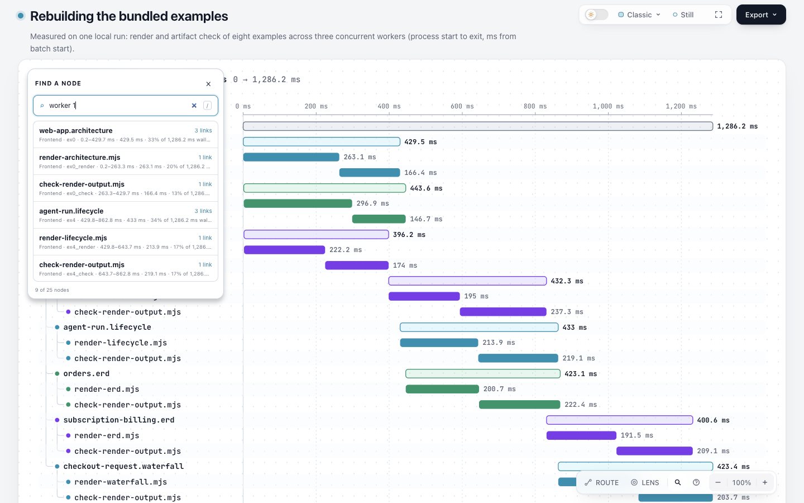
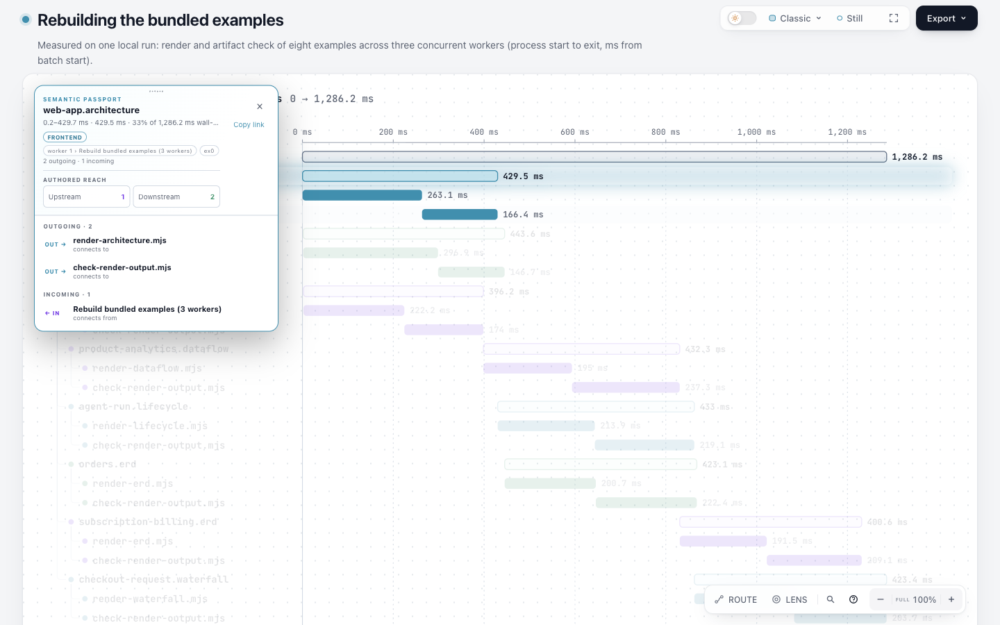
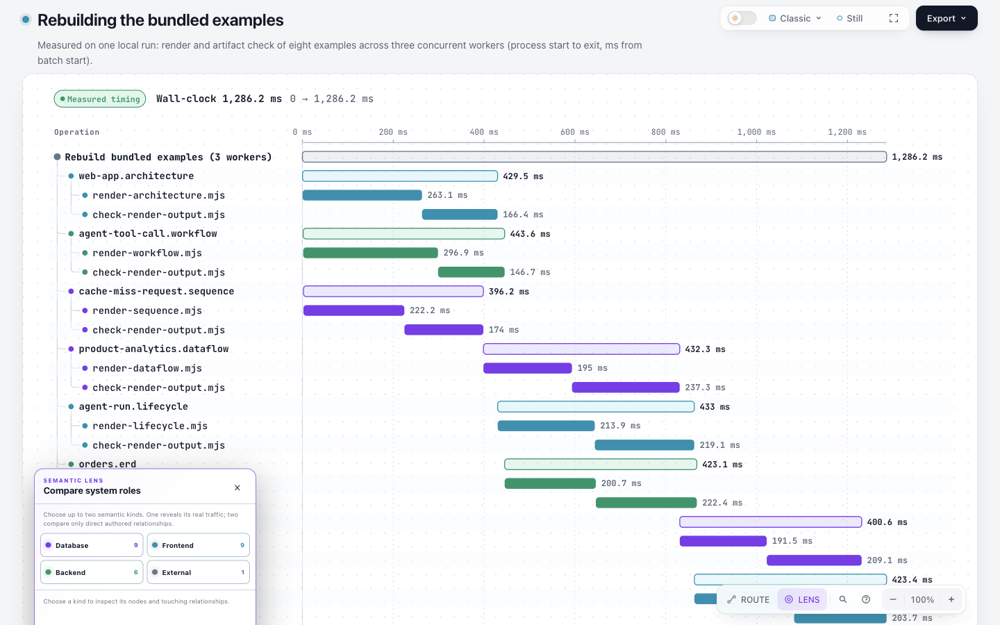

# Waterfall 现有行为复现

这是固定dev的缺陷审计，不是修复候选或新的性能测量。来源是 [d5d979493bba650b3995836afd379cd249f2d0dd](https://github.com/tt-a1i/archify/tree/d5d979493bba650b3995836afd379cd249f2d0dd) 的 [example-rebuild.waterfall.json](https://github.com/tt-a1i/archify/blob/d5d979493bba650b3995836afd379cd249f2d0dd/archify/examples/example-rebuild.waterfall.json)。输入字节未改，原示例宣称一次实测；本轮仅重新渲染其已保存数据，没有重跑其中八个示例来重新计时。Archify [Apache-2.0](https://github.com/tt-a1i/archify/blob/d5d979493bba650b3995836afd379cd249f2d0dd/LICENSE)及[既有署名/许可声明](https://github.com/tt-a1i/archify/blob/d5d979493bba650b3995836afd379cd249f2d0dd/NOTICE)保留。

## 观察

- 输入25个区间：worker 1有9个、worker 2有6个、worker 3有9个，另有1个未归属根区间。三组在Lens中分别叫Frontend、Backend、Database；根区间叫External。
- 实际Finder输入worker 1后返回对应9个ID，结果行仍显示Frontend；按真实Enter定位ex0，其Passport显示Frontend，同时保留worker 1的context。
- Lens列出Database9、Frontend9、Backend6、External1。它们来自绘图tone，不是作者指定的系统角色；当前说明还使用real traffic字样，不能据此将作者声明的parent嵌套升级为流量或因果。
- 源码图例条目interactive:false；实际HTML没有data-legend-kind桥接项。服务图例没有逐项选择能力。Outline按context首段分组和Radar按kind着色仅做源码审计，未冒充本次GUI验证。





截图均为1440×900、浅色、Classic、Still，实际Ego空间18/p1。Lens截图底部被视口截断，仍可观察四个类型按钮；这些图片不是整页可读性或移动端验收。浏览器只执行查找、定位和打开Lens，没有更改产品。页面脚本源及数据在 [完整HTML](example-rebuild-waterfall.html) 中。

## 复现与记录

在固定基线的独立checkout中，用Node22.23.2运行；不需要安装或替换当前Archify：

```sh
mkdir -p /tmp/waterfall-role-audit
node archify/bin/archify.mjs finalize waterfall archify/examples/example-rebuild.waterfall.json /tmp/waterfall-role-audit/example-rebuild-waterfall.html --json --browser-check --quality showcase --out-dir /tmp/waterfall-role-audit/receipts
```

也可直接打开保存的HTML，设1440×900浅色，点击Find a node并输入worker 1，再按Enter；返回后打开Lens。输入、命令输出、三个自动receipt、真实浏览器脚本与状态见本目录；完整字节身份见 [manifest](manifest.json)。脚本中的临时路径和空间ID是历史采集位置，复现时使用自己当前的浏览器任务空间。

Node22.23.2/zlib1.3.1-e00f703；冻结runtime的238个archify/源码文件与基线git blob全部匹配。finalize四个gate均pass、0诊断，visualReview=not-requested；实际三图由root另行检查。GUI脚本exit0，Ego把console/snapshot输出写到stderr，非空stderr不等于执行失败。独立的Browser.getVersion元数据查询返回方法不存在，失败另记，未声称取得Ego精确浏览器版本。没有全测试套件、hosted CI、独立读者或速度收益结论。

[源码取舍报告](../../scouts/waterfall-role-decision.md)解释暂缓原因：统一Span修正角色会合并原Lens分组，旧tone链接不能一对一迁移，Radar还有配色消费者；新增精确service Lens则是额外交互合同。本轮确认问题并保存可复现边界，没有把服务搜索现状误称缺失，也没有为了保住错误色桶建立通用筛选框架。
