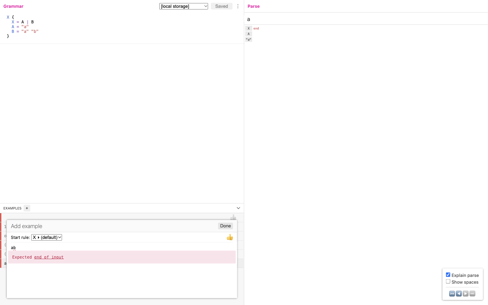
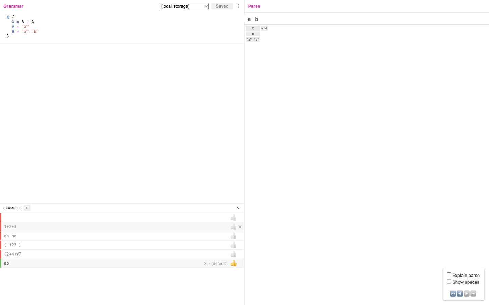
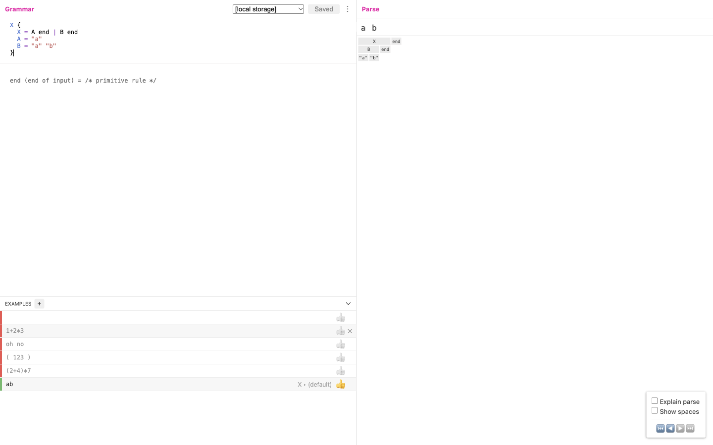
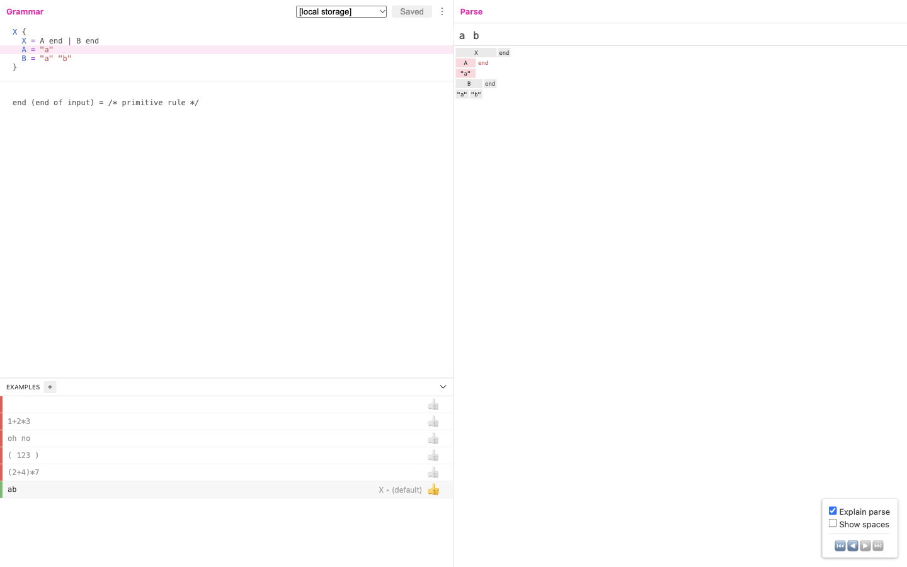

# Ohm: ordered choice and whole-input failure

This is a native-tool observation of the complete small example in [Ohm issue #254](https://github.com/ohmjs/ohm/issues/254), not an Archify implementation or a reproduction of the author's undisclosed real application. Input is `ab`; the original grammar is in `original.ohm`. The issue author proposed `A end | B end`; a maintainer proposed `B | A` and the author explained that the real application was not prefix-shaped. The two alternatives here are limited to this public example.

The deployed [Ohm Editor](https://ohmjs.org/editor/) reported **Ohm 17.5.0** in `window.ohm.version`. Its editor deployment commit is unknown. Independently pinned editor source `2ff2a07225031ead520ad22c2bc19bac7ce75ff2`, package `ohm-js-editor` 0.1.0 and `ohm-js` dependency range ^17.0.0 do not prove which editor build was deployed. [MIT license](LICENSE-ohm-editor-MIT), copyright Alessandro Warth, Marko Röder, et al.; no editor implementation or third-party bundle was copied. The small issue grammar is attributed to the linked issue, rather than relabeled as our own implementation.

| Grammar change | Native match | Native reading evidence |
| --- | --- | --- |
| Original `X = A \| B` | false; line1 col2, expected end of input | Full trace has successful `A` consuming `a`, then failed whole-input `end` with `b` remaining. Explain parse is automatically enabled. |
| `X = B \| A` | true | Full trace consumes `ab` through `B`. Explain parse is automatically disabled. This is not a general fix for other grammars. |
| `X = A end \| B end` | true | Full trace includes the failed `A end` sequence and successful `B end`. Default UI hides the failed sequence. Enabling Explain parse shows it; hovering `A` highlights its source rule. |

Root inspected all four actual screenshots. They use 1440×900 CSS viewports, light native styling, and captured DPR1. These are different native states, not a pixel-parity comparison: the first includes the Add example editor/error, later views show the example list, and the final view intentionally hovers `A`. Other original Arithmetic examples remain in the list and do not refer to this `X` grammar; only the added `ab` example is evaluated here. We did not test human comprehension, all keyboard interactions, mobile layouts, timeline stepping or export.

`*-native.json` records the actual editor grammar/input, native engine version, complete `g.trace(input).toString()`, `g.match(input)` result, rendered DOM, toggle state, viewport, user agent, URL and capture time. These API observations invoke the already loaded Ohm engine separately on the editor's current input; they do not infer execution from visible node absence. They are also saved as full `*.trace.txt`. `scoped-end-explained-state.json` records the UI-only toggle/hover result. Absence from a filtered native view does not mean a branch was never attempted.

The issue grammar was transcribed with LF line endings. Stored `.ohm` files have a final newline; the exact text entered into the UI is retained in the JSON and action scripts. Input `ab` is saved without a trailing newline. No grammar semantic actions or arbitrary user code were added, and no parser, package or live Archify installation was installed.

## Reproduce and failure record

Open the native editor, preserve any existing grammar/examples, replace the grammar with each recorded case, and add one example `ab`. Record the native version, full result and toggle state each time. After the third case, enable Explain parse and hover the `A` label. Grammar changes reset the toggle; applying the same checkbox state to every arm would erase the observed default behavior. The live deployment may change, so a later run is not automatically the same build.

Scripts 01–12 and their logs retain the actual browser sequence; their space34 and temporary paths are historical, not portable automation parameters. Space32 was absent from inventory, so the same goal space was recreated under the user's prior explicit permission. The goal continues and the space remains available.

Attempt04 changed the grammar, then failed to focus the hidden example editor; its log remains. A subsequent root attempt to read the unwritten state file also failed in the tool transcript. Attempt05 inspected the state, attempt06 used Add example, and attempt07 entered the input through the now-visible editor. The failed attempt is not counted as a parse result. No initial artifact was replaced to conceal it.

At the end, the task-created `example5` was removed, the exact initial Arithmetic grammar restored, and the first original example selected. `restored-state.json` retains the five original rows and selection. This is a content restoration record, not a claim that every transient UI or browser preference was restored.

The native UI plus complete text trace already answers this small reading question. A second parser/trace renderer would add version, identity and filtering costs without demonstrated user benefit. Defer an Archify experiment until a concrete handoff remains difficult with the full native controls and evidence available.
