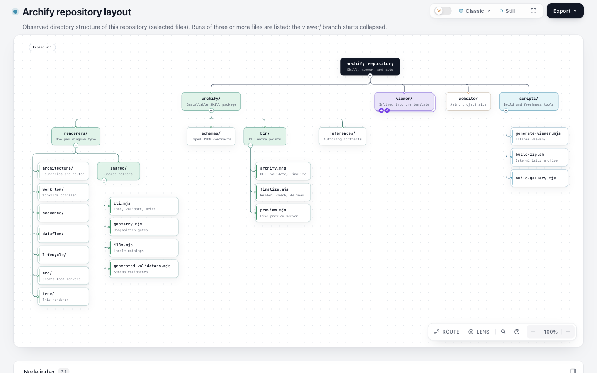
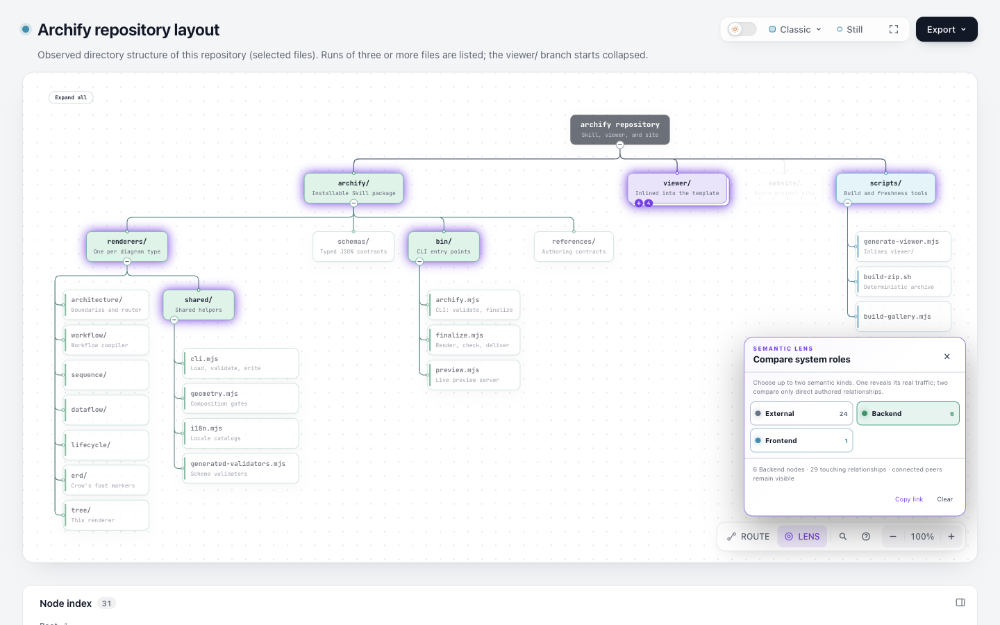
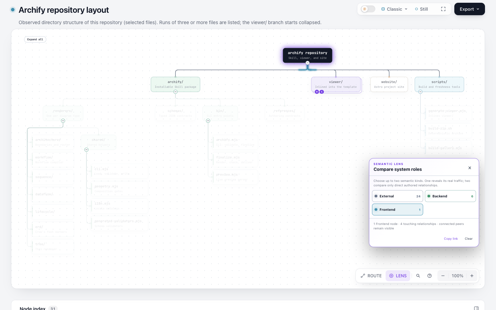
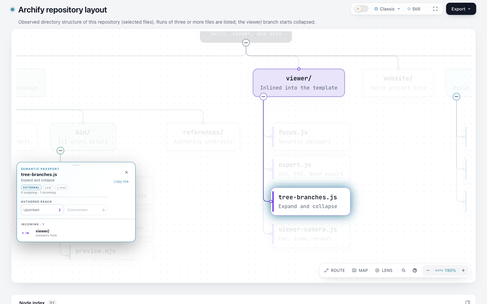

# Finder reveals an authored collapsed Tree target

This observation confirms existing behavior; it does not propose another focus/reveal implementation. The complete 31-node authored `archify-repository.tree.json` and its checked-in HTML were copied byte-for-byte from Archify `d5d979493bba650b3995836afd379cd249f2d0dd`. [Source identity](source-identity.json) records their paths, Git blobs and hashes. The diagram is an existing selected-files example, not a fresh or exhaustive repository scan. The HTML was neither regenerated nor patched with test hooks.

## Observed user path

1. Open the complete HTML at 1440×900, light theme. `viewer/` starts collapsed; `v_tree` (`tree-branches.js`) has `data-tree-hidden` and is not displayed.
2. Select Backend Lens. This is a preserved control: the target has kind External but remains a matched connected peer. A different kind does not establish exclusion. The target is still hidden by its collapsed ancestor. Open Finder and enter `tree-branches.js`; this control preserves the active Backend Lens and ancestor collapse, as recorded in `search-state.json`.
3. Close Finder, remove Backend and select Frontend. This stronger precondition leaves the target outside the Lens match as well as under the collapsed `viewer/`. Open Finder and type the complete unique filename. Opening/searching alone retains the active Lens and collapse.
4. Press Enter on the result. The ancestor expands, Lens becomes null, target is the semantic selection and DOM focus, and the camera reveals it. At the captured state its full rectangle is inside the viewport; opacity is1, display is inline, and a hit test at its center reaches `v_tree`. The SVG has only the active Focus attribute, with no Lens or Reach active mask. Other nodes can remain dim because of the new Focus neighborhood.

Root inspected all four actual Ego screenshots. Capture size is1440×900, and the final measured DPR is1. Panel placement, page scroll/available stage size and camera zoom differ as native controls open or close; these are state observations, not pixel-parity comparisons. The final target is legible and outside Passport. The rectangle/center check concerns this target and viewport; it is not a full occlusion, accessibility or every-viewport guarantee.

`initial-state.json`, `filtered-state.json`, `search-state.json`, `excluded-state.json`, `excluded-search-state.json`, `selected-state.json` and `selected-mask-state.json` keep raw UI/API observations. Scripts01–06 use real Lens buttons, Finder input and Enter; the only page JavaScript reads state or waits for layout. No call to `focus.set`, collapse/reveal or Lens selection was used to perform the interaction. The checked-in example's legacy kind names and Lens wording are preserved; earlier kind/relationship research already covers their semantics, and this observation does not endorse file nodes as external systems or tree links as runtime traffic.

## Reproduce and limits

Open `tree-archify-repository-rendered.html?theme=light` in a browser. Its authored `viewer/` collapse is the starting state. Choose Frontend in Lens, click Find a node, type `tree-branches.js`, and press Enter. For the control, first try Backend and observe the connected-peer behavior. Preserve the complete example; do not remove other nodes to make framing easier. Scripts and logs retain the actual sequence in existing goal space34; their temporary paths and space ID are historical and need adapting for another session.

This is one existing-artifact browser observation, with no new generation or automated test-suite run. The separate source audit reads existing Tree tests and supported Focus/Finder/hash contracts; it does not turn those tests into newly passed results. This browser case does not exercise an active Reach transition, deep links, mobile, cross-artifact navigation, arbitrary duplicate identities, export or human reading benefit. LikeC4's separate cross-view issue is research context, not a reproduction in Archify.

The new masks and ancestor-expansion logic suggested by the initial question are already present. Keep the current implementation; only revisit with a concrete failed path. Sources and attribution remain with the full artifact: Archify's [Apache-2.0](LICENSE-Archify) / [MIT](LICENSE-MIT), [NOTICE](NOTICE) and [third-party notices](THIRD_PARTY_NOTICES.md) are copied from the same revision, and inline notices in the HTML remain unchanged. No installation, publication or PR was created.
