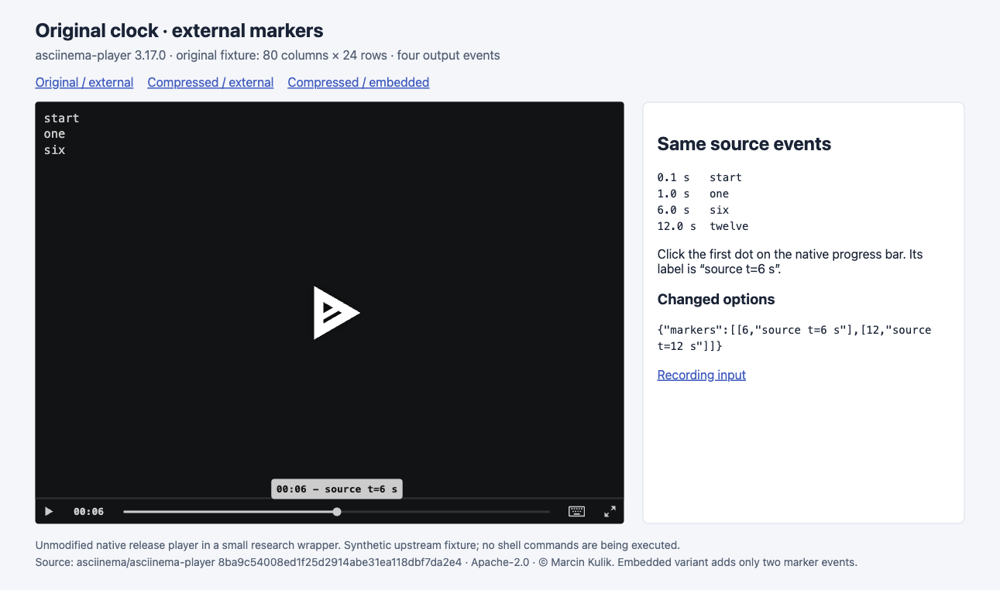
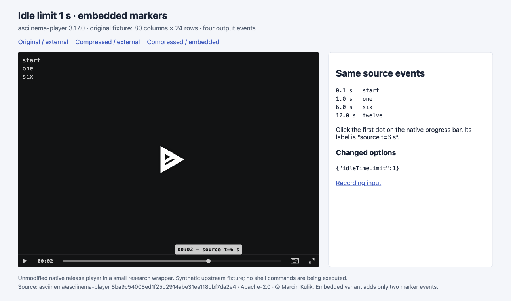

# asciinema：标记属于哪个时间坐标（第 53 批）

本轮完成固定原生播放器的三组对照，**不新增 Archify 终端播放器或通用录制导入器**。实际画面确认：开启空闲压缩后，直接沿用录制秒数的外部标记，与跟随事件压缩的内嵌标记，会指向不同终端状态。原生工具已经提供标记跳转；当前证据支持保留时间坐标的使用边界，尚不足以证明另做播放器能带来新增用户价值。

## 去重与版本边界

开始前刷新 [333 个远程 head](../audit/round53-asciinema/remote-heads.tsv)，相对上批仅研究 hub 推进。当前 hub 与历史 hub 的 scouts 范围未检出 asciinema；分支名未检出 terminal/cast/asciinema。仓库 asciinema 搜索返回 0 issue、0 PR，均记录在[上下文](../audit/round53-asciinema/context.json)。这是有边界的排重，不代表所有终端或操作历史方向都未研究。

[官方文档](https://docs.asciinema.org/manual/player/markers/)展示标记导航能力；页面资源 URL 带 3.9.0-83ce182，部署提交未核实。本次实际运行的是另行固定的 **asciinema-player v3.17.0 / 8ba9c54008ed1f25d2914abe31ea118dbf7da2e4**。两者不混作一次验证。

从官方 release 下载 JS（185010 bytes）和 CSS（19184 bytes），分别匹配 GitHub asset SHA-256；原生文件未改动，留在 Git 外。没有 npm install、Rust/Nix 构建或 CLI 安装。环境没有 asciinema recorder，本次没有录制或执行终端命令。

## 同一段输出，点击同一个来源标签

[官方 long.cast](../audit/round53-asciinema/original.cast)只有 136 bytes：asciicast v2、80×24、四条输出事件：

| 录制起点后的秒数 | 输出 |
| --- | --- |
| 0.1 | start |
| 1 | one |
| 6 | six |
| 12 | twelve |

这是上游合成测试素材，研究者选取；不是自然用户任务。A/B 使用完全相同的原文件；C 只在第 6、12 秒的原输出之后添加两个 m 标记事件，所有原输出与时间保留。三个配置均暂停，点击**原生进度条上的第一个标记**，不是通过浏览器求值调用播放器 API。

| 配置 | 标记提示 | 跳转后终端内容 | 当前时间 / remaining DOM 字段 |
| --- | --- | --- | --- |
| A：不压缩，外部 markers=[6,12] | 00:06 – source t=6 s | start / one / six | 00:06 / -00:06 |
| B：idleTimeLimit=1，同一外部标记 | 00:06 – source t=6 s | start / one / six / **twelve** | 00:06 / -00:06 |
| C：idleTimeLimit=1，内嵌标记 | **00:02** – source t=6 s | start / one / **six** | 00:02 / -00:01 |

这些是未修改的原生发布版播放器，在薄研究页面中的实际截图。终端文字同时从公开 DOM 文本层核对，排除控件后按录制的 24 行读取。截图显示当前时间；remaining 是控件 DOM 中的补充读数，不声称它在截图中可见。没有通过运行时内部状态填造画面。

## 原因与不能外推的结论

固定 [prepareRecording](../audit/round53-asciinema/sources/src__driver__recording__full.js)先对录制事件运行 timeLimiter，再合并外部 markers。限制为 1 秒时，原输出时间成为 0.1、1、2、3；外部标记仍在 6、12，因而还把准备后的事件序列末端延至 12。内嵌标记一起经过 timeLimiter，成为 2、3。源码顺序与本次画面及控件字段一致。

原配置给出两个标记，但画面只有一个可点击点：[ControlBar](../audit/round53-asciinema/sources/src__components__ControlBar.js)只显示严格早于 duration 的标记。恰在末端的标记没有点，不是录制数据被删除。

这里证明的是标记时间坐标的差别。外部标记可以是作者有意指定的播放时刻；本轮不把上述行为直接定为上游缺陷，也没有提交缺陷报告。点击跳转不验证真实播放耗时、自动暂停、命令完成或退出码。v3 的增量时间解析只读了源码，未运行；没有 ANSI 重写、resize、实时流、分段录制或音视频同步测试。

## 对 Archify 的判断

若作者把某次错误或修复说明挂在录制的“第 6 秒”，改变回放压缩选项后仍照搬这个数字，说明可能关联到另一幅终端画面。本例用 six/twelve 具体证明了这种风险；没有证明真实维护任务中它的频率或阅读收益。

当前 dev **847146aeb93b492592adb78dc220f57e4a8b4636** 的 [Timeline schema](../audit/round53-asciinema/sources/archify__archify__schemas__timeline.schema.json)要求带时区的 ISO at，并区分 observed/illustrative；其[轴断开合同](../audit/round53-asciinema/sources/archify__archify__renderers__timeline__README.md)已经要求披露被压缩的间隔。这里的录制只有相对秒数、没有时间原点，不能直接编造成日期事件，更不能把播放坐标当成来源时刻。本轮只读了该合同和渲染源码，没有重新运行 Timeline。

可保留的做法是：引用录制与具体来源事件时，把来源身份和播放坐标分开；需要随压缩保持位置时，利用已提供的内嵌标记，而不是重新维护终端模拟器。真正接入仍需要处理控制字符、屏幕状态、时间版本和回放选项，并有自然任务证明收益。本次四行合成素材不足以支持这些新增成本，所以没有产品实验通过实施筛选。

[证据包](../audit/round53-asciinema/README.md)包含输入及变换、三组配置、原生交互脚本、7 张已查看 PNG、12 个 Git blob 核验的来源文件及离线验证；[许可与署名](../audit/round53-asciinema/NOTICE.md)保留 Apache-2.0 和 Marcin Kulik 归属。首轮页面的页脚在视口外，保留原图后仅缩窄播放器容器并压紧选项展示；前后终端状态一致。全部截图实际为 1291×762。

原始文档页日志只留本地，清单不冒充已上传附件。自有服务已停止、研究页回到 about:blank。未运行产品或上游测试套件、构建、CI、读者研究；未创建 PR、合并、发布或安装。本轮只推进研究远程分支，持续目标仍 active。
