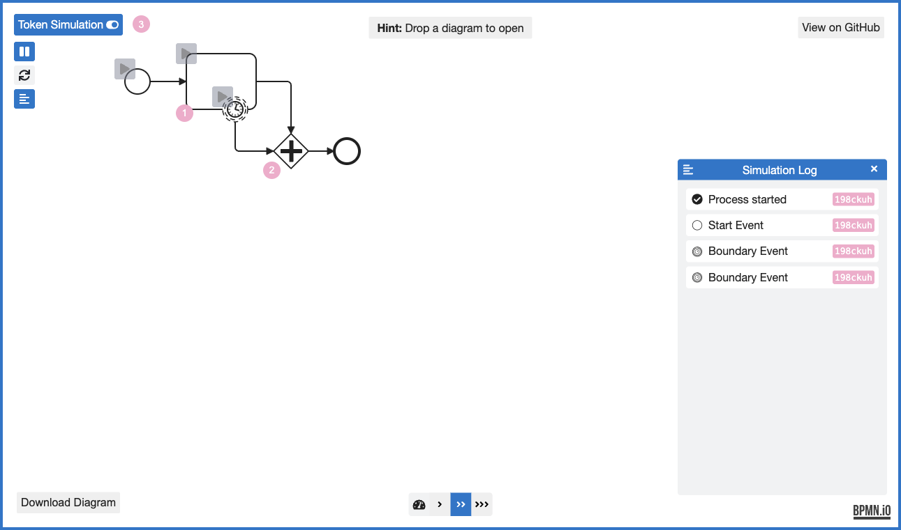
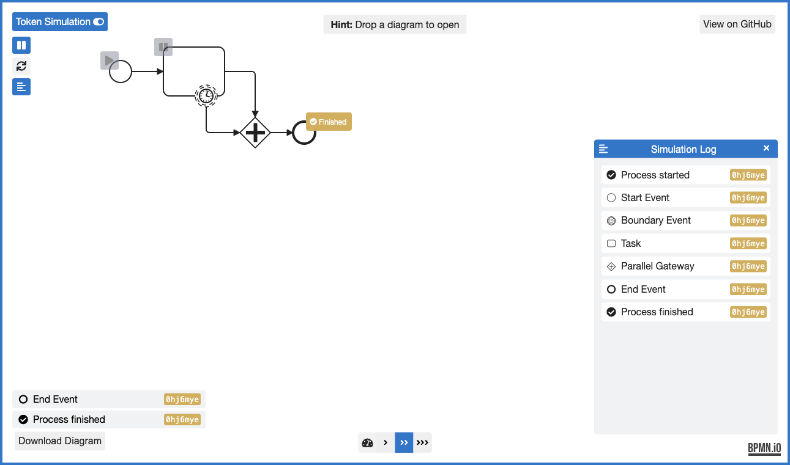

# BPMN 并行汇合：原生令牌与日志对照（第 61 批）

**结论：暂不新增 Archify 流程引擎、BPMN 导入器或同类读图器。** 同一上游夹具中，两次定时器触发会留下两个等待令牌；一次定时器触发再完成任务，才通过汇合并结束流程。原生暂停点、令牌计数和日志已能展示这个区别。没有证据表明再画一张图能改善阅读，本批只保留来源、实际图片与复现记录。

用户要求本批结束后停止持续推进；收尾推送后暂停目标，不启动第 62 批。不创建 PR，不合并、发布或安装。

## 来源与排重

- 项目：[bpmn-io/bpmn-js-token-simulation](https://github.com/bpmn-io/bpmn-js-token-simulation/tree/b1ce5a9bc7836c2a57bd0900cedd297299324643)，固定源码 `b1ce5a9bc7836c2a57bd0900cedd297299324643`，package 版本 1.1.0。保留完整 [MIT LICENSE](../audit/round61-bpmn/sources/LICENSE) 及 Camunda Services GmbH 署名。10 个来源文件逐一核对 Git blob；未引入包、依赖或共享产品代码。
- 自然问题：[上游 #130](https://github.com/bpmn-io/bpmn-js-token-simulation/issues/130) 报告 0.33.0 按令牌数量汇合、未区分每条入边的问题，现已关闭。本批运行当前网页，不是重放旧版本缺陷；也没有运行 Camunda 或 Zeebe。
- 本批开始前核对 333 个远程 head。中断后收尾再核得到 335 个，dev 从 847146ae 推进到 5ecbd1bfdbf83ea747072112493c940e707569cb；新增两个 DSH 修复分支。完整[差异](../audit/round61-bpmn/remote-changes.json)保留。第 60 批的产品审查仍只对应其冻结基线，没有把它提升成新 dev 的验证。
- 历史两份研究总账的 scout 中未找到 bpmn-js/token-simulation 的既有深读。GitHub 的 `is:issue bpmn` 返回 [Archify #312](https://github.com/tt-a1i/archify/issues/312)，`is:pr bpmn` 返回零条；这是关键词排重，不证明没有其他措辞的重叠。#312 已提出工作流决策／条件字段，不能把重做正式逻辑操作符算作新方向。

## 固定输入与语义边界

完整输入是上游 [Simulator.parallel-gateway-join.bpmn](../audit/round61-bpmn/sources/test/spec/simulator/Simulator.parallel-gateway-join.bpmn)。普通任务 Activity_1 的完成路径 Flow_2 和非中断定时器 Timer_1 的路径 Flow_3，都进入 ParallelJoin_1；再经 Flow_4 到结束事件。定时器可手动重复触发，本次没有设置或测量实际等待时长。

[ParallelGatewayBehavior.js](../audit/round61-bpmn/sources/lib/simulator/behaviors/ParallelGatewayBehavior.js) 先限定同一 parent scope，再为每条 incoming sequence flow 找一个由该 flow 发起的 scope，齐备时才退出。不能把单一总数代替入边身份，也不能把不同流程实例的令牌凑到一起。

[SimulatorSpec.js](../audit/round61-bpmn/sources/test/spec/simulator/SimulatorSpec.js) 和三个完整 expected JSON 保留了任务暂停后“一次定时器＋任务”“两次定时器”“不同实例”的测试定义。它们是上游测试源码／期望记录，**本批没有运行这些测试**；实际网页仅执行下面两组。XML 中原有 Camunda Modeler 5.25.0／Camunda Platform 7.21.0 是文件元数据，不是本次运行环境。

## 实际原生页面结果

在官方 [Modeler demo](https://bpmn-io.github.io/bpmn-js-token-simulation/modeler.html?e=1&diagram=https%3A%2F%2Fraw.githubusercontent.com%2Fbpmn-io%2Fbpmn-js-token-simulation%2Fb1ce5a9bc7836c2a57bd0900cedd297299324643%2Ftest%2Fspec%2Fsimulator%2FSimulator.parallel-gateway-join.bpmn) 用公开 diagram 参数加载固定文件。通过真实 hover/click 添加任务暂停点、启动、触发定时器和完成任务；没有读取模型内部状态或用脚本替代按钮动作。页面 DOM 读取只保存可见计数、日志、元素身份和资源 URL。

| 操作序列 | 观察到的结果 | 证据 |
| --- | --- | --- |
| 启动 → 定时器 → 定时器 | 网关计数 2，任务计数 1；日志有两个 Boundary Event，没有 Parallel Gateway 或 Process finished。 | [DOM／动作](../audit/round61-bpmn/browser/05-two-timers.json)、[展开日志](../audit/round61-bpmn/browser/06-log.json) |
| 重新加载同一输入，重新添加暂停点；启动 → 定时器 → 完成任务 | 网关与任务计数清空；结束事件显示 Finished，日志依次含 Task、Parallel Gateway、End Event、Process finished。 | [DOM／动作](../audit/round61-bpmn/browser/07-timer-task.json) |





四张原始 PNG（另含初始页和未展开日志页）均为 1291×761，已逐张查看。截图保留 bpmn.io 标志，无裁剪重画；不同运行的 scope ID／颜色由原生工具生成，不能据此当成稳定实例身份或性能比较。

原生 Download Diagram 导出 [native-export.bpmn](../audit/round61-bpmn/browser/native-export.bpmn)，自报 exporterVersion 1.1.0。导出改变 exporter 元数据及 DI 条目顺序；过程元素、连接、形状边界和路径点可逐项对应原输入，不能宣称导出字节相同。托管 JS 来自 dist/modeler.js，**未归档部署 bundle 或证明其构建 commit**；源码 pin 与网页自报版本分别记录。

## 复现与成本判断

打开上述 demo，在任务左上角 hover 后添加暂停点，再按表中按钮序列操作，展开 Simulation Log。每一组都从重新加载开始；不要把 Task 上的暂停点误当作全局 Play/Pause。固定 BPMN、上游源码、原生导出和实际动作脚本均随[证据目录](../audit/round61-bpmn)保存。

本地核对归档完整性：

```sh
python3 docs/research/2026-10-26/audit/round61-bpmn/verify.py
```

它核对 Git blob、XML 对应关系、已保存 DOM／日志与 PNG 尺寸；不重新执行原生网页，也不是产品或上游测试。浏览器脚本使用本次 Ego space 2，空间已在收尾时正常结束；复跑应使用获授权的研究空间，不能直接假定该编号存在。托管 demo 可能更新，因此这不是完全离线、字节锁定的运行环境。

可借鉴的是阅读时同时显示“等待位置、入边来源、当前实例”的方法；不是让 Archify 的装饰性流动自动承担 BPMN 执行语义。一般化实现需要维护执行状态、scope、暂停／恢复和网关规则，又与 #312 的逻辑条件方向相邻。此固定题的原生展示已足够，现有证据不支持增加这项维护负担，也不证明任何真人阅读速度收益。

中断后旧 exec 38188 和研究空间 3 均已不存在；库存无研究空间，按先前用户授权重建空间 2 后完成两组，最后 finish 成功。第一次未分 issue/PR 的查询没有可解析结果，后续仅采用两次明确类型的结果。初次 git add 提醒 CRLF 会被转为 LF，已用仅覆盖本证据 sources/ 的 -text 属性保留原字节，并再次确认 10 个暂存 Git blob 与上游一致。完整空白检查因此保留原始来源行尾和终端输出的诊断，排除原件后的作者文件检查通过；见[检查记录](../audit/round61-bpmn/checks.json)。
