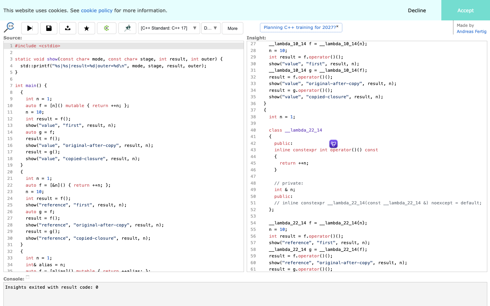
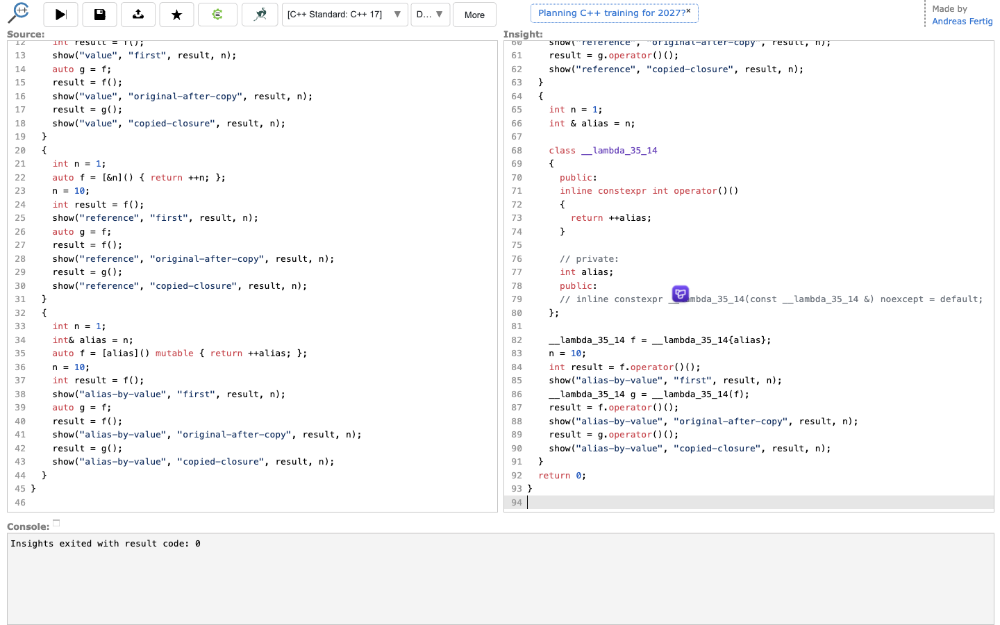

# 第 41 批：捕获声明、转换文本与实际状态

**结论：保留 C++ Insights 的显式转换和源码对照思路，本批不新增 Archify 实现。** 原生工具已能解释这个例子；尚无证据证明再加 C++ 适配器或固定教学页能改善真实阅读任务。

[完整证据包与复现命令](../audit/round41-cppinsights/README.md)

## 来源与去重

开始前刷新了 333 个远程分支，较上一批只有研究汇总分支前移。两个已有研究索引按 cppinsights / cpp insights / C++ Insights 搜索无命中；Archify issue 与 PR 的 cppinsights 精确检索均为零。该搜索范围并不排除其他名称下的相似能力；因此也对照了现有源码卡片、说明和焦点阅读机制，没有把新增语言例子直接视作产品缺口。

[C++ Insights](https://github.com/andreasfertig/cppinsights) 是 Andreas Fertig 及贡献者维护的 Clang 源到源转换工具。本次固定提交为 **5374b54f704de8610a2c9150df748577c22eb8cc**，六份源码/文档及 MIT 许可按 Git blob、字节长度和 SHA-256 核对。README 明确承认并非所有转换都能编译或保证正确；默认关闭的 educational lifetime 模式另有手工教学转换警告。本次没有运行文档中的悬空生命周期例子，也没有构建、安装上游 LLVM 工具链。

历史 [issue 64](https://github.com/andreasfertig/cppinsights/issues/64) 提供了真实问题线索：引用类型变量按值捕获时，转换出的成员是否仍是引用。它在 2018 年已关闭，不能当作当前缺陷或问题频率证据。本例另写整数状态比较，未复制该 issue 的字符串代码，也不是其复现。

## 可复现的对照

三个独立作用域都先令外部 n=1，建立闭包后把 n 改成 10。先调用 f，再复制成 g，分别调用 f 和 g。每次调用与输出分开写，避免参数求值顺序干扰；所有被引用的对象在调用期间都存活。

| 捕获方式 | 首次 f | 复制后 f | 副本 g | 三次观察到的外部 n |
| --- | ---: | ---: | ---: | --- |
| n 按值捕获 | 2 | 3 | 3 | 10 / 10 / 10 |
| n 按引用捕获 | 11 | 12 | 13 | 11 / 12 / 13 |
| int& alias=n，再按值捕获 alias | 2 | 3 | 3 | 10 / 10 / 10 |

原网页显示的三组成员分别为 int n、int& n、int alias，并把闭包复制和 operator() 调用展开。这个对照说明变量本身是引用，并不代表按值捕获后仍共享那个外部状态。当前 C++ 工作草案的 [capture 条款](https://eel.is/c++draft/expr.prim.lambda.capture#10)也明确区分引用实体与按值捕获成员的类型；这里只据其解释语义，没有把当前草案称为固定 C++17 标准文本。

通过真实 UI 全选转换输出，DOM selection 与输入控件选中文本完全相同，共 2,174 字节；未手工修改、归一化或调用编辑器内部 API。原程序和此转换文本分别用本机 Apple clang 17、C++17 编译运行，两轮都成功，九条打印记录完全一致。共四次程序执行，而不是四名独立作者或自然用户任务。保留十条正式命令、二十个完整 stdout/stderr 文件；两轮对应的十对原始流相同。

## 原生页面与证据边界

十三份浏览器操作脚本和日志、四张 1440×900 实拍已保存并目视检查。网页 Version 页面报告 cpp-insights 23.1、同一个固定提交、Ubuntu Clang 23.1.5、默认 libstdc++ 16。页面报告的版本与源码一致，但这不是对服务器二进制的独立校验；本机 Apple clang 17 的运行也不是浏览器执行。

转换成功、转换文本在本机能编译、这九条输出相同，是分别取得的事实。它们不证明任意 C++ 转换等价，也不保证 ABI、内存布局、闭包类名的稳定性或完整运行轨迹。生成类名包含行列位置，不宜拿来作为跨修订身份；引用字段在这里是工具的教学呈现，不是通用 ABI 协议。

首次大小写错误的 README 请求、非法 snapshot scope、停留 Version 页时查找编辑器、错误选择空 textarea 导致后续缺文件编译，均在证据包说明。浏览器失败日志原样保留；没有将 scratch 失败冒充正式回放结果。

## 对 Archify 的决定

可以参考的是“把隐式操作展开，并让读者回到具体源码”，以及把声明、教学转换、实际观测区分开。现有源码卡片与说明已能承载这类证据；这个合成例子还没有暴露必须新增交互的缺口。

暂不引入 C++ AST/LLVM 依赖、在线转换服务依赖、生成类名解析器或闭包状态推断。它们需要持续跟随语言、工具链和转换格式变化，当前收益证据不足以支持维护成本。也不为了增加方向数量另做一页相同教学内容。

后续触发条件：真实 Archify 阅读任务确实难以关联原代码、转换片段与已采集状态，并有明确生产者契约和读者比较证据。届时再评估最小呈现方案。当前只归档研究分支，没有新 PR、issue、评论、合并、发布或安装；未运行无关产品测试。

