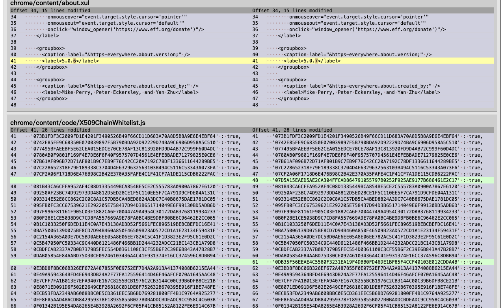

# 第 58 批：diffoscope 保存报告的证据范围

2026-10-29。开工核对 [333 条远程 head](../audit/round58-diffoscope/remote-heads.tsv)，只有上批已交付的 conflict-explanation 与 research hub 前进。既有 [artifact-diff 研究](artifact-diff-reading.md)仍缺固定 tar 对的原生运行；本批没有补装 diffoscope，而是实际检查 [官网链接的历史报告](https://diffoscope.org/examples/https-everywhere-5.0.6_vs_5.0.7.html)。issue/PR 的 diffoscope 定向查询均为零，不保证穷尽所有同义工作。

[完整证据包](../audit/round58-diffoscope/README.md)保留 1117354 bytes 的原始 HTML、五份原样源码/许可、三张实际截图、浏览器记录和复核脚本。报告标为 diffoscope 28，官网当前列出的版本是 335；不把旧报告当成当前能力。tag 28 参考源码的目录与页脚仍为 debbindiff，不能据版本号证明报告来自该精确 commit。

实际确认：about.xul 的 zipinfo 两行完全相同，均为 3421 bytes；成员正文仍显示第 41 行 label 从 5.0.6 变成 5.0.7。灰色清单行是清单文本没有变化，不等于整个文件没有变化。SQLite dump 则有四对省略计数，行内无展开控件，整页无脚本。固定历史源码展示以计数替代大块差异的处理，但本轮没有运行 parser 或原始 XPI 比较。

实际点击验证了成员与 SQLite 转换层的 ¶ 锚点。测试选择器的自动滚动不算原生搜索能力。一次 marker hover 稳定性超时被保留；随后观察确认已到正确锚点、marker 已在视口内，直接记录状态，没有重复失败动作。三图当前尺寸均为 1279×784，不能沿用前批视口。

**处置：继续暂缓摘要图和 importer。** 原生报告已有分层内容与可引用锚点，而按 listing 或行样式推广文件级“相同”会误导。完整保存 HTML 也不等于完整未省略的差异。下一步门槛仍是固定完整输入、明确省略状态并实际生成的报告，再比较同一阅读任务；本批不证明额外图的收益。没有新接受的实现方向，因此只更新研究分支，不开同题实验分支或 PR。未运行 Archify/上游全套测试、CI、合并、发布或安装。
