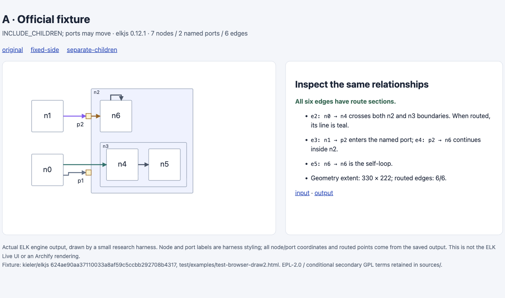
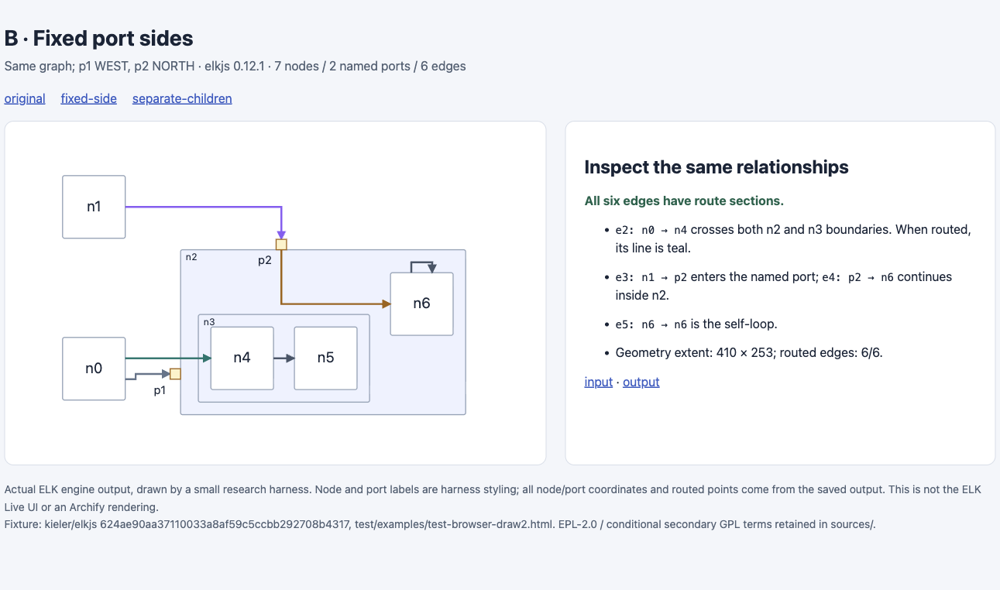
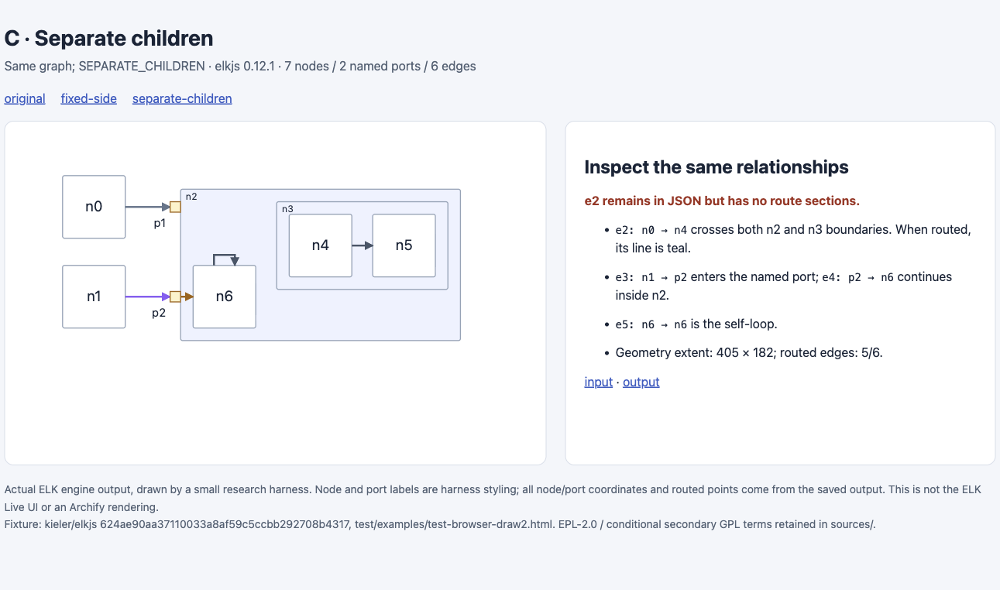

# ELK：命名端口与跨层级连线的边界（第 52 批）

本轮保留可复现的引擎对照，**暂不接入通用 ELK 布局器或自动导入器**。七节点的官方示例说明了命名端口与层级布局的具体能力，也暴露了接入时必须检查的输出完整性；它尚未证明比 Archify 现有布局更省时、更清楚。研究证据进入已有研究分支，不新建产品实验分支或 PR。

## 先排重，再限定输入

开始前刷新了 [333 个远程分支](../audit/round52-elk/remote-heads.tsv)。当前与历史研究 hub 的 scouts 范围搜索未发现 ELK 条目；这不是全仓穷尽搜索。已有 dataflow-automatic-showcase-layout、preserve-route-port-widths、readable-diagram-layout 等方向继续保留其职责，不重复做侧边锚点、端口分散或泛化自动排版。

[远程上下文](../audit/round52-elk/remote-context.json)保留三个分支的精确 head/提交说明，以及 ELK 搜索的 1 条 PR、2 条 issue；宽泛 port 搜索只取 83 条 PR 中的前 30 条。PR [#140](https://github.com/tt-a1i/archify/pull/140)仍 open，head d5f99c9078abb8ada472a27197224852a6872bab，负责 Mermaid flowchart 导入。这些是职责参照，不是本轮重新完成的正确性审查。

Archify 当前 dev 固定在 847146aeb93b492592adb78dc220f57e4a8b4636。[Architecture schema](../audit/round52-elk/sources/archify-architecture.schema.json)、[Dataflow schema](../audit/round52-elk/sources/archify-dataflow.schema.json)与[作者合同](../audit/round52-elk/sources/archify-authoring-contract.md)已有 fromSide/toSide、显式几何和自动端口分散；它们不等同于 ELK 图里的独立命名端口对象及其跨层级身份。

## 实际运行了什么

[ELK Live](https://rtsys.informatik.uni-kiel.de/elklive/)显示维护页面，未进入原生编辑器，部署版本未知。因此改用固定 **elkjs 0.12.1 / 624ae90aa37110033a8af59c5ccbb292708b4317** 的发布包，在隔离证据目录运行官方 test/examples/test-browser-draw2.html 的完整图对象。

没有安装包或执行安装脚本。只下载校验过的 tarball，读取 bundle、LICENSE 与 package 元数据；bundle 为 **1,646,241 bytes**，SHA-256 **b1032b7cfd2a57c54c6f0e8369d7665e19a579954f7cd20a6dae28f1912ea0d7**，留在 Git 外。运行环境是 Node v26.12.0 / darwin arm64。npm gitHead 与固定 source tag 一致，但未从源码重建或独立验证签名。

[原始输入](../audit/round52-elk/input-original.json)有 **7 个节点、2 个端口、6 条边**，其中 e2 从 n0 连到嵌套两层内的 n4；e3 进入 p2，e4 从同一个 p2 连到容器内的 n6，还有 n6 自环。这是研究者选取的上游合成示例，不是独立自然用户任务。

| 配置 | Promise | 保留关系 | 有路径的边 | 布局范围 |
| --- | --- | --- | --- | --- |
| 原始 INCLUDE_CHILDREN | resolved | 6/6 | 6/6 | 330 × 222 |
| 仅添加 n2 FIXED_SIDE、p1 WEST、p2 NORTH | resolved | 6/6 | 6/6 | 410 × 253 |
| 仅将根层级选项改为 SEPARATE_CHILDREN | resolved | 6/6 | 5/6 | 405 × 182 |

这些是实际引擎 JSON 经小型研究绘图脚本展示后的浏览器截图，**不是 ELK Live UI，也不是 Archify 输出**。节点和端口坐标、路由点直接取自结果；标签与配色由研究脚本提供。浏览器 DOM 中的全部路径点已逐条与输出核对，端点也落在其声明的节点或端口边界上。

三种配置的节点、端口及关系身份完全相同。第三种配置的 e2 仍有 sources/targets，但没有 sections，图中因而不画它；不能把 resolved 或数组仍有 6 条边当作全部绘制成功。也不能据此说 ELK 丢失关系或存在普遍缺陷：这是特定层级配置下的实际几何输出。另一个上游测试以不同图期待异常，本轮没有运行它。

## 用户价值与成本判断

命名端口能表达“进入哪个接口、从哪个接口继续”，固定侧边可以保留这类约束；这与把多条节点连线分散到同一侧不同。若出现真实接口图需要，值得用该任务继续评估。当前合成示例没有证明这种需求在 Archify 中的频率或现有表达无法解决的损失。

通用适配器需要明确节点与端口身份、嵌套容器坐标、边所在坐标系、跨层级连线、标签与缺失路径的处理。把端口直接变成普通组件或静默省略无路径的边，会改变表达。构建期运行可以避免把 1.65 MB 引擎嵌入每份交付物，但仍要维护这些映射和验证；体积不是唯一否决理由。

因此保留一个具体的接入检查原则：对每条需要呈现的关系，检查结果是否真的有可用路径，并按 container 还原坐标。当前 Archify 未使用该引擎，不为假设中的接入新增运行时校验、依赖或 schema。没有同输入 Archify 产物、独立作者或阅读者对照，故不作更美观、速度或完整性提升结论。

## 证据与限制

[证据包](../audit/round52-elk/README.md)含三份输入、三份原始输出、静态 HTML、7 张已查看图片、11 个逐 Git blob 核验的来源文件、重放脚本和离线核验。许可及署名见 [NOTICE](../audit/round52-elk/NOTICE.md)，保留 EPL-2.0 与源文件的条件性 secondary license 说明。

首次运行在布局完成后的 terminateWorker 清理调用失败；未配置真实 worker，移除多余清理后完成三种配置。首次绘图的 p1 标签贴近另一条线，保留旧图后仅调整展示标签。最初请求 1440 × 900，但 PNG 与最终 DOM 实际均为 **1291 × 762**，原因未验证；保留错误尺寸断言，按实际一致视口记录，不声称完成 1440 × 900 验收。

本轮没有运行 Archify 或上游完整测试、worker、FIXED_ORDER/FIXED_POS、大图、增量布局、CI 或读者研究。自有 loopback 服务已停止，研究标签页已回到 about:blank。只推送研究远程分支，未创建 PR、合并、发布或安装。持续目标仍 active。
