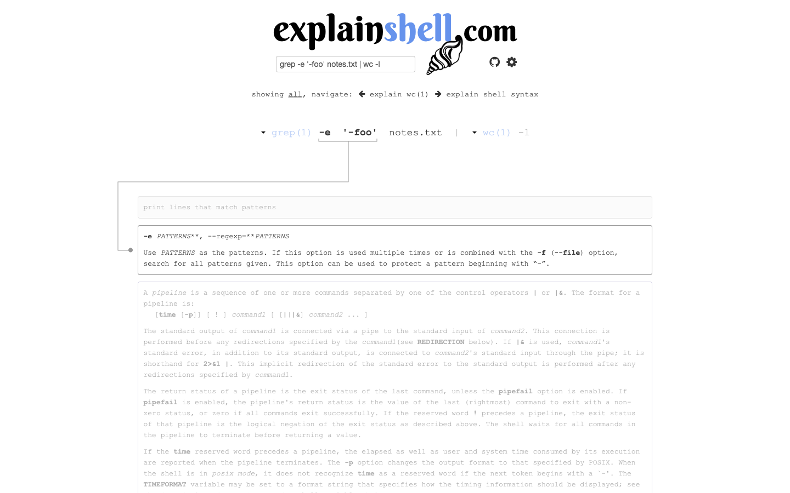
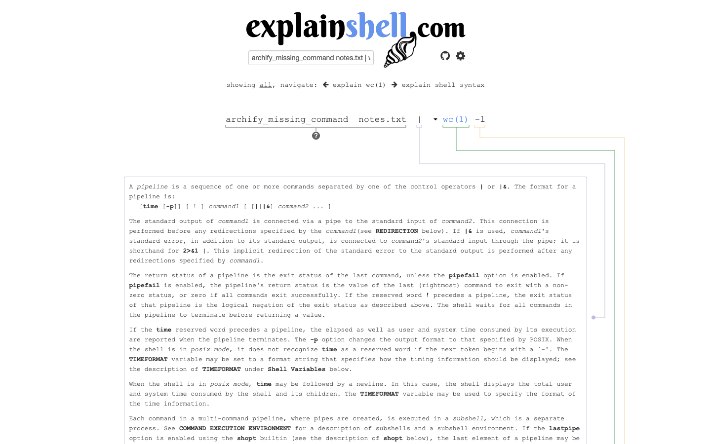

# 第 43 批：解释覆盖、手册来源与实际执行

**结论：补齐 explainshell 原生交互证据，暂不新增 Archify Shell 解析器或同义教学页。** 原生页面已经保留完整片段、关联说明、区分缺少参数帮助与缺少命令手册，并允许选择手册来源。未发现值得另起实现的实际 Archify 阅读失败。

[完整证据包与复现步骤](../audit/round43-explainshell/README.md)

## 去重与本批增量

上批 3ec072108 已推送、工作区干净，属于有效进展。本批重新核对 333 个远程 head，只有研究汇总分支较上批快照前移。已有 [Shell 阅读研究](https://github.com/tt-a1i/archify/blob/3beb343b8fd6686201bde9b0f307f9a1c6b00246/docs/research/2026-10-25/scouts/shell-reading-round9.md)深入分析过引用区间，但明确没有操作原生页面。explainshell HEAD 仍为 827ebe38da9822a10e89946551e377330a9de35e，本次不重复计为新项目。

Archify 对 explainshell 的显式 issue/PR 查询各为零；这不证明所有相似工作都不存在。还检查了 Finder：当前 node-finder.js 已把节点 textContent 纳入索引，因此没有凭“成员搜索”设想增加第二套索引。两处初始探查错误保留说明：猜测的 semantic-finder.js 不存在，首次 GitHub 搜索缺少 issue/PR 类型而失败；后续使用实际文件和有效查询。

## 实际页面观察

在 [explainshell](https://explainshell.com/) 的解释输入框提交原创文本，**没有在终端执行这些命令**：

```text
grep -e '-foo' notes.txt | wc -l
```

1. 页面把完整的 -e '-foo' 作为一个片段关联到参数帮助，没有因引号或开头的减号拆错。悬停时该片段及对应帮助 opacity 为 1，其余已知帮助为 0.4；原始引用仍然可读。
2. notes.txt 仍保留在命令中，旁边有问号。其 title 只说明没有匹配到帮助，不能由此推断文件不存在、参数无效或命令失败。
3. 增加原创 --archify-unknown 后，这个选项和 notes.txt 都被标成未匹配帮助；已识别的参数、管道和 wc 说明仍保留。两者共享“帮助缺失”标记，不代表它们具有相同的运行有效性。
4. 把前半段换成 archify_missing_command notes.txt，页面把该段整体标为缺少手册，后面的管道及 wc 仍能阅读。这与单个参数缺少帮助是不同范围。

第二次重新提交原始文本，六个片段的文字、helpref、class 和 title 与首次一致。只比较这组结构字段，不宣称整页、随机颜色或全部帮助内容逐字一致。七张 1440×900 实拍均已目视检查；title 是 DOM 观察，图片中的问号不证明浏览器原生 tooltip 已经出现。

## 来源身份比一个命令名更具体

原始 wc(1) 的实际链接是 /explain/1/rust-wc；打开其菜单选择 gnuwc(1) 后，链接变为 /explain/1/gnuwc，输入显示与 URL 查询中也出现显式的 gnuwc.1 手册选择符。这个选择不证明本机装了哪个 wc，更不是实际程序调用记录。

同一个 rust-wc 手册在原始输入中对应 help-3，在缺失命令的输入中对应 help-1。它们是当前页面的局部关联键，不能直接作为跨页面身份。固定源码的 es.js 也按 helpref 关联当前 DOM 中的帮助块；这不是运行轨迹或程序对象标识。

据此保留三种信息：原始输入片段、所选帮助来源、当前解释覆盖范围。若将来确实有 Archify 输入需要这些关联，先复用既有源码引用与说明机制，再证明新增交互的收益，不引入 manpage 数据库、Shell 解释执行器或通用 AST importer。

## 成本、许可与验证边界

六份完整上游文件固定到 [idank/explainshell 的该提交](https://github.com/idank/explainshell/tree/827ebe38da9822a10e89946551e377330a9de35e)，按 Git blob、字节长度和 SHA-256 验证，原 GPLv3 许可和署名完整保留。来源文件只归档在研究目录，没有进入 Archify runtime；页面显示的手册仍有自己的来源和条款，不能统一改称仓库 GPL 许可。

保存七份操作脚本/日志、七张截图、四种解释输入状态和八条结构化 DOM 记录。归档审计通过；未运行上游测试、parser、matcher 或提交给网页的 Shell 命令，没有 stdout、实际 argv、环境、文件内容或退出状态证据。线上部署提交和手册数据库版本未知。

原生工具对本例已经足够；尚无真实读者任务表明再画一页管道或增加解析器能抵偿维护成本。此次只推研究分支，无新 PR、issue、评论、合并、发布或安装。研究目录不改变产品行为，未运行无关 renderer suite。




