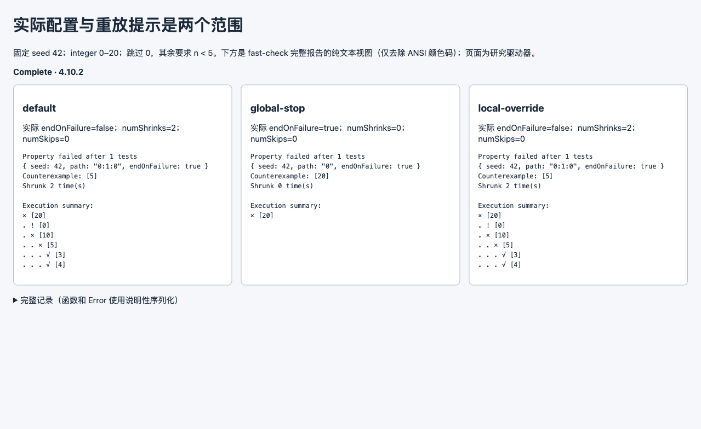

# 第 59 批：fast-check 实际配置与原生报告

2026-10-29。先刷新 [333 条远程 head](../audit/round59-fast-check/remote-heads.tsv)，只有上批 research hub 前进；复用既有 [反例收缩研究](counterexample-reading.md)与[真实配置困惑](natural-reading-gap-round13.md)，没有当作新方向。查询命中 2 个 issue、6 个 PR，涉及检查、打包、依赖、Explainer 等标题；[命中记录](../audit/round59-fast-check/context.json)保留，不宣称穷尽式查重。

[实际执行包](../audit/round59-fast-check/README.md)使用冻结的浏览器 ESM 构建，而非安装包：库自报 fast-check 4.10.2 / c77afa82；此前研究固定源码为 0207dd29，二者不混用。固定本地 property 为 integer 0–20，跳过 0，其余要求 n < 5，seed 42，VeryVerbose；没有数据库、网络或私有源码输入。

| 实际配置 | 结果 | 原生报告提示 |
| --- | --- | --- |
| 默认 endOnFailure=false | 20→10→5；numShrinks=2 | endOnFailure:true |
| 全局 endOnFailure=true | 停在 20；numShrinks=0 | endOnFailure:true |
| 全局 true，被局部 false 覆盖 | 与默认相同 | endOnFailure:true |

默认摘要含六项：失败 20，其下跳过 0、失败 10，10 下失败 5，5 下成功 3、4。numSkips=0 没有计入首次失败之后的跳过，numShrinks=2 也不等于六次尝试。实际有效配置须看本次 RunDetails/runConfiguration，不能由重放提示反推；源码已核对全局/局部合并、停止收缩与计数范围。

页面为研究驱动器，不是原生 GUI 或 Archify 新阅读器。首稿直接显示 ANSI 控制码，保留原图/源码/输出；末稿只去掉显示层的颜色控制码，完整原始报告与说明性序列化 RunDetails 仍在归档。两次末轮从头复跑的完整结果字节一致，未单独执行 seed/path 提示重放。两张 1279×784 实拍逐张查看；三个实际加载资源均来自本机，服务已停止、p1 已清空。

八份源码/许可与 Git blob 相符，包含 fast-check、pure-rand、unenv、buffer、ieee754 的署名。CDN bundle 和 source map 原字节保存，可离线复跑；未证明 CDN 可复现构建，不能凭自报 commit 或许可归档 commit 确定所有组件版本。原讨论是 3.15.1，本次不是它的精确重演。

**处置：补证后仍暂缓树图/importer。** 原生 VeryVerbose 已给出失败、成功、跳过；缺口在于保留实际配置与提示的各自来源。只有一个合成 property，没有独立读者、自然长任务或图的额外收益证据。通用任意值导入和配置追溯仍有维护成本。只更新研究分支，无新 PR、共享代码更改、上游全套测试、产品测试、CI、合并、发布或安装。
