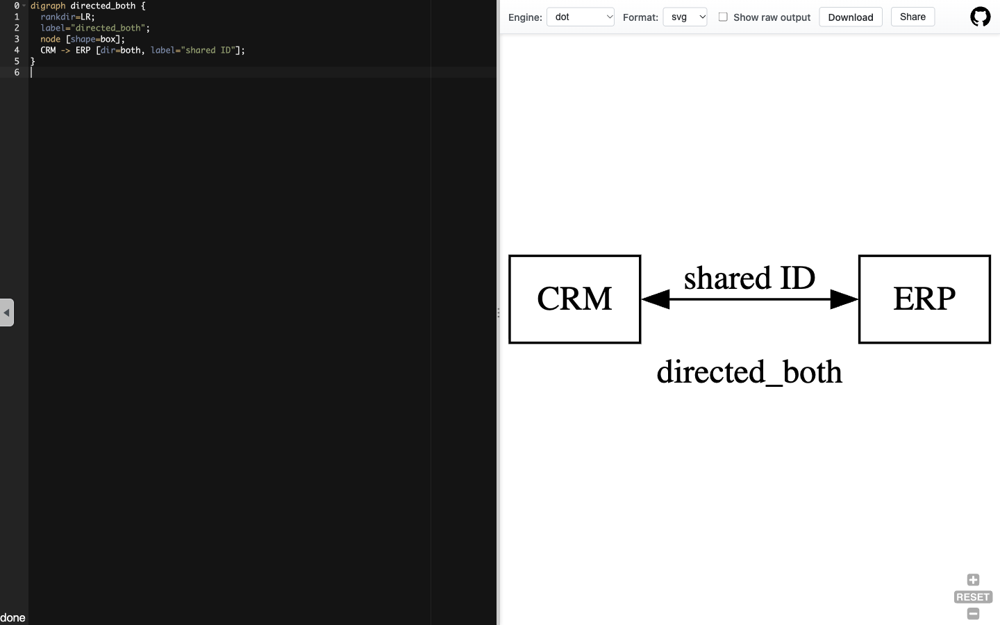
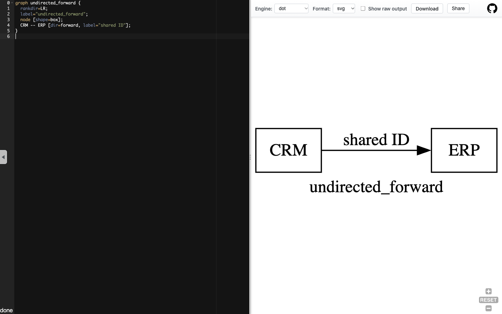

# 第 42 批：箭头外观、图类型与遍历策略

**结论：为 #1139 补充原生反例，不另起方向语义实现。** GraphvizOnline 的实测结果表明，箭头数、边记录数和图的 directed 标志可以不同。不能只移除或增加 SVG 箭头，就把 Route/Reach 的新规则视为已经确定。

[完整证据包与复现步骤](../audit/round42-graphviz-direction/README.md)

## 先核对实际需求与已有工作

上批 465ce5201 已推送且审计通过，属于有效进展。本批重新读取 333 个远程 head，只有研究汇总分支较上批快照前移；dev 仍为 847146aeb93b492592adb78dc220f57e4a8b4636。

[#1139](https://github.com/tt-a1i/archify/issues/1139) 有明确的实际需求：CRM、项目系统和 ERP 的共享标识引用不应被画成单向流量。它仍 open，已有贡献者在[调查 Architecture 的方向契约](https://github.com/tt-a1i/archify/issues/1139#issuecomment-6459490388)，并明确区分箭头外观和遍历。搜索该 issue 号得到的 [#1145](https://github.com/tt-a1i/archify/pull/1145) 在 50568c662d5227d292f030d4b7520a47ce28fe64 明确将 #1139 排除在连接调整功能之外，新连接仍为 forward。本批没有审查、修改或接管这些贡献。

旧研究已经覆盖 Graphviz、Graphology 和相关图问题；[graph-answers](https://github.com/tt-a1i/archify/blob/3beb343b8fd6686201bde9b0f307f9a1c6b00246/docs/research/2026-10-28/scouts/graph-answers.md)也明确暂缓未定方向语义。本批的增量是实际渲染和 JSON 的对照，不把 Graphviz 重新计为从未研究过的项目，也不重复一份 Archify 行为方案。

## 原生工具如何区分这些概念

[Graphviz 的 dir 文档](https://graphviz.org/docs/attrs/dir/)将该属性定义为箭头装饰选择；[DOT 语言](https://graphviz.org/doc/info/lang.html)另行定义 graph/digraph 及其边运算符。我们在 [GraphvizOnline](https://dreampuf.github.io/GraphvizOnline/) 输入五个完整原创小图，保持两个节点和一条 shared ID 关系，切换 SVG 与 JSON 输出。

| 输入 | 实际可见箭头 | JSON directed | JSON 边记录数 |
| --- | --- | --- | ---: |
| digraph，dir=forward | CRM → ERP | true | 1 |
| digraph，dir=none | 无箭头 | true | 1 |
| digraph，dir=both | 两端箭头 | true | 1 |
| digraph，dir=back | ERP → CRM | true | 1 |
| graph，dir=forward | CRM → ERP | false | 1 |

五例 JSON 的边都记录 tail=CRM 对应 ID、head=ERP 对应 ID；back 没有交换这两个字段，both 没有新增反向边。无向图中的 tail/head 是序列化记录，不意味着它具有语义上的单向性。图中箭头所在位置另以五张实拍核对，SVG edge group 的箭头多边形数分别为 1/0/2/1/1。

这些是原生输出的事实，不是我们写的模拟器或重新实现的图算法。第二轮重新粘贴五份输入，地址栏片段解码后与各自完整 DOT 文件相同，五份 JSON 与第一轮逐字节一致。SVG 保存的是渲染后的 DOM，含网站 pan/zoom 标记，不冒充官方下载导出。

这组小图借用了真实问题中的共享标识语境，但不是报告者完整集成图，不能用于宣称真实任务阅读效率改善。增加箭头也不能证明系统真的执行了请求或通信。

## 遍历仍需单独取得证据

本机 PATH 中没有 dot、gvpr、dijkstra，本批没有安装或运行这些 CLI。官方 [dijkstra 手册](https://graphviz.org/pdf/dijkstra.1.pdf)还单独规定了 -d 模式只使用前向边；这是文档依据，不是本机算法实测。此次浏览器只验证图的解析与渲染，没有执行最短路或可达性算法。

因此本轮没有得出“Archify 的 none/both 应怎样遍历”，也没有把 Graphviz JSON directed 标志直接移植为 Archify 的逐边规则。后续应由已有方向调查明确引用、交换、图遍历和动画分别表达什么，再验证相容性。

## 价值、成本与交付

价值在于给实际需求补上可复核的反例：单向箭头不必代表有向图，无箭头不必代表无向图，两个箭头不必代表两条边。它能避免只改 SVG marker 后，界面上的关系说明与 Route/Reach 给出互相冲突的答案。

直接复制 Graphviz 渲染器或另加图状态没有必要。Archify 的模式、动画、校验、比较、导出与共享 Viewer 都有方向假设，而 #1139 已有调查范围。当前证据不足以支持一个新的并行实现，继续保留来源供该方向评估。

GraphvizOnline 固定源码 ecaf161aade6111e60f49abf03a5442a6f6beec5，作者 Dreampuf，BSD-3-Clause。四份完整文件按 Git blob、长度和 SHA-256 核对，许可原样保留；未向 Archify runtime 复制其依赖。线上部署提交与 Graphviz 引擎版本未知，不用源码提交代替部署证明。

六份浏览器操作脚本与日志、五张 1440×900 实拍、五份 DOT、十份原生 JSON、五份 SVG DOM 和来源记录已归档。最初点击 Ace 的小 textarea 被遮挡，失败日志保留；观察可见编辑区后完成后续操作。归档审计通过，按研究文档影响范围没有运行无关 renderer 测试。只推研究分支，无新 PR、issue、评论、合并、发布或安装。

