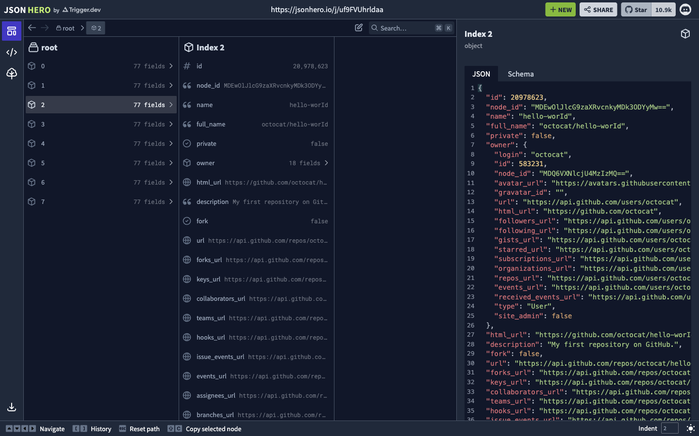
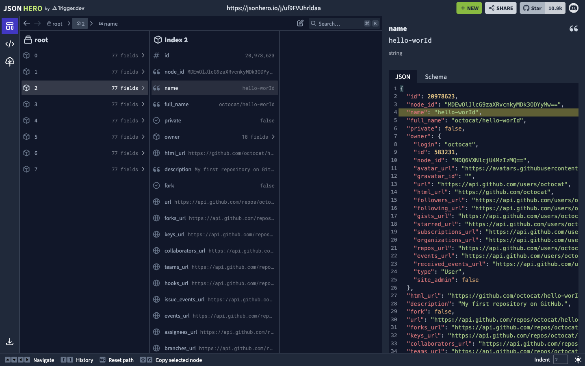
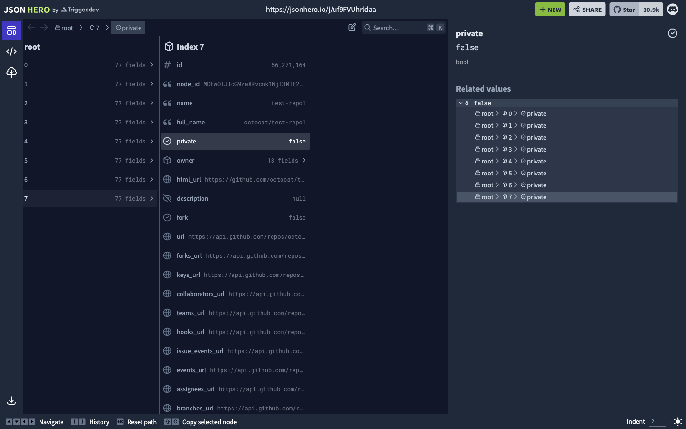
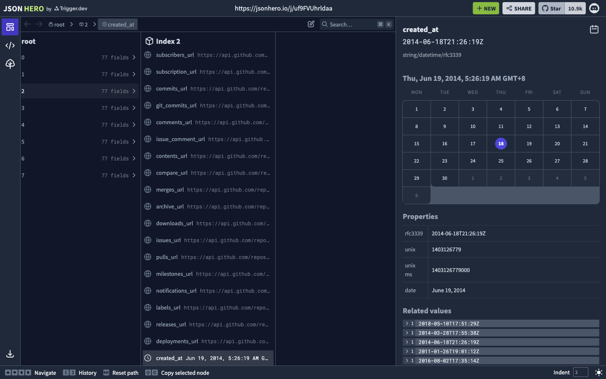

# 第 48 批：JSON Hero 的字段位置、关联值与推断展示

结论：**保留原生交互证据和设计约束，暂不新增 JSON 阅读器或数据导入器。** 这次没有改 Archify 产品行为，研究成果只推送现有 `codex/research-lab-20261026`，不创建 PR。

## 排重与适用范围

开工检查了 [333 个远程 heads](../audit/round48-jsonhero/remote/heads-before.tsv)。CodeTour / Codecrumbs 的按问题阅读已有 `codex/lab-source-question-tour@94d6a4d0`；多文件补丁定位已有 `codex/lab-diff-file-navigation@48f076f9`；Jless 相关计数问题已有 `codex/lab-finder-link-count@b91366b9`。本轮未重复实现这些方向。当前与历史研究文本的定向查询未发现 JSON Hero，不代表穷尽所有工作。

Archify 的 `"JSON Hero"` 查询返回一个已关闭 issue [#330](https://github.com/tt-a1i/archify/issues/330)，内容是 CLI 参数错误的 JSON 输出，并非 JSON 阅读器；PR 查询为零。`jsonhero` 的 issue / PR 查询均为零。原始结果保存在证据包，未把搜索命中数量当作产品需求。

固定来源为 [triggerdotdev/jsonhero-web@15157053](https://github.com/triggerdotdev/jsonhero-web/tree/15157053174ba7a0a79c77b2925fbde7e05a6334)，Trigger.dev / JSON Hero contributors，[Apache-2.0](../audit/round48-jsonhero/sources/LICENSE)。19 份来源均按 Git blob 和 SHA-256 核实；网站部署 commit 未知，不能声称实际页面就是这个版本。

## 同一对公开记录的原生对照

操作的是首页已存在的 [GitHub API 样例](https://jsonhero.io/j/PjHo1o5MVeH4)，没有上传、创建或编辑文档。后续从页面下载链接读取的 JSON 包含 8 个公开 octocat 仓库，每项 77 字段。该下载不是初次加载响应；已比对的可见字段一致，未声称整个载入数据已逐字节核对。

| 起点与操作 | 实际结果 |
| --- | --- |
| Index 1 的 `private: false`，Alt+Left 后 Down | 到 Index 2，但字段位置消失，右侧显示整个对象 |
| Index 1 的非空 `name`，同样按键 | 到 Index 2，仍保留 `name`，值为 `hello-worId` |
| 展开 `8 false` 关联值组 | 显示从 `$.0.private` 到 `$.7.private` 的 8 个路径 |
| 点击最后一个路径的 private 叶子 | 正常定位 `root / 7 / private`，显示 false |

原始的 Index 0→1 对照也出现同样结果。固定源码 `calculateStablePath` 在替换父路径后用 `if (!jsonAtUpdatedPath)` 回退；这与 false 的观察一致，但不构成部署身份证明。不能把 false 当作缺失，也不能由本次 false 个案声称零、空字符串、null 的原生行为都已执行。

Alt+Left 后还存在两个不同范围：右侧标题保持选中叶子，下面 JSON 区域显示高亮父对象，并标出叶子所在行。截图保留这种状态，没有把整个右侧面板误称为纯叶子详情。

固定关联值源码把标量转成字符串，数组表示为 `Array(n)`，对象表示为 `{...}`，缺失表示为 `undefined`。因此这是一种展示分组，不能直接移植为严格类型身份或深相等判断。本轮没有执行混合类型碰撞样例；8 个 false 的路径计数才是实际验证范围。

## 原值、推断格式与日期显示

样例 `$.2.created_at` 的原值是字符串 `2014-06-18T21:26:19Z`。页面保留原值，并标记 `string/datetime/rfc3339`，显示 Unix 秒 `1403126779` 和 GMT+8 的 June 19。离线标准库核对了这个时间转换。

同时保留了不一致：Asia/Shanghai 环境下标题和 date 属性显示 June 19，日历高亮却为 18；第二次访问及 DOM 的高亮 time 元素也记录了 18。这张图证明页面如何展示，**不证明日历正确**。没有修改上游或猜测其部署、服务端时区、hydration 原因。

`useJsonSchema` 的整份数据推断与 `JsonSchemaViewer` 的路径映射仅做源码检查，没有在浏览器中验证 Schema 标签。日期格式识别、JSON 原始类型和作者提供的语义合同不能混为一谈。

## 对 Archify 的价值与成本判断

- **保留字段位置：有明确阅读价值。** 对同结构记录逐项比较，少重复展开；但 Archify 当前 Focus 以节点 / 边身份和来源引用为主，没有同样的任意嵌套 JSON 字段浏览合同。先有真实记录比较需求，再评估最小增量。
- **关联值到具体路径：值得借鉴。** 计数必须能追溯到对象，类型、缺失与显示摘要要分开。现有 Finder、来源卡片和已完成的计数修正不需要再添同义面板。
- **丰富类型预览：本轮不引入。** 新增推断、日期/时区、多种媒体预览、列导航和状态恢复会增加维护面；还没有证明它能改善 Archify 的自然阅读任务。现有来源定位不需要靠通用 JSON 导入器才能使用。

[证据包](../audit/round48-jsonhero/README.md)保存 12 份浏览器脚本/日志、13 张已查看实拍（12 张有效状态、1 张导航尚未完成的保留记录）、公开样例下载、19 份固定来源及可复算摘要。验证覆盖文件身份、图片尺寸和已归档观察，不是上游单测或新产品验收。没有安装依赖、创建 PR、合并、发布网站或更改 live 安装。

后续门槛是实际 Archify 使用者需要跨同结构记录比较某个字段，且现有节点定位或来源引用不能回答。届时应保留原始类型与位置，用同一记录对检验新增阅读能力；本轮不为一个已能由原生工具回答的问题再做静态仿制页。
