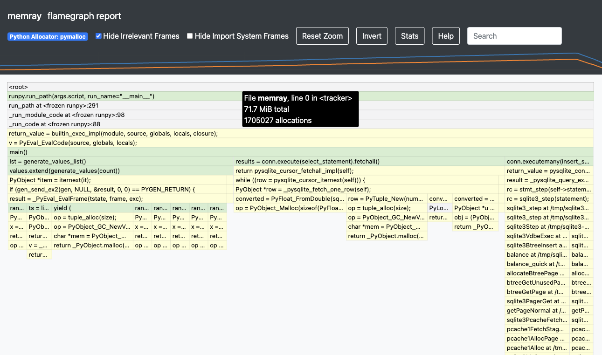

# Memray 峰值分配与整次运行统计：第 54 批

2026-10-29。结论：补齐固定原生报告的实际交互证据，仍暂缓堆解析器和新 viewer。本轮接续 [堆保留关系调研](heap-retention-reading.md)，没有形成新的产品实验，不创建 PR。

先刷新 333 个远程分支，检查已有 retained-size 实验及堆阅读 scout；与上批相比仅研究主分支前进。GitHub 的 memray issue/PR 关键词查询均为 0，但不代表排除了所有同义工作。Difftastic/GumTree 同源结构差异对照仍缺本地运行条件，本轮没有安装工具，转向已有 Memray 原生证据缺口。[检查记录](../audit/round54-memray/context.json)。

## 固定输入与实际结果

从 [Memray 固定源码](https://github.com/bloomberg/memray/tree/f70db8143c7601ca55b4b219e50577a3f06e38ea) 取官方 sqlite 预生成 HTML，核对 1,354,914 字节和 Git blob 后在 loopback 打开。报告自身的录制日期为 2023 年，不能因它位于 v1.20.0 源码树就认定其生成器版本为 v1.20.0。没有原始 .bin，没有重跑 profiler，也没有执行用户自然任务。

| 观察 | 结果 | 能支持的判断 |
| --- | --- | --- |
| Stats | 整次运行 3,602,050 次分配；404 frames seen；峰值 71.7 MiB | 总统计范围与峰值树不同 |
| 默认根节点 | 71.7 MiB；1,705,027 allocations；121 个 frame DOM | 该固定报告峰值主图的显示值 |
| 取消 Hide Irrelevant Frames | 勾选状态改变；稳定 frame 记录未变；根值相同 | 没有观察到实际隐藏/恢复效果 |
| Invert | 根值不变；全部标签和宽度相同，y 上下翻转 | 本按钮改变垂直方向，未证明调用聚合反转 |

[Stats 实图](../audit/round54-memray/browser/04-stats-settled.png)与 [Help 实图](../audit/round54-memray/browser/05-help.png)说明主图取峰值时仍占用内存的分配调用栈，横向顺序不是时间。不能把两种 allocation 计数相减就称为释放对象数；121 个 DOM frame 也不是 profiler 的 404 frames seen。71.7 MiB 是舍入显示值，不是精确字节校验。

## 对 Archify 的价值与成本判断

值得保留的是“每个数值写清统计范围，并能回到原生证据”的阅读要求。这个报告已有悬停、统计、解释和方向切换。本次没有证明新增图能更快回答用户问题，也没有获取同一个对象的 allocation 与 retention 数据。分配调用栈不等于引用路径或支配关系；已有 Wasm retained-size 实验也不能填补这个缺口。因此继续暂缓通用 heap importer，避免承担格式、对象身份、弱引用和 GC roots 等维护成本。

## 证据与限制

[完整复现包](../audit/round54-memray/README.md)包含 10 张已检查 PNG、三种稳定 DOM 状态、来源许可、抓取/服务/捕获脚本和离线验证器。过早 Stats 截图、过渡期 frame 采样及过严浮点断言的首次失败均保留；最终记录区分这些失败与有效观察。截图实际为 1291 × 762；翻转后悬停根节点产生滚动，不能当成相同裁切位置的比较。

HTML 本身固定，外部 CDN 依赖只记录 URL，未冻结响应字节；不是完全离线或整套依赖固定的复现。当前结论仅适用于这一份旧报告，不能概括当前全部 Memray 行为。没有 Chrome 同源快照、用户理解测试、Archify 输出、产品测试或 CI。服务已停止，研究页已清空。所有来源署名和 Apache-2.0 全文保留于包内。
