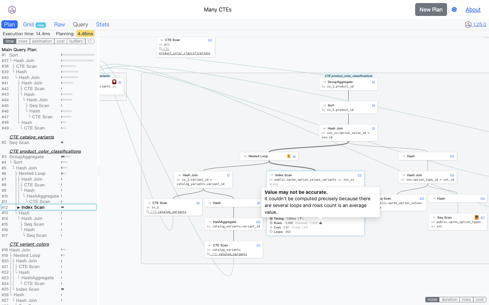

# 第 50 批：PEV2 原生对照与计划行数实验复核

结论：**保留固定三节点讲解，不新增计划解析器。** PEV2 已经把循环次数计入行数，并解释平均值带来的近似；Archify 的现有样例应定位为针对一个问题整理原字段、算式、局部结构和来源。没有证据支持再做一套完整计划 reader。

## 先检查已有方向

开工刷新 [333 个远程 heads](../audit/round50-pev2/remote-heads.tsv)，相对第 49 批只有研究 hub 推进。历史研究已有 PEV2 选型及独立 `codex/lab-plan-row-counts` 分支，head 为 `91e2ffadb5cd46fc72d5da978a4b83f8c7dfe521`；因此不新建同题实验。已查当前 / 历史 scouts、原实验 README、字段与来源记录、原始截图以及已有分支。

[排重记录](../audit/round50-pev2/duplicate-check.json) 保存了 issue / PR 组合查询和 head 查询的精确范围：0 issue、2 个已关闭 PR、该 head 0 PR。只读取查询元数据，不声称审查了所有相关实现。复核在新的隔离 worktree 完成，原方向分支已推进到 [`794692251231051ff229ac983e9c674a374e653c`](https://github.com/tt-a1i/archify/tree/794692251231051ff229ac983e9c674a374e653c/experiments/plan-row-counts/native-comparison)，正常快进推送并读回确认；没有创建 PR。

## 同字节原生证据

官方演示入口实际转向 explain.dalibo.com 托管服务，未填表提交。改为官方 [PEV2 v1.25.0 单文件](https://github.com/dalibo/pev2/releases/tag/v1.25.0)，在本机回环地址打开。该 release tag 恰为原实验已固定的 `e41d4e8b3006c479f9364d68a5d538d81cb7d110`。下载的 1308080-byte HTML 与发布 digest 相同；源码 pin 与资产身份分别验证，没有重建证明。

原生内置 Many CTEs 输入框和 Raw 文本均逐字节等于原实验的 67418-byte JSON，SHA-256 `a1c79b5782086474c73bd5ad2f7dd3265d73663f9030f5769638a4c2633cf6b4`。这次确实运行了官方页面，但没有运行数据库或重新生成查询计划。

| 节点 | 原生 Grid | General / 原字段 |
| --- | --- | --- |
| #6 Nested Loop | rows 1,056，loops 1，低估 2× | 原 planned 528 / actual 1056 |
| #7 Outer Hash Join | rows 352，loops 1，低估 2× | 原 planned 176 / actual 352 |
| #12 Inner Index Scan | rows ~1,056，loops 352，无估计偏差标记 | Rows ~1,056，Planned ~1,056；原均值均为 3 |

#12 的警告悬停说明多次循环使用的是平均行数，所以累计值有近似性。不是 Archify 独有的解释。固定 plan-service 将 actual 和 planned 都乘以观测的 Actual Loops；估计倍率另用原始 actual / planned。**Planned ~1,056 是按实际循环次数换算的显示量，不是原 JSON 的 Plan Rows，也不是独立估计的总循环数。** 本例原值 3 / 3 没有被当成 352× 估计偏差。

Misc 没有重复列出 raw 行数字段，符合 help-service 的排除表；Raw 完整文本仍可读取且字节一致。上图文件名里的 zoomed 来自缩放尝试，实际节点宽度未变，不将它记为缩放成功。它是已等待 opacity=1、visible 后的提示截图。

## Archify 的有限增量

重新打开了原有两份 HTML，未改作者输入、JSON 模型或产物。解释页将 raw planned 3、平均 actual 3、loops 352、累计约 1056 并排呈现，并保留“可重复输出、不是唯一记录数、局部不代表整体准确”、其余两个节点的 2× 差异和固定来源 pointer。

这种人工编排适合解释一个具体误读与分享一份固定材料，维护范围仍是一个作者样例。完整计划探索、CTE 跳转、各指标查看交由 PEV2；不复制 importer、单位处理、并行聚合、时间归因或性能诊断。原生展示完整计划，Archify 人工选择三节点，两者的上下文规模不相同，不能据此宣称普遍理解速度提升。

后续只有出现独立自然任务、现有 Tree / Explainer 无法满足的阅读需要，并能与原生同输入比较时，才重新考虑公共能力。当前没有读者研究、任务计时、正确率或 SQL 优化收益证明。

## 交付与验证

[完整证据包](../audit/round50-pev2/README.md) 保留 21 轮原始脚本 / 日志、7 张已查看 PNG、输入三份同字节副本、13 个通过 Git blob 验证的来源文件、失败尝试及离线核验脚本。实验分支增加了四张对照图、固定来源、复现步骤和 [capture receipt](https://github.com/tt-a1i/archify/blob/794692251231051ff229ac983e9c674a374e653c/experiments/plan-row-counts/native-comparison/capture.json)。这些是实际页面记录，不是生成式图片。

PEV2 源码和样例保留 PostgreSQL License，Copyright (c) 2019, Dalibo；单文件发布物只留本地校验副本，不把其第三方依赖改标为同一种许可。单文件会请求 GitHub 最新版本元数据，已记录，不能称为完全没有联网。没有上传计划、安装、合并或发布网站。

本批验证为档案哈希、来源 blob、三节点字段与原生显示、截图和文档链接核对。原产品 render / finalize 结果只在原版本复用，不冒充本次执行；未运行产品 / 上游测试或远程 CI。研究目标继续保持 active。
