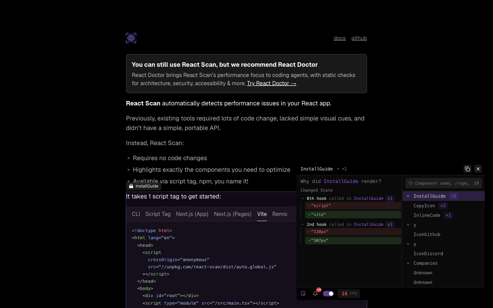
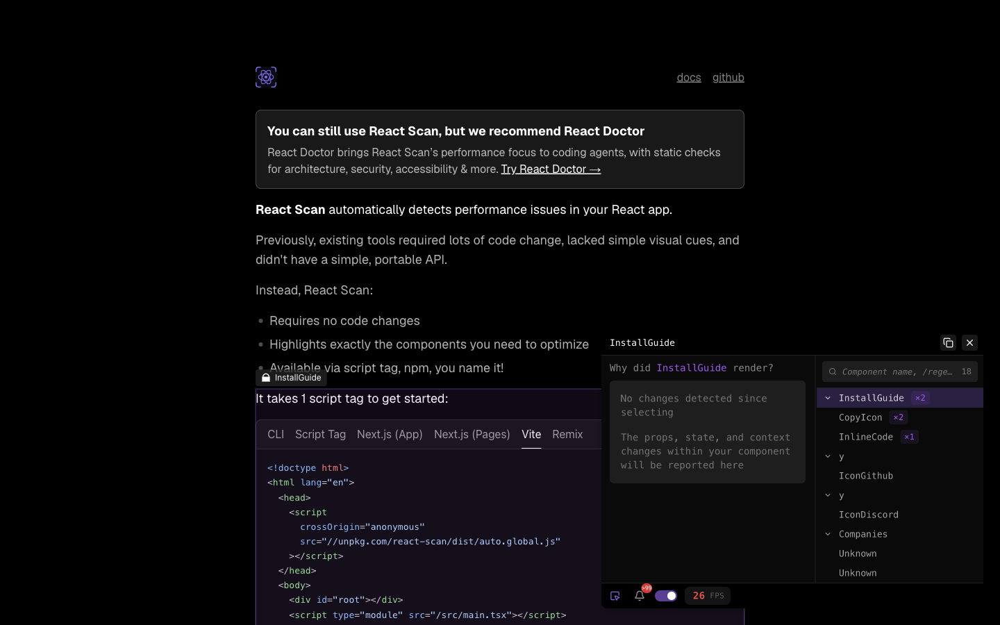

# 第 47 批：React Scan 的选中范围与变化历史

结论：**保留交互模式参考，暂不实现 React 性能导入器或新的 Archify 面板。** 原生工具已把页面元素、组件树、状态差异关联起来；具体价值依赖 React 运行时采集，不能由一张静态图替代。本批完成了此前研究清单未覆盖的 React Scan 原生操作，主要发现是同一检查器中几个计数与变化列表的范围不同。

## 排重与真实需求

开工刷新 333 个远程 heads，仅研究 hub 从第 46 批基线推进；当前与历史 research 文本对 React Scan / Why Did You Render 的定向查询无命中，不代表穷尽所有工作。Archify GitHub 查询返回 0 issue、2 PR：[#992](https://github.com/tt-a1i/archify/pull/992) 是 Code Analysis 的 AI task / evidence / comparability，[#942](https://github.com/tt-a1i/archify/pull/942) 是 Markdown 设计渲染。两者当前均 closed、unmerged；不能把检索返回计为新 React Scan 实现，也不复制其中的任务交接或来源面板。[状态快照](../audit/round47-react-scan/remote-state.json)保留查询边界。

上游 [#198](https://github.com/aidenybai/react-scan/issues/198) 的用户希望把采集接入 CI/CD，并询问是否能从首次渲染开始而不必选 DOM。维护者追问是会话中的各组件计数还是首屏总数，并指出保存所有组件计数的性能代价。该 issue 当前 closed / not_planned；这不是需求已实现或已否定的证明。历史 [#6](https://github.com/aidenybai/react-scan/issues/6) 则请求在标签显示累计计数，closed / completed。这些是真实需求背景，本批没有重现原用户应用或 CI。

固定来源为 [React Scan 0fb31862](https://github.com/aidenybai/react-scan/tree/0fb31862b697ef3ed2d8ed6990878a35a4ca8a75)，[MIT](../audit/round47-react-scan/source/LICENSE)，Aiden Bai / Million Software, Inc.。README 和实际网站现在都推荐 React Doctor；这里只确认该推荐存在，没有测试后继工具。

## 同一个 InstallGuide 的实际操作

在官网自带的 React Scan 中，先选 Script Tag，再选择 InstallGuide；未安装或注入工具。主观察如下：

| 原生操作 | 观察 |
| --- | --- |
| 初次选中 InstallGuide | “No changes detected since selecting”；不是整页从未变化 |
| 切换到 Vite，展开状态行 | 第 0 hook：script→vite；第 2 hook：138px→307px；各 x1 |
| 选 CopyIcon，再选回 InstallGuide | 变化列表清空；InstallGuide 树徽标仍 ×2，History DOM 保留之前条目 |
| 再切 Script Tag | 各 x1，显示反向的 vite→script、307px→138px |
| 再切 Vite | 各 x2，但展开仅显示最近一对值 script→vite、138px→307px |

最后一张有效展开图 [11-vite](../audit/round47-react-scan/images/11-vite.png) 中，两个 hook 徽标各 x2、组件树 ×5、标题 ×3 同时可见。这里只报告这次显示值，不把任一徽标等同真实函数调用总次数。不能从选中后的空列表推出没有历史变化，也不能从计数重建所有中间状态。

固定网站源码中 InstallGuide 的三个 useState 依次是 activeTabId、didCopy、height；它和这次第 0 / 2 hook 的值变化一致，但部署身份未确认，故只能作源码交叉解释。没有源码行号或采集器输出就不能把 ordinal 自动映射为稳定跨版本身份。

## 源码合同与部署身份

固定 use-change-store 按 fiberId 订阅，切换身份时清空聚合状态；每项累计 count，并保留最近的 previousValue / currentValue。这与观察到的选中范围、最新值对一致，仍不等于完整会话事件日志。

固定 instrumentation 的树计数要求 hasChanges 或 hasDomMutations，并有 16ms 条件；组件树读取该 renderCount。标题则来自 timeline 更新数减一。它们在此源码中本就不是同一个计数口径。未运行源码单测，也没有断言这段 TypeScript 就是页面的准确构建输入。

特别保留了身份反证：固定树 public bundle 为 387,683 bytes，SHA-256 `54ca59646f948ccebc43c6b644ee9c189cd4291a5e49ef69a10ffe7444aa233f`；操作后从实际 script URL 请求的文件为 391,118 bytes，SHA-256 `fb0b2e8f4e428cbb5eeb4987a20c34bbe8cce45b532e6fb4093a6c7509480c37`。二者都声明版本 0.5.7，字节却不同。这个后续 GET 不是初始加载响应，网站部署 commit 未知。

## 验证与取舍

[完整证据包](../audit/round47-react-scan/README.md)含 12 份来源、两份原字节 bundle、14 份浏览器脚本/日志、原始 DOM、12 张已查看实拍及离线可复核摘要。8 张主证据、3 张辅助图和 1 张绘制尚未完成的截图分开列明；错误命名、遮罩拦截、开关 locator 失败均保留。DOM 能读到折叠内容，因此“可见”判断使用截图。延迟、FPS 和 History 耗时受本次环境影响，没有用它们做性能结论。

对 Archify 可借鉴的是：选择对象后就地解释，且明确记录从何时、针对哪个身份开始。现有 Native Viewer 的 Focus、来源链接和解释面板已承担静态对象定位，不需要另建同义 inspector；本 hub 的 viewer/focus.js 为直接 DOM/SVG 操作，React Scan 也不是它的直接性能采集方案。把外部 React 的运行记录映射进来则需要处理采集边界、fiber/实例身份、hook ordinal、批处理/去抖、保留窗口和源码版本，维护代价明显超出本次观察。

本批因此不创建产品分支方向或导入器，也不复制相邻 Code Analysis AI task 功能。下一门槛应是可公开的自然任务：完整同一次采集、明确身份与问题、原生回答仍不足；然后才比较 Archify 是否减少读者误判。当前只有可复核的原生行为，没有这项收益证据。研究记录推送现有远程 hub，无新 PR。
