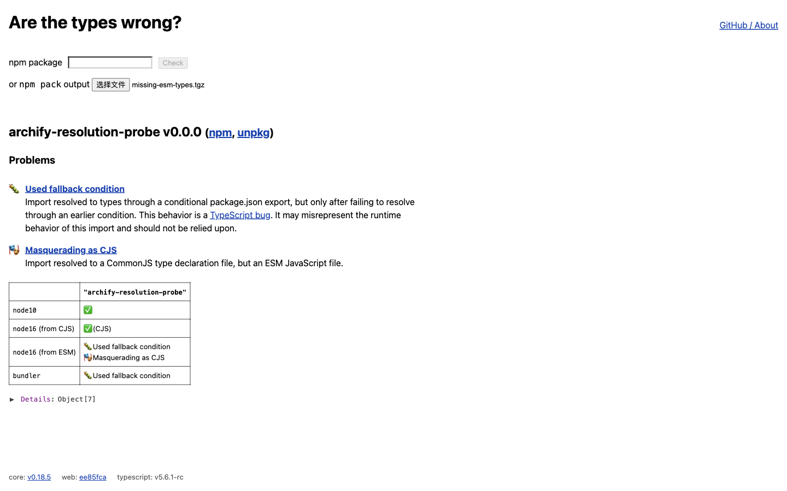
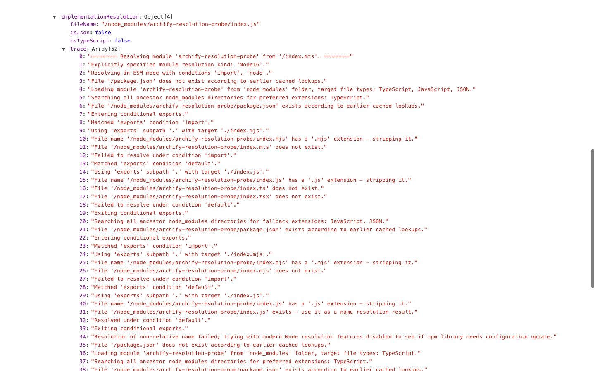

# 第 37 批：类型解析、工具模型与实际加载

**结论：保留原生复现，暂缓通用 resolver 导入器和另一个图解页。** Are the Types Wrong 已能指出本例的声明格式问题，且可展开完整解析 trace。但它的 `implementationResolution` 来自 TypeScript 模型，不能直接当作 Node 实际加载路径。当前没有自然用户阅读失败或图形表达收益的证据，重做条件解析会增加版本、上下文和扩展名规则的维护成本。

## 先查重复

开始前保存 [332 条远程 head](../audit/round37-remote-heads.tsv)。与第 36 批推送前库存相比，只有已交付的 binary-size-domains 分支新增、研究总账更新。两个研究总账中检索 publint、arethetypeswrong、conditional exports、module resolution；旧第 16 轮讨论包关系激活，不是本轮类型与运行时路径对照。已有 lockfile、依赖身份、任务图方向不重做。

[task-view 当前 HEAD](../audit/round37-resolution-native/taskview-head.json) 仍为 `a3fa21767bfaeb3077fdda08bddb7249366caa93`，与第 18、30、34 批已读版本相同。[六个有界 issue/PR 查询](../audit/round37-resolution-native/dedup.json)针对 conditional exports、publint、arethetypeswrong，结果均为 0；这不是“所有概念重叠都不存在”的证明。

## 来源与候选

| 固定来源 | 与本题相关的能力 | 筛选结果 |
| --- | --- | --- |
| [Are the Types Wrong](https://github.com/arethetypeswrong/arethetypeswrong.github.io/tree/ee85fcadb8c1130627f36d0f48cc5b8b6b12451c)，MIT，Andrew Branch 2023 | 环境矩阵、问题说明、展开后的声明与实现解析及 trace | 使用原生网页完成对照；不重做矩阵或将模型字段转换为执行图 |
| [publint](https://github.com/publint/publint/tree/b994a0309546495255242d0d047293d3d2f08a13)，MIT，Bjorn Lu and publint contributors 2026 | 已有 default 最后、types 最前、声明格式等规则；支持自定义条件的官方 fixture | 本轮只读源码和规则，没有运行 publint；不能据此声称它检出了三个本地例子 |
| [Node 22.23.3 文档](https://github.com/nodejs/node/blob/80dc632040e6bada37aac1220dde9c79581c9c22/doc/api/packages.md#conditional-exports)，MIT 及完整 LICENSE 内第三方通知 | 条件顺序、嵌套条件和 package 自引用 | 只用已有 Node，原生加载结果独立保留 |

[16 个完整来源文件](../audit/round37-resolution-native/sources/manifest.json)均核对上游 tree/contents 的 Git blob、字节数和本地 SHA-256，完整许可随文件保留。没有移植上游实现。TypeScript [#50762](https://github.com/microsoft/TypeScript/issues/50762) 此次读到的状态是 closed / not_planned；[归档](../audit/round37-resolution-native/typescript-50762.json)保留实际状态，不写成“当前仍 open”。也没有检查或运行最新 TypeScript。

## 三例原生对照

由上游 [FallbackCondition 的 Common causes](https://github.com/arethetypeswrong/arethetypeswrong.github.io/blob/ee85fcadb8c1130627f36d0f48cc5b8b6b12451c/docs/problems/FallbackCondition.md) 推导原创可运行补全：沿用 main/types/exports 的结构，另加本地测试包名、version/private、原创源码和探针。不是上游 suite。

包将 `import` 映射到 `index.mjs`，`default` 映射到 `index.js`。ESM 实现导出 `"esm"`，CJS 实现及其声明是 `"cjs"`。同一个 `probe.mts` 要求导入值的类型为 `"esm"`；实际运行使用单独的 `runtime.mjs`。使用 package 自引用，无需创建 node_modules 或安装包。

| 原创控制 | TypeScript 5.8.3 / NodeNext | Node 22.23.3 实际 ESM 加载 | 原生网页的 node16-esm 格 |
| --- | --- | --- | --- |
| 缺少 `index.d.mts`，两个实现存在 | 转到 default 的 `index.d.ts`；TS2322，exit 2 | 加载 `index.mjs`，打印 `esm`，exit 0 | Used fallback condition + Masquerading as CJS |
| 添加匹配的 `index.d.mts` | 在 import 条件解析到 ESM 声明；exit 0 | 仍加载 `index.mjs`，打印 `esm`，exit 0 | 通过，整个矩阵显示 No problems found |
| 保留 ESM 声明，但删除 `index.mjs` | 声明仍可解析；exit 0 | `ERR_MODULE_NOT_FOUND`，指向 `index.mjs`，exit 1 | Masquerading as ESM；模型的实现路径为 `index.js` |

两份新临时目录各 8 条命令，共 16 条；包括版本查询和三例的编译器、实际加载。16 对 stdout/stderr **仅替换明确的 run 根路径后**相同，不冒称原始字节全等。三个 tgz 输入的配对字节完全相同。原始源码、argv、cwd、exit、时长和完整输出见[观察包与复现脚本](../audit/round37-resolution-native/README.md)。这些不是 16 个独立产品测试。

## 原生页面检查与关键边界

使用同一 Ego 研究空间，三个自制 tgz 通过网站的文件选择入口读入浏览器 worker，未发布 npm 包。文件按标准 tar 的 `package/` 前缀打包，没有调用 npm pack 或安装程序。源码 [main.ts](https://github.com/arethetypeswrong/arethetypeswrong.github.io/blob/ee85fcadb8c1130627f36d0f48cc5b8b6b12451c/packages/web/src/main.ts#L40) 与 [worker.ts](https://github.com/arethetypeswrong/arethetypeswrong.github.io/blob/ee85fcadb8c1130627f36d0f48cc5b8b6b12451c/packages/web/worker/worker.ts#L34)区分文件检查和 npm 下载入口。页面自动生成的 npm/unpkg 链接不意味着这些原创包已发布；没有点击它们。

页面自报 core **0.18.5**、web **ee85fca**、TypeScript **5.6.1-rc**。本地编译器是 **5.8.3**，实际运行器是 **Node 22.23.3**；网页的 node16 是解析模式，不是本轮实跑过 Node 16。保留这些不同上下文，不将其合并成同一引擎的回归比较。

实际展开 Details → entrypoints → `.` → resolutions → node16-esm → implementationResolution → trace。第三例的 52 行实现解析 trace 明确记录 `.mjs` 不存在、继续 default 并选取 `.js`；但 Node 22 的实际加载直接失败。

源码可以解释这个差异：[getEntrypointInfo.ts:175](https://github.com/arethetypeswrong/arethetypeswrong.github.io/blob/ee85fcadb8c1130627f36d0f48cc5b8b6b12451c/packages/core/src/internal/getEntrypointInfo.ts#L175) 通过 `tryResolve(true)` 取得 implementationResolution，[multiCompilerHost.ts:130](https://github.com/arethetypeswrong/arethetypeswrong.github.io/blob/ee85fcadb8c1130627f36d0f48cc5b8b6b12451c/packages/core/src/internal/multiCompilerHost.ts#L130) 调用的是 `ts.resolveModuleName`，带 `noDtsResolution`；这里没有执行 Node。原生页面已提示包有问题，但这个提示和模型路径不等于实际加载轨迹。也不能把网页的 bundler 绿色格推广为 Node 能运行。

六张 1440×900 实拍均查看；保留 11 次浏览器操作及快照、最后展开的 DOM 文本。展开深层 JSON 需要多次点击，长 trace 有滚动和横向裁切；未做窄屏、键盘无障碍、完整产品验收或阅读速度测试。没有制作 Archify 图、伪造原生界面或将截图当作收益证明。

## 价值、成本与后续条件

真实价值是让包维护者区分“声明解析到哪里”“工具预测哪里”“实际加载了什么”，避免把一个语境的绿色结果推广到另一个语境。现成矩阵和 trace 已能指出当前小例的问题；原生输出加这张三列表已经能描述差异，尚无证据需要再维护一个内容页或通用转换器。

暂缓 resolver、条件求值器、自动执行待分析包及图适配器。泛化需要维护 producer/version、条件顺序、ESM/CJS、声明扩展名和上下文，而当前仅三个原创受控例，不是自然项目交接任务。新事实也不能转成全库通用“修复规则”。

重开条件：在自然包排障中收集到重复的具体误读；同一观察包提供原始 producer 版本、完整条件/来源与独立运行证据；然后比较一个只引用现有证据的阅读层能否减少误判。优先薄的证据并列，不重写解析器。

本批只更新 `codex/research-lab-20261026` 的可审查研究包，没有通过筛选的新实现方向，因此没有新实验分支、PR、合并、发布、部署或安装。持续目标保持进行中。
