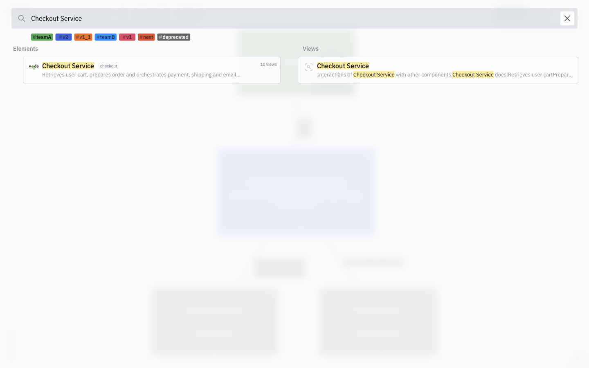
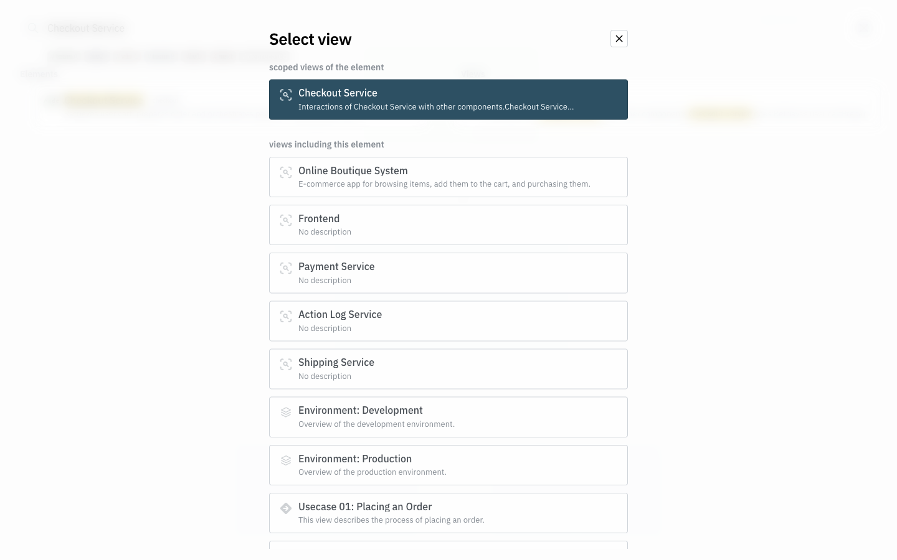
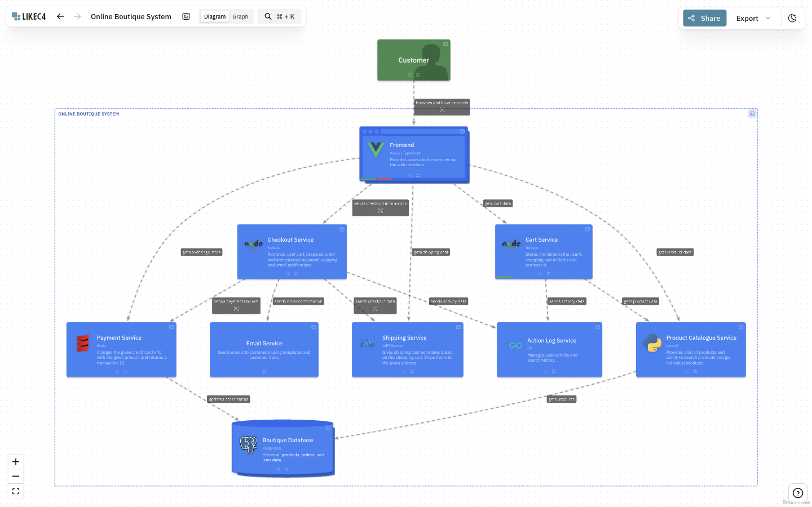

# 第 38 批：跨视图搜索的原生补证与版本差异

**暂缓新增导航状态、自动退焦或适配器。** 本批补查第 26 批明确未执行的原生交互，不把既有搜索候选重新包装成新方向。已看到目标元素跨图可达，但未稳定复现搜索后的定位过程；保存失败和观察边界，不把它写成通过验收或确认的产品缺陷。

## 去重与固定范围

开始前核对 [332 条远程 head](../audit/round38-remote-heads.tsv)，相对第 37 批只有研究总账更新。task-view HEAD 仍是已研究的 `a3fa21767bfaeb3077fdda08bddb7249366caa93`。[头部记录](../audit/round38-search-native/heads.json)分别保留它、LikeC4 与 template 的身份。读取两个 hub 的图阅读、搜索、来源预览和键盘实验；Finder context/highlights、Route、Lens、SourceCard、阅读返回和 Tree reveal 不重复实现。另一个 search/reveal 的 PR 标题/正文组合查询为 0，只是有界检索。

研究入口是 [LikeC4 #1711](https://github.com/likec4/likec4/issues/1711)：用户搜索其他大图中的元素后，打开图仍难定位。此次读取仍为 closed。第 26 批已读其修复，但只有源码与 helper 测试，未运行网页；所以本轮的新增工作是原生观察，而不是重复源码结论。

限定一个官方示例、一个元素 Checkout Service、桌面 1440×900；不安装 LikeC4，不构建模板，不调整模型、图布局或产品源码。额外的指针/Enter 对照用于排除第一次操作的偶然性；观察仍不稳定后停止扩展。

## 三种版本不能混用

| 对象 | 本轮身份与范围 |
| --- | --- |
| 上轮修复源码 | `likec4/likec4@b7a69c46e2bf67b9ee1f5b691004cd629a85245a` |
| 本轮读取的 main | `likec4/likec4@1512779bd85c56cc8dd76b0f01ab1b0d67316737` |
| 官方模板源码 | `likec4/template@a89dd2f0dca11c24afd68196357d3105b56f220c` |
| 实际网页 | README 链接的 `https://template.likec4.dev/view/index`；实际脚本 URL 为 `/assets/index-uAaApuHU.js`，没有取得可确认的部署 commit/引擎版本 |

模板 package.json 的 likec4 依赖为 `latest`，不能由模板仓库 SHA 推出运行时版本。22 份当前源码/模型/许可与 2 份旧版源码/许可都完整保留，24 个 Git blob、字节数及 SHA-256 与上游 tree 核对通过。LikeC4 和模板均为 MIT；保留 Denis Davydkov 署名及源文件中的 NVIDIA 版权头。完整模型 DSL 已归档，未宣称在本机编译重建了网页。

一个直接改变后续判断的事实：旧版 `machine.actions.ts` 的 `AUTO_UNFOCUS_DELAY = 0`，本次 main 是 `3000`。因此第 26 批“此 revision 不自动退焦”仍然成立，但不能推广到现在。当前源码的跨视图搜索焦点可以启动自动退焦；同视图分支发出的 `focus.node` 未附 autoUnfocus。**这些是固定源码事实，不是本轮网页的三秒时序验收。**

## 实际操作和保留的失败

从 System Landscape 打开搜索，输入 `Checkout Service`。原生页面将 Elements 与 Views 分列；元素结果有 `checkout` 身份提示、说明和 **10 views**。选择元素后，picker 又区分自身 scoped view 与包含它的其他图。本题选择更大的 Online Boutique System，而不是直接选同名 scoped view。

完整过程没有改写 UI 或调用应用内部状态：19 个脚本和日志、11 张真实 PNG、DOM 观察和短时采样全部保留。截图均已查看。过程包括：

- 首次页面及搜索弹层仍在加载时的空快照，随后等待得到实际内容。
- 第 07 次动作的旧 ref 失效；改用已观测的 DOM 标识。它是自动化失败，不是产品缺陷。
- 第 09 张截图处于 picker 淡入过程，另留第 12 张稳定图；不以淡入截图判断视觉质量。
- 第 10 次选图后仍留在 index，等待超时。
- 第 12 次确实到达 `/view/boutique/`，但等待谓词只接受无末尾斜杠的 `/boutique`，产生了错误超时。第 13 次读取确认新 URL、Checkout Service 节点及其可见位置；没有为此重启浏览器或重开研究空间。
- 第 14 次同图搜索与 Escape、第 15 次直接点击节点有实拍。直接点击得到 React Flow 的 selected 状态，不能把它当作搜索定位的成功证明；第 14 次也没有建立可靠的“搜索聚焦后再 Escape”前置条件。
- 第 16 次采用连续指针操作及稳定 picker 等待，搜索关闭后仍在 index；8 秒采样窗口只有一个不同的图状态。第 19 次对同一选图按钮用 Enter 激活，49 个 DOM 样本覆盖约 6.9 秒，URL 全为 index，未观察到选中节点。没有把这些失败从账目删除。

这一张晚到截图只能证明图和目标在页面上；不能区分“没有高亮”和“曾高亮后退场”。节点框位置也会随适配动画变化，不把不同时间的 DOM 测量硬套成同一帧像素坐标。

指针与键盘对照没有建立稳定导航，更没有确认部署版本、故障触发条件和根因。观察时检查过 `document.visibilityState=visible`、`document.hasFocus()=true`；这仍不能排除自动化、动画、焦点与站点实现的其他差异。没有提交上游 issue、改上游代码或宣称已复现新的 LikeC4 bug。

第 18 次只读查询还记录到工具默认视口 1291×762；截图脚本显式设为 1440×900，但这些设置不能证明全部中间动作都保持同一尺寸。这也是观察限制。第 16、19 次把选择流程放在同一脚本中，仍未导航，因此也不能将失败单独归因于调用间视口变化。

## 来源合同与 Archify 的取舍

当前 [searchActor.ts](https://github.com/likec4/likec4/blob/1512779bd85c56cc8dd76b0f01ab1b0d67316737/packages/diagram/src/search/searchActor.ts) 会保存 viewId/目标 FQN，等待退出动画结束，再给图 actor 发导航或同图聚焦；`MAX_WAIT_ANIMATION_END` 是 1000ms，超时分支退出等待。这个结构是值得注意的时序边界，但本轮没有证明它导致上述失败。不能仅凭源码形状就添加重试、超时补偿或另一层状态机。

Archify 固定 dev `847146aeb93b492592adb78dc220f57e4a8b4636` 的 [Finder 选择](https://github.com/tt-a1i/archify/blob/847146aeb93b492592adb78dc220f57e4a8b4636/viewer/node-finder.js#L113) 已在关闭搜索前执行 focus 与 reveal；[focus.setMany](https://github.com/tt-a1i/archify/blob/847146aeb93b492592adb78dc220f57e4a8b4636/viewer/focus.js#L1552) 清 Lens/Route 状态并显现 Tree 祖先。两文件与当前实验 checkout 的字节差异为零。这只是本轮静态复核，未重跑 Archify 浏览器测试，也不证明所有过滤、跨图身份或窄屏情形。

**价值**：搜索后能看见正确身份及其上下文，是明确的阅读需求。**成本**：现有 Finder/reveal 已覆盖单图动作；跨图状态、延迟聚焦、自动退焦需处理身份映射和动画时序。**判断**：没有本地 Archify 缺口，也没有可靠原生对照支持新增功能；不照搬三秒退焦或复制一套导航 actor。

下次只有在具体 Archify 自然产物中出现“搜索选择了节点但仍看不到”的记录，才固定原 HTML、状态和身份做最小复现。外部站点本例如需继续，先取得可确认部署版本或可控、已授权的本地运行条件，不继续用更多截图猜根因。本批只推研究分支，无新实现分支、PR、发布、合并或安装。
