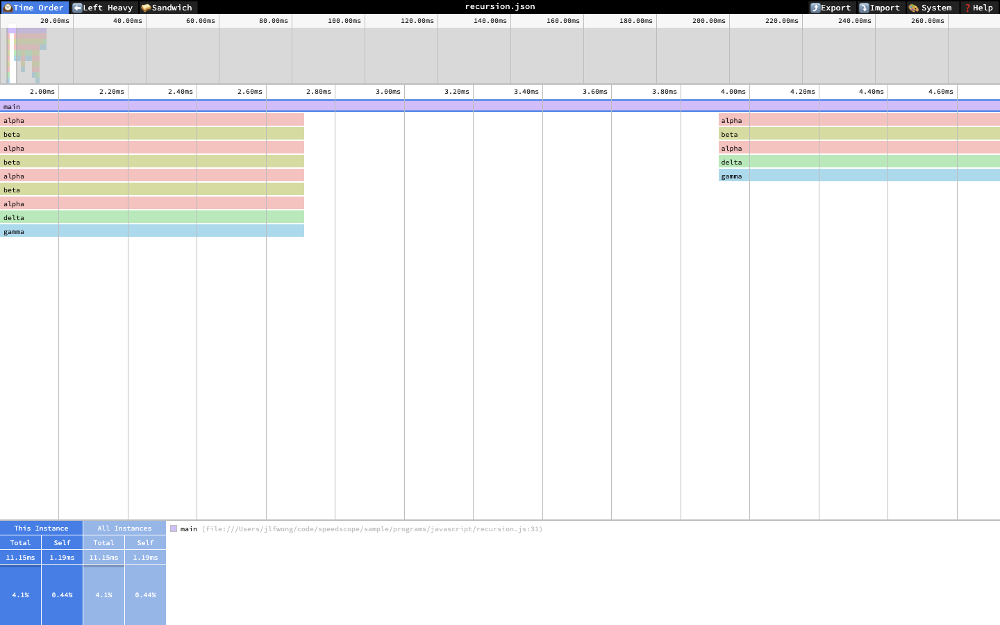
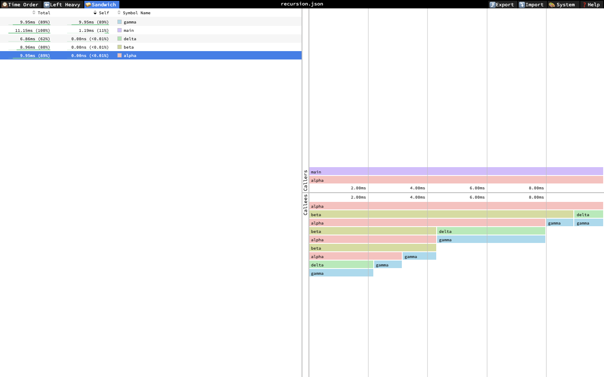

# 第 46 批：Speedscope 原生阅读补证

2026-10-29。结论仍是 **defer 通用性能数据导入器**。本批补齐 [已有 scout](profile-window-reading.md) 的原生操作缺口，没有把同一个项目计作新候选。固定样本证明了视口、统计分母与递归显示之间的区别；未证明 Archify 图解能提高阅读效果。

## 排重和证据范围

启动前刷新 333 个 Archify 远程 heads，与第 45 批相比仅研究 hub 和 task-flow-tests 推进。本批 `repo:tt-a1i/archify is:issue speedscope` 与 `is:pr` 窄查询均为 0；不声称穷尽所有相近工作。上游 [#39 Add support for crop](https://github.com/jlfwong/speedscope/issues/39) 和 [PR #366](https://github.com/jlfwong/speedscope/pull/366) 仍 open，后者未合并。保留[状态及 heads](../audit/round46-speedscope/remote-state.json)，不重复实现其裁剪功能。

来源固定 [Speedscope fe804e6281cf847713448c2c3e0faec3e1f62b2d](https://github.com/jlfwong/speedscope/tree/fe804e6281cf847713448c2c3e0faec3e1f62b2d)，Jamie Wong，MIT；[12 份完整来源及哈希](../audit/round46-speedscope/sources.json)含许可、原始 profile、导入器、聚合逻辑和相关视图。实际打开的网站导出自报 `speedscope@1.25.0`，部署 commit 未知；源码与观察一致不构成版本同一证明。

输入是上游公开 Firefox 61 recursion fixture，不是 #512 的用户数据。它有一个 GeckoMain 线程和 15 条采样记录，原始 duration 约 274.298。原生导出明确以 milliseconds 为单位，范围 0–274.29782799998065，含 62 条 evented 记录。固定 Firefox importer 按相邻采样栈开闭 frame，并过滤部分位置；这些记录是重建表示，不能解释为 62 次调用，也不能当真实入口/退出采集。未运行样本程序或重新采集。

## 实际观察

| 操作 | 观察 | 能支持的结论 |
| --- | --- | --- |
| Time Order 双击 main，再按两次 `+` | 轴刻度缩到约 2.00–4.60ms | 视口确实变窄；不是精确裁剪边界 |
| 切回 Sandwich | 五个函数 Total / Self 与缩放前逐项相同 | 本次缩放没有改变该表的全局权重 |
| 选择 main | Time Order 为 11.15ms / 4.1%；Sandwich 为 11.15ms / 100% | 相同绝对量使用不同分母 |
| Left Heavy 按 `r` | 递归层折叠，随后 Sandwich 五行仍相同 | 折叠改变展示，保留本例函数权重 |
| Sandwich 选择 alpha | 原生显示 Callers / Callees 图 | 比较基线应包含该交互，而非只有静态火焰图 |
| 折叠前后 Export | 两份 JSON 字节相同 | 本次显示操作未改动导出 profile |

## 分母与重复帧重算

从原生导出逐区间重算，有非空表示栈的权重为 **11.149112ms**。main total 除以整个导出范围约为 **4.0646%**，除以该非空栈权重为 **100%**，符合 UI。固定源码中表格用 `getTotalNonIdleWeight()`，详情用 flamechart 总权重；方法名 nonIdle 不证明剩余时间就是 CPU idle。

同一区间对相同 frame 去重，alpha total 为 **9.954630ms**、beta 为 **8.962159ms**；若按递归出现的每层重复累加，则会得到 **25.424630ms**、**17.600079ms**。这只是对该导出表示的计算反例，不是新的实测执行时间。固定源码折叠递归后复制原 frame 权重，避免重建树改变 self 的归属。

[analysis.json](../audit/round46-speedscope/analysis.json) 保存五个函数精确值、DOM 表和导出哈希；[analyse.py](../audit/round46-speedscope/analyse.py) 两次运行字节一致。上游已有同 fixture 的测试快照，其数值提供来源交叉检查；本批未执行上游测试。

## 失败记录和验证边界

15 张 1440×900 原生实拍保留，其中 9 张有效截图已人工查看。另 6 张来自未真正缩小画面的早期尝试，明确排除为缩放证据；文件名含 verified / main-fit / narrow 也不能改变这一点。10 号脚本执行前语法失败，11 号修正后完成递归检查。[完整操作、图像审计和复现说明](../audit/round46-speedscope/README.md)保留这些差别。

两次导出相等只覆盖本次同一导入后的显示操作，不是两次独立导入验收。DOM 表相等不能证明缩放成功；成功依据是 08 / 09 的实际画面。没有确定精确选区边界、复现原 issue、执行 proposed crop、跑 Perfetto 同输入对照或测量读者正确率。没有新运行时代码，因此未跑与本包无关的产品测试。

## 对 Archify 的取舍

原生工具已经能提供时间顺序、聚合、递归折叠和调用上下文。剩余需求是按明确窗口重算及解释统计口径；仅静态翻画会丢掉区域选择能力，而自建导入器需长期维护采样权重、过滤、线程、栈身份、递归、时间单位和裁剪边界。当前证据不足以承担这项维护。

将本批作为后续解释文档的证据材料，继续等待有完整公开输入、明确窗口及预期答案的自然阅读任务。届时先比较原生裁剪方案，再判断是否值得复用现有 Archify 解释/来源设施；本批不新增产品页面、解析器或分支方向。证据仅推研究远程分支，无新 PR。
