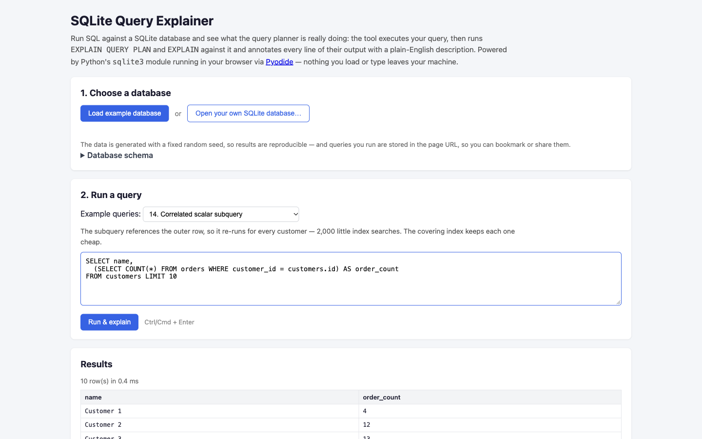
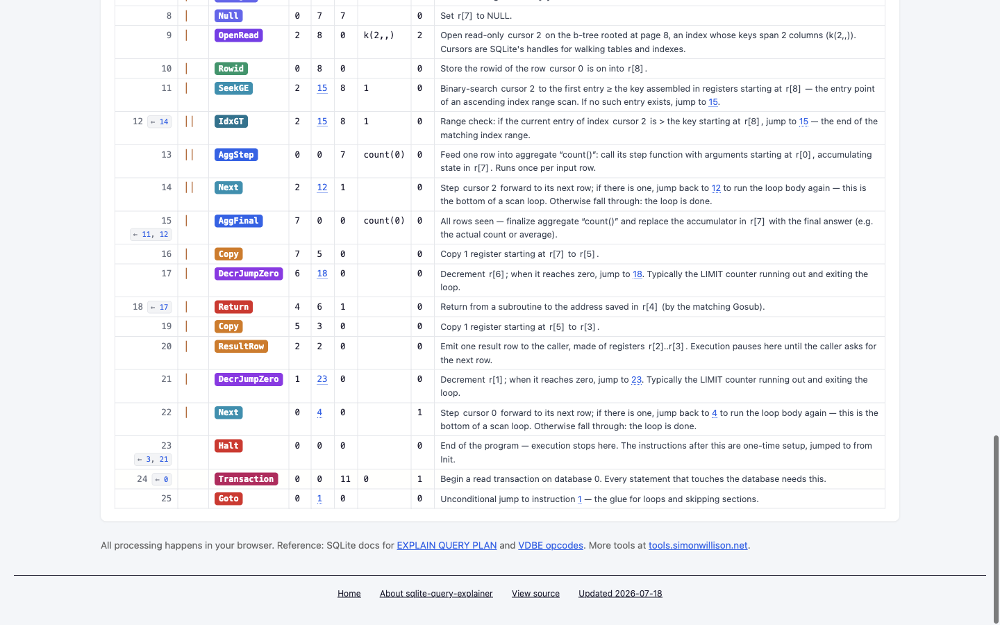

# 第 40 批：查询计划不能代替执行次数

本批补上已有 SQLite 研究的原生缺口，没有新增 Archify 实现方向。已完成两次原生回放与上游网页检查；只保存研究分支，不创建 PR、安装运行时、发布站点或合并。

[完整证据包与复现命令](../audit/round40-sqlite-native/README.md) · [逐项观测](../audit/round40-sqlite-native/browser-observations.json)

## 去重与问题来源

开始时刷新 333 个远程 head；相比上一批只新增 jq 实验分支并移动汇总分支。旧研究分支的 `query-plan-smalltools.md` 已分析 PEV2、DuckDB、SQLite 等工具，并明确说没有运行 SQLite 或原生浏览器。此次补证该缺口，不把同一个工具计成新发现。远程未发现查询计划实现分支；有范围的 SQLite issue / PR 查询均为 0，不能当作穷尽去重证明。

task-view main 仍为 `a3fa21767bfaeb3077fdda08bddb7249366caa93`，已有方向不重做。

[Simon Willison 的 SQLite Query Explainer](https://tools.simonwillison.net/sqlite-query-explainer)把计划原文与通俗解释并列，并为字节码提供跳转和寄存器关联。当前源码固定在 [5fc8e8bba888405dd1a447859b231ede37822ae9](https://github.com/simonw/tools/blob/5fc8e8bba888405dd1a447859b231ede37822ae9/sqlite-query-explainer.html)，完整 HTML 与旧研究使用的 `e410e25efd604bf897b476443f406da47b578264` 版本逐字相同。

其中相关子查询的说明声称每个客户都触发一次搜索，共 2,000 次；实际示例 SQL 带 `LIMIT 10`。这个边界此前只有静态分析，现在可以用本机已有的扫描统计实测。

## 原生执行结果

复用上游完整的固定种子数据库生成函数，另加明确的 LIMIT／排序对照。生成环境是 Python 3.15.0 / sqlite3 3.54.1；执行环境是 Apple SQLite 3.51.0，已确认启用 `ENABLE_STMT_SCANSTATUS`。环境身份没有混写。

| 同一相关子查询的变体 | 返回行数 | orders 索引搜索次数 | 索引访问行数 |
| --- | ---: | ---: | ---: |
| LIMIT 0 | 0 | 0 | 0 |
| 原例 LIMIT 10 | 10 | 10 | 104 |
| 无 LIMIT | 2,000 | 2,000 | 20,000 |
| 按 order_count 降序、LIMIT 10 | 10 | 2,000 | 20,000 |

前面三组的 EQP detail 字符串相同，但完整记录中的节点 ID 不必相同。它们分别执行 0、10、2,000 次索引搜索；最后一组说明“返回 10 行”也不能反推“只搜索 10 次”。计数来自原生 `.scanstats on`，没有通过注入函数或图中节点数量推算。

网页初始示例还有一个同类边界：查询 purchase 事件并 `LIMIT 10`，说明却称访问全部 50,000 行。两次补充 profile 均记录访问 39 行、返回 10 行。这是对说明中无条件断言的反例，不是一般性的“LIMIT 必然只扫描少量行”结论。

每次正式回放 11 条命令，另各补一条初始示例 profile，共保留 24 条命令及完整输出。两次独立生成的数据库哈希相同；24 对 stdout/stderr 原始流逐字相同，不需要归一化。数据库不提交，完整生成器、种子、版本、尺寸和 SHA-256 足够重建并核对。原生报告没有 cycles，未据此比较速度。

SQLite 官方[profiling 文档](https://sqlite.org/profile.html)分别定义 loops 与 rows；[EQP 文档](https://sqlite.org/eqp.html)将计划描述定位为交互调试信息，格式可随版本改变。它们并不是稳定的实际指标协议。

## 原生页面检查

十份独立 Ego 操作脚本和日志、七张 1440×900 实拍完整保存，均已目视检查。异步加载 Pyodide 后继续观察同一页面，没有因等待而重新初始化数据库。

1. 页面实际展示了前述 2,000 次搜索和 50,000 行扫描的文案；同时保留 SQL 与结果，读者可核对矛盾。
2. 通过查询输入框读取到浏览器 SQLite **3.39.0** 与完整 source ID；扫描统计编译选项返回 **0**。本机计数不是浏览器计数，没有将它们说成同一次执行。
3. 浏览器前十行和不限行数时显示的前 200 行，与本机对应结果相同。这不证明完整数据库或引擎等价。
4. 不限行数查询显示 `200+ row(s)`。固定源码只计时 execute 加 fetchmany(201)，再显示 200 行。该时间不能当完整消耗全部结果的耗时，也不是节点耗时；201 的抓取请求也不证明所有内部操作只发生 201 次。
5. 悬停 `r[1]`，指令 1 与 21 两处引用同时高亮。点击指令 0 的目标，指令 24 滚入可视区域并带有 flash 类。它们是静态引用交互，不是执行轨迹。源码按显式寄存器集合与地址标识关联，没有靠词语相似度猜关系。

未确定页面部署提交。当前固定 HTML 与旧版本相同、实际页面出现相应文案、浏览器报告其 SQLite 身份，是三个分别取得的事实；不能合并成已知部署版本。

## 对 Archify 的筛选结论

**保留的参考：** 原文旁附说明，跳转目标保留来源，按显式身份关联高亮。需要解释时让读者能回到具体输入、语句或指令，收益比再画一个推测执行图更明确。

**不引入的部分：** 把 SCAN 写成必然访问全部行、从静态子查询节点推算实际调用次数、把有限抓取的时间赋给整条查询。对缺失指标保持未知；不从最终输出数量补值。

**本批不新增实现：** 原生工具和现有 Archify 阅读机制已经能组织这组材料。另造 SQL 引擎、opcode parser、计划适配器或固定教学页，尚无独立读者收益支持其维护成本。既有 Postgres 每次／累计指标候选也不因本次 SQLite 结果自动通过。

这是筛选决定，不是“已经证明图解无价值”。未做自然用户任务比较，没有理解率或效率结论。后续若遇到真实 Archify 输入，需要表达已采集的计划统计，应先取得生产者版本、采集范围和实际指标，再评估最小呈现方案。

## 来源与验证

完整 HTML 和 Apache-2.0 LICENSE 均来自 Simon Willison 的 `simonw/tools`，已按 Git blob、字节长度和 SHA-256 验证；上游生成器保留署名和许可，控制查询及回放／审计脚本由本研究添加。没有向 Archify 公共运行时复制上游实现，也没有对外发送 issue、评论或 PR。

归档审计核对原始流、查询结果、统计、浏览器观测和来源身份。研究记录不涉及共享产品行为，未运行无关 renderer suite。原始上游文件和网页日志的空白诊断保留；仅作者编辑范围要求通过空白检查。

