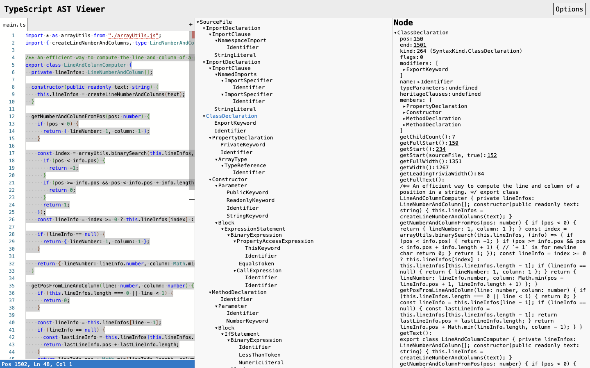
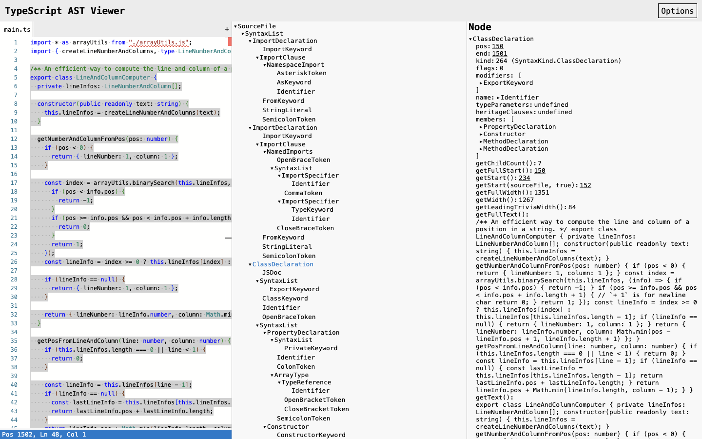
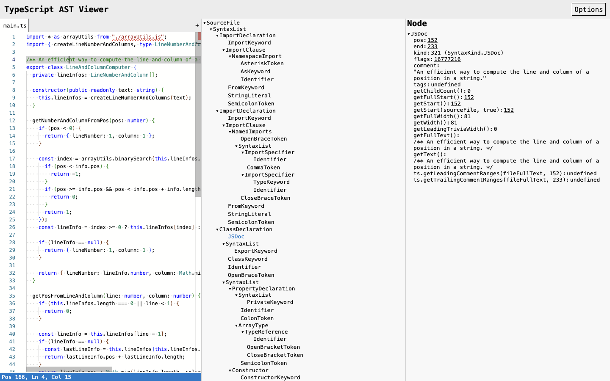
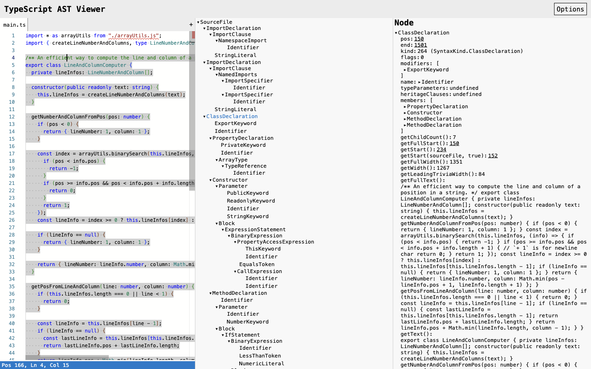

# 第 51 批：TS AST Viewer 的树模式、源码位置与命中范围

结论：**保留原生对照，不新增 Archify AST reader。** 此工具已经直接回答“这个源码位置对应哪个语法节点、为什么高亮包括注释”。新增通用适配会引入编译器版本、遍历方式、位置单位和节点身份合同；本轮没有发现现有 Archify Tree / Explainer 无法满足的独立读者任务。

## 排重与对象

刷新 [333 个远程 heads](../audit/round51-ts-ast/remote-heads-before.tsv)，相对第 50 批开工只多出上一批两个已完成提交。检索当前和历史 scouts，已有 source map、行焦点、SARIF 位置单位与图关系计数；没有把这些原则重新算作新方向。本次补的是 TS AST Viewer 原生同输入、同坐标、不同遍历的直接观察。

[精确项目名检索](../audit/round51-ts-ast/remote-state.json)的 issue / PR 结果为零。扩大到 AST 有 1 个 issue 和 42 个 PR，仅读取首批 30 条 PR 元数据，不能声称全部排除。相邻 [Draft #1015](https://github.com/tt-a1i/archify/pull/1015) 仍 open / unmerged，head `fe4f80d2195e0a7b49b7cfe6d3dba7ffd31a7ac8`，与[第 49 批实际读过的 diff](quarto-annotation-round49.md)相同。它承接作者指定的源码行焦点，不是 AST 节点命中；本轮不重复实现行高亮，也未重新审查或修改该 PR。

来源固定到 [dsherret/ts-ast-viewer @ cbcacc6181b1e3ef09f3f61eb3d8056c004a5bd9](https://github.com/dsherret/ts-ast-viewer/tree/cbcacc6181b1e3ef09f3f61eb3d8056c004a5bd9)，MIT，Copyright (c) 2017-2024 David Sherret。原生站点控件显示编译器 6.0.3；部署 commit 未验证，源码解释与网站实测分别记录，不混作同一构建证明。

## 完整真实文件，保持同一输入

输入是该项目自身完整 [LineAndColumnComputer.ts](../audit/round51-ts-ast/fixture/LineAndColumnComputer.ts)，1502 bytes，SHA-256 `6ddd8c62c70ded6b3cfc45db33a851f51c28a5bfdbdd513003c3f4aa6db38b12`。粘贴到虚拟 /main.ts，原生 SourceFile 的 getFullText() 在前后两次均逐字节读回一致。没有改写示例或执行该类。

它是研究者选取的真实文件，不是独立用户任务；其它被 import 的项目文件没有载入，编辑器中的未解析 import 诊断不能当作源项目缺陷。Binding / Factory code / Show internals 关闭，Script target 为 ESNext / Latest。关闭 Binding 也不等于关闭 Monaco 所有诊断。

## 原生对照发现

| 同一 ClassDeclaration | forEachChild | getChildren |
| --- | --- | --- |
| 完整树 DOM 标签数 | 272 | 467 |
| 类直系树项数 | 6 | 7 |
| 属性 getChildCount() | 7 | 7 |
| pos / getFullStart() | 150 | 150 |
| getStart() | 234 | 234 |
| 包含 JSDoc 的 start | 152 | 152 |
| end | 1501 | 1501 |

272 / 467 不是屏幕同时可见数，也不是图节点身份。forEachChild 的类直系项为 ExportKeyword、Identifier、PropertyDeclaration、Constructor、两个 MethodDeclaration；getChildren 的直系项为 JSDoc、两个 SyntaxList、ClassKeyword、Identifier 和左右大括号。**forEachChild 并非排除所有带 Keyword 名称的节点**，两种模式也不是单纯改变颜色。

getChildCount() 是另一项编译器方法输出，不能未经定义就当成当前视图的直系项数。固定 [getChildrenFunction](../audit/round51-ts-ast/upstream/src/compiler/getChildrenFunction.ts) 明确分派两条遍历；源码也对没有 getChildren 的 tsgo 节点回退到 forEachChild，并在 Options 隐藏不适用的选择。本轮只运行 6.0.3，没有把 7.x 分支的源码阅读说成实际验证。

更直接的交互对照是同一源码光标 **Pos 166 / Ln 4 / Col 15**：

- getChildren 模式命中 **JSDoc [152,233)**，仅高亮该注释。
- forEachChild 模式命中 **ClassDeclaration**，画面中的 JSDoc 和类同时高亮；完整区间 **[152,1501)** 由固定源码规则推导，截图未展示全部行。

这不是源码发生变化。固定 [getDescendantAtRange](../audit/round51-ts-ast/upstream/src/compiler/getDescendantAtRange.ts) 按当前遍历方式查找，排除 SyntaxList / EOF 的直接候选并处理同起点情形；[getStartSafe](../audit/round51-ts-ast/upstream/src/compiler/getStartSafe.ts) 优先取首个 JSDoc 的起点，App 的高亮调用它。150 包含类前两个换行，152 是 JSDoc 起点，234 是 export class 起点，不能统一叫“节点开始位置”。

## 对 Archify 的筛选结论

值得保留的是数据合同习惯：图的子项数量应注明遍历；源码高亮应注明起止来源，不能把 fullStart、排除 trivia 的 start、包含 JSDoc 的 start 和作者指定行范围混用。已有 Tree 可以显示固定层级，Explainer 可以把原字段与说明并排组织；这并不要求把每个语法树都导入 Archify。

本次原生工具已经给出树、原字段、文本和源码联动。支持通用 AST 意味着持续跟随编译器 API / kind、遍历模式、编辑后位置与身份更新；绑定类型还需要完整项目与解析选项。当前没有证据表明这些维护成本能换来 Archify 的具体新增阅读收益，故不生成一个只复制原生树的实验，也不修改共享 Viewer、source 合同或 PR #1015。

[证据包](../audit/round51-ts-ast/README.md)含 11 轮脚本与日志、6 张已查看的真实 PNG、15 份校验过 Git blob 的来源文件、前后输入读回和离线核验。保留 stale ref、被遮挡的 textarea 和过早高亮采样；它们没有被包装成上游缺陷。输入仅 ASCII，未验证 Unicode 差异；没有读者研究、速度、正确率、整项目类型检查或上游测试结论。

本批只推进研究远程分支，未创建 PR、安装、合并或发布。完整目标继续 active。
