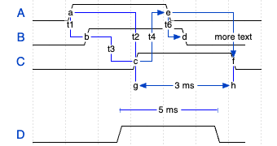
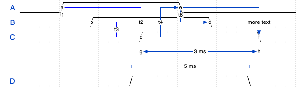

# WaveDrom：相位、缩放与时长标签，第 55 批

2026-10-29。结论：补齐原生时序图证据，继续暂缓新波形引擎或导入器。旧 [协议工具调研](https://github.com/tt-a1i/archify/blob/3beb343b8fd6686201bde9b0f307f9a1c6b00246/docs/research/2026-10-25/scouts/protocol-schema-smalltools.md)已提过 WaveDrom，但当时没有运行它。本次不是新发现一个项目。

## 实际问题与版本

读者调整横向比例时，能否把 phase 当作固定比例的相位，并把图上的“ms”文字当成计算所得的时长？这直接关系到图中边沿是否仍然对齐。

先刷新 333 个远程分支，只有研究 hub 相对上批前移；task-view 仍为 a3fa217，已有方向不重做。Archify 的 WaveDrom issue/PR 定向查询为零，不等于穷尽所有同义工作。[排重和版本记录](../audit/round55-wavedrom/context.json)。

当前引擎源码 head 为 5f44f7d8 / 3.8.0，但实际执行的是固定官网源码 375378ef 所含的 **3.7.0 原生编辑器**。27 个站点文件按 Git blob 和长度校验后原样在 loopback 服务，没有安装包或构建源码。Google 字体/分析脚本响应没有固定；PWA worker/icon 未镜像，相关 404 保留于日志。不能宣称完整离线环境或已验证 3.8.0。

## 三组同源输出

取官方 tutorial 的 Sharp lines 完整输入，比较原例、三个显式 phase 全改为 0、仅加 hscale:2。它是作者教学图，不是硬件采集或上游 issue 原帖的 clock 输入。

| 条件 | g–h 与 I–J 各自跨度 | I/J 相对 g/h 左移 | 标注文字 |
| --- | --- | --- | --- |
| 原例 | 120 | 20 | 3 ms / 5 ms |
| phase = 0 | 120 | 0 | 3 ms / 5 ms |
| hscale = 2 | 240 | 20 | 3 ms / 5 ms |

数值来自 SVG 局部坐标。缩放后跨度变大，phase 偏移保持原量，不能把同一个 phase 值直接当作新周期中的固定比例。文字则来自 edge 声明；两段等宽线仍标不同的 ms，不能据此说工具测出了两个不同物理时长。

固定旧源码的事件位置公式把 hscale 乘在位置项，未乘在 phase 项；标签直接取 edge 文本。这与本次测量一致，但没有重建发布 bundle 的完整构建链。[源码、输入、导出和复现步骤](../audit/round55-wavedrom/README.md)。

## 原生问题已有讨论，暂不扩大实现

[上游 #171](https://github.com/wavedrom/wavedrom/issues/171)描述过 hscale 改动使相位对齐变化；进一步沿评论读到 [作者在 #53 的说明](https://github.com/wavedrom/wavedrom/issues/53#issuecomment-42156824)，相同 phase 在不同 hscale 下对应不同角度。它是已有语义与兼容性讨论，不是本次发现的新缺陷，也不是 Archify 应接管的计算责任。

对 Archify 有用的是保留作者标签与实际观测的区别，并在搬运时序图时明确缩放/坐标约定。原生工具已能编辑和导出这些关系；新增通用转换器需要维护波形字符、周期、相位、标记、皮肤和单位解释。当前没有独立读者任务证明这笔成本值得，也没有必要为三个参数结果再建一套交互界面。

验证覆盖 9 个源码 blob、27 个缓存资源、三种输入和导出中的 10 条声明边，以及关键跨度/偏移；9 张 PNG 均实际检查。首次采样曾在 750ms 延迟更新前读到上一份图，保留早期记录后改为等待输入同步再重采。没有把过早采样认定为引擎渲染错误。没有硬件测量、协议正确性验证、用户效率结论、Archify 产品测试或 CI。服务已停，研究页清空；只推研究分支，不提 PR。
