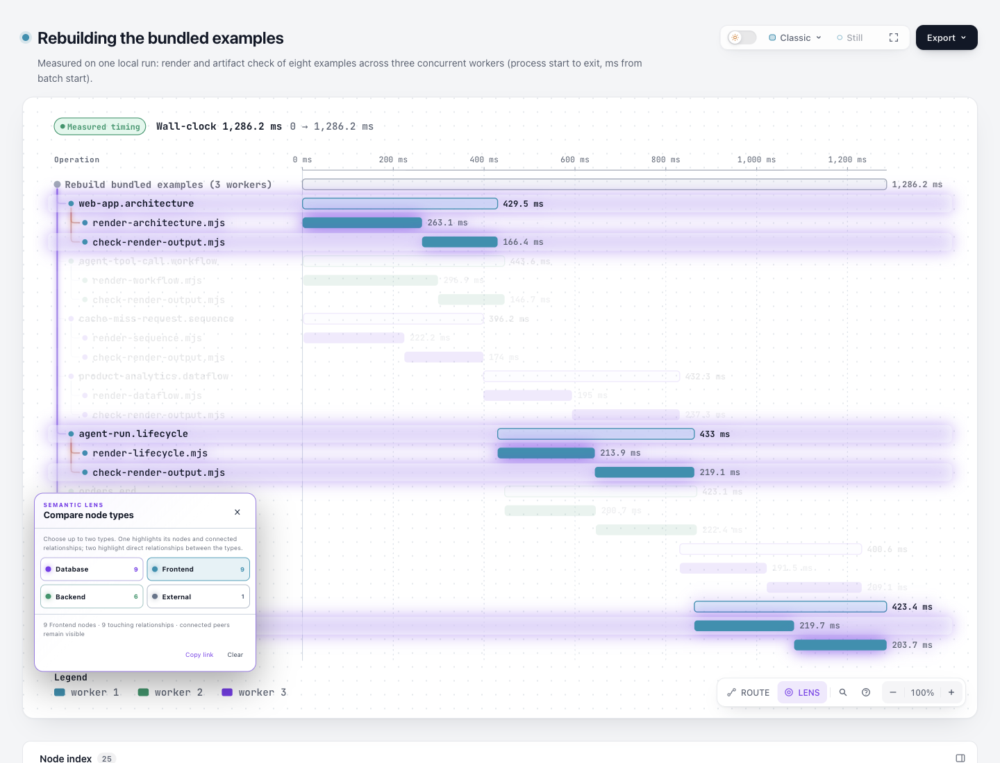

# Lens：图中关系不是实测流量

Lens 原文称选择一个类型会显示“真实流量”，但它读取的是图作者提供的节点和边，并未测量流量；例如 Waterfall 中父子关系也会被突出显示。候选将说明改成选择一个节点类型时突出其节点和关联关系、选择两个类型时突出两者直接关系。它修正说明，不改变分类、URL、选择行为或图数据。

修订涉及 12 份 locale 的三个现有键：`viewer.lens.title`、`viewer.lens.instruction`、`viewer.guide.lens.hint`，以及一处 CSS 注释和既有生成物。首次[补丁](evidence/native/source-first.patch)只更新面板标题和说明；后续发现引导提示仍提到流量，故[最终补丁](evidence/native/source-final.patch)一并修正。独立[源码审查](evidence/source-review.md)核对了对应消费者、翻译覆盖及保持不变的行为；它不是全部语言的专业翻译或视觉验收。

## 同输入产物和对照

基线为 Archify `dev@d5d979493bba650b3995836afd379cd249f2d0dd`，候选是该基线上的本实验源码变更。以下是完整原生 HTML，输入由 [inputs](inputs/) 保留；每份目录另含命令、stdout、stderr、delivery 和 finalize 回执。输入与 HTML 的原始和公开哈希、字节数见[清单](evidence/hash-mapping.json)。

| 固定输入 | 基线 | 候选 | 目的 |
| --- | --- | --- | --- |
| [英文 Waterfall](inputs/waterfall-en.json) | [HTML](artifacts/base/waterfall-en.html) | [HTML](artifacts/candidate/waterfall-en.html) | 英文原生说明；两侧显式传入 browser-check |
| [中文 Waterfall](inputs/waterfall-zh.json) | [HTML](artifacts/base/waterfall-zh.html) | [HTML](artifacts/candidate/waterfall-zh.html) | 中文说明 |
| [零关系](inputs/zero-relationships.json) | [HTML](artifacts/base/zero-relationships.html) | [HTML](artifacts/candidate/zero-relationships.html) | 单节点无关系对照 |
| [无 locale 的覆盖输入](inputs/author-override.json) | [HTML](artifacts/base/author-override.html) | [HTML](artifacts/candidate/author-override.html) | 无 locale 默认行为，不是有效覆盖对照 |
| [显式英文 locale 与覆盖](inputs/author-override-en.json) | [HTML](artifacts/base/author-override-en.html) | [HTML](artifacts/candidate/author-override-en.html) | 检查显式 locale 下作者翻译覆盖 |

十份最终 finalize 均记录 validate、deliver、check、browser-check 通过，且回执的 browserCheck.requested 和 ran 均为 true；只有英文基线和候选命令显式传入 `--browser-check`，其余八份命令未显式传入，回执仍记录运行。visualReview 均为 not-requested，自动检查不等于人工视觉验收。

原作者覆盖输入缺少 `meta.locale`；[CLI](../../archify/bin/archify.mjs) 的 locale 处理在缺少它时提前返回，因此两侧实际显示默认文案，不能作为作者覆盖生效证据。新增的英文输入只补入 `meta.locale: "en"`，保留原先的 translations；两侧产物和回执单独记录。实际页面判断见下方主任务补充。

零关系输入经历两次失败：首稿缺少 `meta.output`，在 deliver 失败；第二稿补了 output，却缺少 `meta.evidence`，在 validate 失败。这两份[原始输入](evidence/native/zero-first-input.json)、[第二输入](evidence/native/zero-second-input.json)、[首次回执](evidence/native/attempt1/)和[第二次回执](evidence/native/attempt2/)均保留；两次均未生成成功 HTML。修正输入后重跑，才得到上表的最终产物。失败属于 fixture 构造，不计入成功门禁。

## 本地验证和证据边界

运行环境 Node `22.23.2`、zlib `1.3.1-e00f703`、Chrome `156.0.8078.48`。已有[聚焦测试](evidence/focused/stdout.log)记录 46/46 通过、零跳过；[core](evidence/generated/npm-test.stdout)记录 19/19；[生成物检查](evidence/generated/test-generated.stdout)通过。15 个既有示例 SVG 字节未变的对照见[记录](evidence/generated/svg-identity.stdout)。两次 ZIP 的记录哈希相同，`4b5cb4ec0d85e19439368a3e46e6d0887855dbcd5b70760643f99f706557c89e`；首次 archive 检查因脚本遗漏 ZIP 内路径前缀失败，保留[错误](evidence/generated/archive-check.stderr)及[更正检查](evidence/generated/archive-check-corrected.stdout)。这些均是本地记录，不是 hosted CI 或完整测试套件结论。

为公开记录，含 `/Users/tsk` 的副本将该前缀替换为 `<USER_HOME>`；未含该前缀的文件按原字节复制，十份 HTML 均为原字节。[映射](evidence/hash-mapping.json)列出每份原始及公开 SHA-256 和字节数。脱敏后的回执仅供阅读，不能作为 live provenance 重用：需要重新运行 finalize 创建新回执。原始文件保留在记录所列本机临时路径，并非随提交交付的永久归档。原生 HTML、补丁和日志保留原有空白以保持身份；全量 diff 空白检查因此有 272 条归档内容告警，排除这三类冻结归档后的代码、输入、文档检查通过。

## 实际页面检查

在已获授权重建的 Ego 研究空间 24 中，主任务实际打开十份 HTML、点击 Lens 和类型按钮，并检查全部 17 张截图。共有 19 条 DOM 观察；[观察](root-review/observations.json)和[成对比较](root-review/comparison.json)保留节点 ID、边组、计数、URL fragment、视口及面板几何。浅色、减少动态效果；主对照为 1440×900，窄视口为 390×844。中文的 zoom 读数选择器没有返回文本，不能由两个 null 推导中文缩放一致；截图显示双方 100%。

| 实际操作 | 基线 → 候选 | 图片 |
| --- | --- | --- |
| 英文选择 Frontend | 均 9 节点、9 条相连关系；标题和说明替换 | [基线](root-review/base-en-one.png) / [候选](root-review/candidate-en-one.png) |
| 再选择 External | 均 10 个选中节点、3 条直接关系，方向计数 0 / 3 | [基线](root-review/base-en-two.png) / [候选](root-review/candidate-en-two.png) |
| 英文窄视口 | 说明完整换行，面板没有新增内部滚动或页面横向溢出 | [基线](root-review/base-en-narrow.png) / [候选](root-review/candidate-en-narrow.png) |
| 中文选择前端 | 均 9 节点、9 条相连关系，新说明可见 | [基线](root-review/base-zh-one.png) / [候选](root-review/candidate-zh-one.png) |
| 打开 Guide | 提示改为突出图中关系 | [基线](root-review/base-guide.png) / [候选](root-review/candidate-guide.png) |
| 单节点、零关系 | 双方均 1 节点、0 条关系 | [基线](root-review/base-zero-visual.png) / [候选](root-review/candidate-zero.png) |
| 有效 en locale 与作者覆盖 | 两侧均显示 Reader chosen title、自定义 instruction；DOM 也保留自定义 Guide hint | [基线](root-review/base-override-en.png) / [候选](root-review/candidate-override-en.png) |

原无 locale 的覆盖样例在双方都走默认文案，保留为负对照；它不能证明作者覆盖生效。显式 locale 的补充对照才支持上述覆盖结论。五组成品的主 SVG 均字节相同；Waterfall 复用此前已测量的 25-span 输入，本轮没有重新测量构建速度。

边界：1440×900 长图的 Lens 底部在双方截图中超出视口，单节点短图的面板顶部在双方都被容器裁切。这些原有问题仍存在，不算本次修复。补充 1440×1100 [完整候选画面](root-review/candidate-en-full.png)可看到面板全部控件，但该对基线和候选停靠位置不同，仅用于内容和选择结果检查，不用作几何一致的像素比较。窄视口内画布及工具条仍有裁切，不能据此声称移动端、触摸或辅助技术验收。12 种语言未经过全部母语与视觉检查，也没有阅读速度、理解率收益的测量。

首次截图脚本用了不存在的按钮 ID，超时后没有生成截图；根据实际 DOM 修正后才完成取证。[历史脚本和日志](root-review/harness/)保留该失败与后续执行，脚本以文本归档，不能直接当作便携复现入口。原始图片未裁剪或重绘。[独立交付审计](root-review/delivery-review.md)核对当时的 188 项清单、两套原始/公开映射、成对 SVG、回执和已保存的 UI 记录，结论为范围内无阻塞项；审计未重新运行浏览器或测试。最终清单另包含审计报告本身。



## 复现

在依赖和 Chrome 已就绪的两份 checkout 分别以 Node 22.23.2 执行；将下例 `INPUT` 指向本实验的绝对输入路径。基线检出上述 dev 提交，候选检出本实验代码。每次输出到新目录，避免覆盖已保存记录。英文对照显式加 `--browser-check`；其他四份按原命令不显式添加：

```sh
RUN_DIR=$(mktemp -d /tmp/archify-lens.XXXXXX)
node archify/bin/archify.mjs finalize waterfall "$INPUT" "$RUN_DIR/diagram.html" --json --out-dir "$RUN_DIR/receipts" --browser-check
```

零关系仍用 `waterfall`，两份作者覆盖输入改用 `architecture`。浏览器检查需要环境中已有 Chrome；具体原始命令及各次输出路径见各 `.command.json`。不要把脱敏回执当作重新生成的有效回执。

## 来源

输入和实现来自 Archify；贡献遵循仓库 Apache-2.0 与根 LICENSE/NOTICE。上轮 [Ninja 原生研究](https://github.com/tt-a1i/archify/tree/03861a26/docs/research/2026-10-26/audit/round16-ninja-native)讨论的是构建依赖及 order-only 的原生命令证据；这里是 Archify 对作者关系的描述，不声称 Ninja 原生工具缺少该功能，也未复制第三方实现。没有执行 Ninja、发布、安装或合并。
