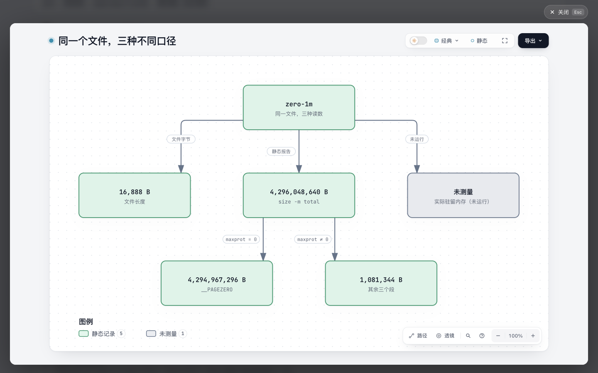
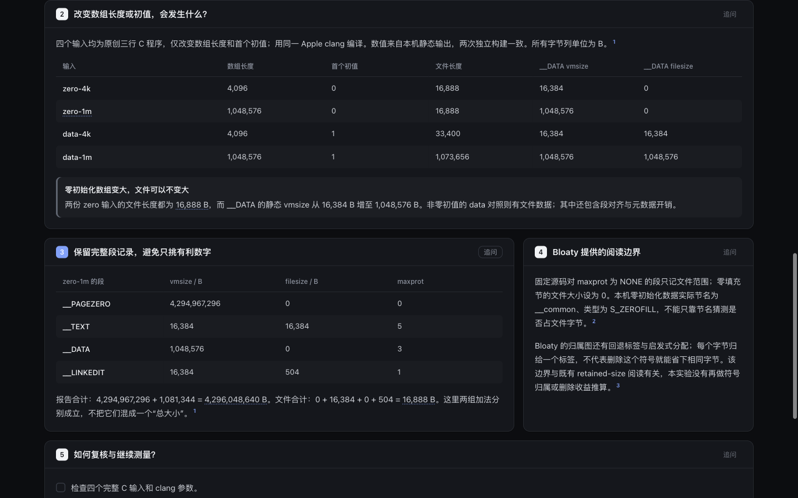

# 文件长度、段尺寸与未测的内存

`zero-1m` 文件只有 **16,888 B**，Apple `size -m` 却报告 **4,296,048,640 B** 的 total。其中包含不可访问的 4 GiB `__PAGEZERO`；去掉它之后的 1,081,344 B 仍是静态段尺寸，不能当作实测驻留内存。

这是受 Bloaty 文件 / VM 分域机制启发的固定内容实验。它帮助读者先识别数字口径，再解释零填充，不增加 Archify 产品代码、公共 Viewer、schema、依赖、通用二进制导入器或运行时采样器。只有桌面阅读候选证据，尚无真实读者提效结论。只交付独立远程分支，不创建 PR。

## 阅读入口

- [解释页](explanation.html)：主结论、五步聚焦、四例对照和完整段表。
- [同源原文包装](raw-records.html)：同一主结论、四个完整 C 输入、完整 size 输出及可展开的完整 otool 输出；不是 Bloaty 官方 UI。
- [原生图](domains.html)、[可编辑 Explainer 输入](candidate.explainer.json)、[图输入](domains.architecture.json)。
- [两次原生观察](evidence/native-a/commands.json)、[第二次命令](evidence/native-b/commands.json)、[受限投影](evidence/projection.json)、[验证记录](evidence/verification.json)。





## 实际做了什么

四份原创 C 输入仅改变数组长度（4,096 / 1,048,576）与首个初值（0 / 1）。使用已有 Apple clang 17.0.0、`-Os -fno-common`，在两个新建临时目录各编译一次。每轮记录 23 条命令：工具和 OS 信息，以及四例的编译、size、otool、nm、file。没有执行生成的可执行文件，也没有安装、编译或运行 Bloaty。

| 输入 | 数组字节 | 首个初值 | 完整文件 B | __DATA vmsize B | __DATA filesize B |
| --- | ---: | ---: | ---: | ---: | ---: |
| zero-4k | 4,096 | 0 | 16,888 | 16,384 | 0 |
| zero-1m | 1,048,576 | 0 | 16,888 | 1,048,576 | 0 |
| data-4k | 4,096 | 1 | 33,400 | 16,384 | 16,384 |
| data-1m | 1,048,576 | 1 | 1,073,656 | 1,048,576 | 1,048,576 |

零初始化数据实际进入 `__common` 节，节类型为 `S_ZEROFILL`；不能只凭节名猜测。其数值常量也与已安装 Apple SDK 的 loader.h 核对，见 [常量证据](evidence/macho-constants.json)。每个文件的 `__PAGEZERO` 都有 vmsize=4,294,967,296、filesize=0、maxprot=0、initprot=0。

两轮的四个二进制哈希相同，46 对 stdout / stderr 流逐字相同。记录了全部 argv、工作目录、退出码和用时；这些用时不是作者效率或性能基准。临时二进制未提交，输入、完整工具输出、长度和哈希足以重建核对。

`verify.py` 只接受这组固定形状的记录：核对四个段、zero-fill 类型、完整文件与段 filesize 之和、size total 与段 vmsize 之和，并核对页面表格、图中数字、内存未知状态及 HTML 内嵌输入。它不解析任意 Mach-O，不构成 Archify 产品导入能力。

## Bloaty 来源与归属

固定 [google/bloaty@f1a83e63f36beb628dcf022e1201a2eb391a22a6](https://github.com/google/bloaty/tree/f1a83e63f36beb628dcf022e1201a2eb391a22a6)，本轮重新核对 HEAD 未变。Apache 2.0；源码 Copyright 2016 Google Inc. All Rights Reserved.，Bloaty 作者。

- [工作原理](upstream/doc/how-bloaty-works.md)：文件 / VM 两套范围、回退标签与字节归属边界。
- [Mach-O 实现](upstream/src/macho.cc) 305–361 行：maxprot=NONE 的段只记录文件范围，零填充节的文件长度为 0。
- [RangeMap](upstream/src/range_map.h)、[上游 README](upstream/README.md)、[完整许可](upstream/LICENSE)。

五份文件的字节长度和 Git blob SHA 均与固定上游目录记录相符，SHA-256 另行保存；根目录未发现 NOTICE。上游代码只作为研究原件保留，没有复制到产品实现。源码观察不冒充 Bloaty 运行结果；本机表中的“其余三个段”也不是宣称测得了 Bloaty 的 VM TOTAL。

开始前检查 331 个远程 heads，较前批只新增 schema-annotations，并更新研究总账。对照旧总账的 retained-size / binary-reading：本例不重做直接支配、删除收益、同一 bit 的多种解释或通用二进制编辑器。Bloaty issue / PR 关键词查询各 0，检索范围与失败探针保留在 [sources.json](evidence/sources.json)；关键词结果不证明全库绝无概念重叠。

## 复现

在已有 Apple Command Line Tools 的 arm64 macOS 上，从仓库根目录运行。输出目录必须尚不存在：

```sh
python3 experiments/binary-size-domains/reproduce.py --output /tmp/archify-binary-size-replay-a
python3 experiments/binary-size-domains/reproduce.py --output /tmp/archify-binary-size-replay-b
diff -r /tmp/archify-binary-size-replay-a/streams /tmp/archify-binary-size-replay-b/streams
```

`result.json` 记录二进制路径、长度和哈希；输入也复制到输出目录。先看工具版本，再与本分支的归档记录比较。不同编译器、SDK、架构或链接器可以改变字节数，不能强行沿用本页数字。

以下命令验证本分支归档，并重建原文包装；使用仓库已有构建依赖和 Node 22.23.3 可重建图与解释页：

```sh
python3 experiments/binary-size-domains/verify.py
node archify/bin/archify.mjs finalize explainer experiments/binary-size-domains/candidate.explainer.json experiments/binary-size-domains/explanation.html --json
ARCHIFY_CHROME='/Applications/Google Chrome.app/Contents/MacOS/Google Chrome' node archify/bin/archify.mjs finalize architecture experiments/binary-size-domains/domains.architecture.json experiments/binary-size-domains/domains.html --quality showcase --json
```

若输入改变导致旧 browser-check 回执不再属于新产物，应先归档旧回执或选择新的输出目录；不要覆盖后伪称沿用旧证据。本轮复用两份锁文件相同的已有依赖，提交前移除临时链接，没有安装。

## 产物检查与范围

- 最终 Explainer validate / deliver / check 通过，未自动运行 browser-check。保留一条写作建议：“归属不代表删除收益”是必要的来源边界，未为消除告警而删除。独立原生图四项门禁通过，含 Chrome browser-check。
- Ego 实际操作了五步阅读（1/5 至 5/5）、结束、原生图入口、深浅主题、面板导航、第一项 checkbox，以及原文的 zero-1m 导航与完整 otool 展开。
- 1440×900 桌面正文和表格无页面级横向溢出。390×844 正文 scrollWidth=390；两张表在 332px 容器内局部滚动。
- 13 张真实页面 PNG 已逐张查看，尺寸见 `evidence/image-dimensions.json`；实际操作脚本与输出在 `evidence/browser/`，其中 TaskSpace 3 和绝对路径只属于本次会话。
- **窄屏限制保留**：预览数字偏小；原生图初始视口裁切右侧，需要缩放或平移。本实验没有完成移动端图阅读验收，也没有扩大到共享 Viewer 修复。
- 原文和解释页使用相同输入、主结论和数字，但信息组织不同；这是可复核内容候选，不是盲测、用户效率实验或速度比较。
- 未运行完整产品测试库存、跨平台 / 全浏览器 CI、RSS 采样或视频导出；未改动发布输入，因此未重建 ZIP / 图库。未合并、发布或安装。
- 全量 staged whitespace 检查有 100 条原始上游 / 生成 HTML / 原生与浏览器日志提示，完整输出保存为 `evidence/whitespace-check.json`。保留原字节；作者 Python、JSON 和本说明的 scoped 检查通过。

## 首稿与失败记录

首稿的长标签在实际页面里压成一行。最终保持六个节点、五条关系、端点与数字口径，改用主数值 / sublabel，并缩短纵向间距。首稿 JSON、HTML、截图及所有 finalize 记录保留。

第二次原生 finalize 的前三项通过，browser-check 因旧回执属于旧 artifact 而拒绝覆盖。归档 `first-native-browser-check.json` 后，同一修订第三次 finalize 全通过；没有降低校验或改动产品代码。

另保留前期探针事实：未限定类型的 GitHub 搜索被拒绝，随后分别查询 issue / PR；Apple size 不支持 `--version`；旧研究工作区路径不存在，改读已有 Git 对象。这些不是成功检查。

本实验保留为桌面内容候选。若没有真实阅读需求支持进一步复用，不增加 Bloaty 集成、通用 parser 或新的内存指标。
