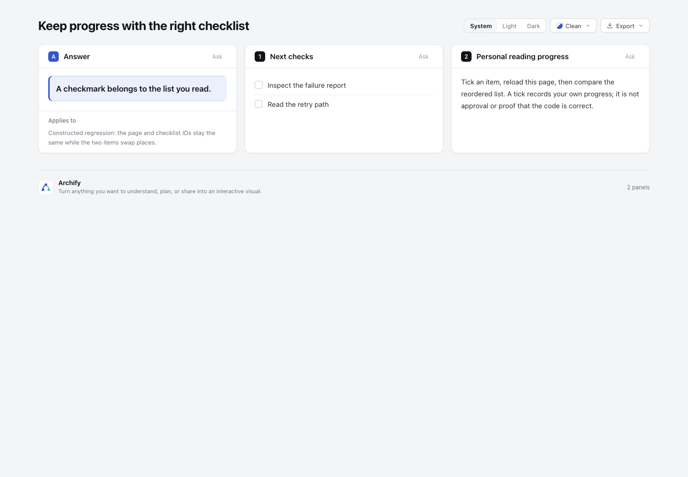

# Checklist progress follows ordered content

JSON 清单沿用相同页面和 block ID，却调换条目顺序时，旧版会把第一项的勾选套在另一项上。这个小修复把读者进度绑定到**整份清单的文字和顺序**，避免错项继承。

这是检查 task-view 新增阅读进度机制时发现、用完整构造输入复现的 Archify 缺陷；不是用户生产事故，也没有阅读速度或正确率实验。分类为 product interaction。基线是 `dev@6ca6a5c84439b57ea22e0630fe306e1d91587a6e`；已独立复查的产品修复、回归及 ZIP 固定在 `88e7e64b8e5d8ae7bafd754e60ece33c5d59dd58`。分支为 `codex/lab-checklist-progress`。

## 实际产物

| 状态 | 页面 | 真实浏览器截图 |
| --- | --- | --- |
| 基线：先勾 retry，再交换清单顺序，failure report 被错勾 | [base](artifacts/base-reordered.html) | [错误继承](screenshots/base-reordered.png) |
| 候选：同样交换顺序，两项均未勾选 | [candidate](artifacts/candidate-reordered.html) | [整份新清单重置](screenshots/candidate-reordered.png) |
| 候选：只改无关段落，retry 仍已勾选 | [prose edit](artifacts/candidate-prose-edited.html) | [进度保留](screenshots/candidate-prose-edited.png) |



静态 HTML 本身不携带读者勾选；这些截图是在同一个本地 HTTP origin、相同 artifact/block ID 下实际点击和重载所得。打开独立 HTML 不能重演此前的浏览器存储历史。完整输入见 [inputs](inputs)，逐文件 bytes/SHA-256 见 [manifest](manifest.json)。

## 行为与成本

renderer 复用已有 SHA-256 helper，摘要只包括有序 `block.items`；reader 把这个摘要追加到原来的 artifact/block 存储键。产品仅两处逻辑变更，没有 schema、依赖或安装变更。它影响所有重新生成的 Explainer checklist；普通列表和 ordered list 保持原行为。

- 同清单刷新、修改别的段落，保留进度。
- 重排、改字、增加或删除条目，整份清单从未勾选开始；没有猜测单项对应关系。
- 回到完全相同的旧清单，可恢复它原先的进度。不同 artifact/block 的进度独立。
- 旧存储键没有清单内容身份，首次使用新生成的 HTML 会重置其进度。旧记录没有删除，也没有猜测迁移；这是明确的一次性兼容性变化。
- 已生成的旧 HTML 不会自动改变，需要重新渲染。进度仍是这个浏览器 origin 的个人勾选，不是代码审批、测试结果或验收结论；相同清单引用的代码改变不会自动清除进度。

Markdown 本来就按 block 内容生成 ID，清单变动已会换键；此次问题直接暴露在保留显式 ID 的 JSON 输入。没有以整个页面 revision 作键，避免无关内容变化清空清单。

## 验证

| 证据 | 结果与范围 |
| --- | --- |
| 新 Chrome 回归在修复前运行 | [0 pass / 1 fail](evidence/archify-checklist-red.log)，准确失败于重排后错项继承 |
| 相同回归在候选运行 | [1 pass / 0 fail / 0 skip](evidence/archify-checklist-green.log)，真实 Space 输入、同一 file URL 重载；覆盖重排/改字/增删、无关段落、原内容恢复、artifact/block 隔离及旧键重置 |
| 受影响 charts/Markdown 清单测试文件 | [7 pass / 0 fail / 0 skip](evidence/archify-checklist-charts.log) |
| 公共 CLI 核心 smoke | [19 pass / 0 fail / 0 skip](evidence/core-smoke.log) |
| 候选公共 finalize + browser-check | [四阶段 pass](evidence/candidate-public-gate.json)，[完整浏览器回执](evidence/candidate-browser-check.json)，无 diagnostics |
| 独立代码复查 | 四文件无阻塞发现；检查普通/ordered/checklist 分支、输出转义及测试有效性。复查者未重复跑浏览器，不冒充独立浏览器验收 |
| canonical ZIP | [官方 Node 22.23.2 / zlib 1.3.1-e00f703 两次构建](evidence/package-build.log)字节相同；[独立目录解包后的公共 CLI smoke](evidence/package-smoke.json)三阶段 pass，未运行解包版 browser-check |

协调者另用 Ego Lite 实际完成基线勾选→刷新→重排错项，以及候选旧键重置→勾选→刷新保留→只改段落保留→重排清空。原始观察在 [evidence](evidence)，9 张未编辑 PNG 在 [screenshots](screenshots)。桌面统一 1440×1000；390×844 暗色下候选勾选也能经键盘和刷新保存，但基线与候选都有 400px scrollWidth，约 10px 原有横向溢出，**没有宣称移动端布局全部通过**。另保留刷新后主题回到浅色的中间观察；页面主题本来不持久化，因此暗色截图在刷新后重新点 Dark 捕获。

原始 red 日志含 Node 断言输出的两处空白行尾，保留原字节；排除该原始日志后的 whitespace 检查通过。

这些验证对应上述源码提交；后续提交仅添加实验材料。没有运行全仓详细套件、全浏览器 inventory、Windows 或发布流程。远端 CI 状态在交付时另行读取，不能用本地测试替代托管 CI。

## 复现

使用仓库支持的依赖和 Node 22，从仓库根运行：

```sh
node experiments/checklist-progress/reproduce.mjs
ARCHIFY_CHROME='/Applications/Google Chrome.app/Contents/MacOS/Google Chrome' npm run test:browser -- test/explainer-browser.test.mjs '--test-name-pattern=checklist progress'
npm run test:focus -- test/explainer-charts.test.mjs
```

第一条在新的临时目录生成三个完整页面及原始回执，不覆盖固定证据。可把独立准备的基线 checkout 绝对路径作为参数，用相同输入生成基线页面。自动回归直接走公开 renderExplainer，原有 helper 派发真实 Space，不直接设置 checkbox.checked。

手工复现时在一个仅供本实验使用的本地 HTTP origin 下，把 original.html 作为 page.html，勾选 retry 并刷新；然后用 reordered.html 替换 page.html，重新导航以避开缓存。保持 origin、artifact ID 和 checklist ID 不变。基线会错勾 failure report；候选重置。再用 prose-edited.html 重复，可验证其他段落变化保留原清单进度。不必清除用户浏览器存储。

基线在最初 docs/research 临时位置生成后移入此实验目录；原始 finalize 回执保留当时路径，HTML 字节未改。交付 sidecar 留在本地且被实验 .gitignore 排除。候选在最终实验路径生成；公共 gate、截图和 manifest 均绑定最终 HTML 字节。

## 来源与范围

[task-view 固定源码](https://github.com/gtindo/task-view/blob/a3fa21767bfaeb3077fdda08bddb7249366caa93/internal/render/assets/app.js#L348-L432) 用实体内容指纹标记阅读状态，促成此次对 Archify 清单身份的检查。没有复制它的实现、fixture 或依赖；本实验输入独立构造，沿用仓库 Apache-2.0。没有声称 task-view 的 flow 标记会在所有代码变化后失效，也没有实现完整 Flows 或审批系统。

已检索当前 GitHub issues/PR；[PR #1119](https://github.com/tt-a1i/archify/pull/1119) 是作者声明的只读节点 task_checklist，和此处读者个人进度不同。相关调研收录在 research hub 的 `docs/research/2026-10-28/scouts/task-view-refresh-reading.md`。用户已授权独立实验和远端分支；此分支供审阅，未合并、发布或更新任何 live installation。

AI 使用披露：Codex 协调研究、实现、回归、独立复查与说明；委派 agent 使用 gpt-6.1-sol。没有宣称已获人工最终验收。
