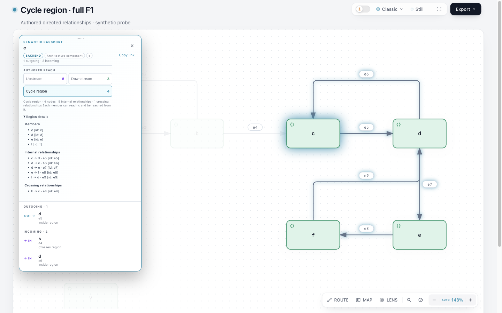

# Cycle region · authored Architecture Viewer experiment

2026-10-28。真实产品候选：在 Architecture 单节点 Passport 的 Upstream / Downstream 下方，点击 **Cycle region**，查看与所选节点互相可达的整个循环区域、全部内部关系以及单向跨区关系。它消费当前作者图，不分析代码或推断运行故障。没有新增 parser、SCC 依赖或并行状态 owner。



当前 f05 实测主图为 1440×900、scrollY0、auto-focus zoom148% 的 c 区域阅读视口；完整 13 节点/14 关系仍在 HTML 中，并非每个节点都出现在这张截图里。主图 SHA256 `b31474a9c0c00ae85650d6fe6c106e943f5546dd9ec2a3e285a0f43f07aa28b1`，189972 bytes。[全部 root 原图及逐图阶段绑定](evidence/root-browser/INDEX.md) 保留 base/d2cc/30b/f05 的真实区别。

## 输入、对照与答案

- [完整原创 F1 拓扑](f1.topology.json) 与 [合法 Architecture 输入](f1.architecture.json)：13 节点、14 关系全部保留，包括 e14:x→x。没有用单条 cycle witness 代替区域，没有删自环或菱形。
- [baseline.html](baseline.html)：固定 base `6ca6a5c84439b57ea22e0630fe306e1d91587a6e` 的原始 renderer/template，以同一 JSON 生成；[candidate.html](candidate.html)：本工作树产品源码公开 finalize 的结果。两者均为自动 viewBox 的 Architecture。
- [固定 light 基线 SVG](baseline.light.svg)、[候选 SVG](candidate.light.svg)、[比较结果](svg-comparison.json)：在相同 1440×900、light、reduced-motion 下，从真实 Chrome 的原生 `svg-light` 导出。候选导出时激活 c 区域。逐项比较所有节点/关系的 tag、geometry、key、id、端点、标签及文本，身份一致；临时 Focus/Reach/relationship 标记被清除，live DOM 不受污染。SVG 的新增样式使文件字节不同，未声称整体字节相同。
- 全部输入/HTML/SVG 与主要源码的 SHA-256、字节数见 [identities.json](identities.json)。candidate 在该轮实施检查时以未提交工作树冻结；这些文件哈希是此次实际验证身份，不表示后续远端交付状态。

| 选择 | 成员 | 内部关系 | 跨区关系 |
| --- | --- | --- | --- |
| a / b | a,b | e2,e3 | e1,e4 |
| c / d / e / f | c,d,e,f | e5,e6,e7,e8,e9 | e4 |
| x | x | e14 | 无 |
| s / i / u / v / w / t | 空 | 无 | 无 |

e4:b→c 两端属于不同循环区域，始终保留为外部上下文，不标为区域内部。空结果显示明确说明，保留普通 neighborhood；x 自环是 1 节点/1 关系的非空结果。区域节点数包含所选点。没有显示混淆 SCC、简单环和节点数的“cycles=某数字”。

## 交互合同

原生按钮及 details 支持 Tab、Enter、Space；`aria-pressed`、polite 摘要、成员/内部/跨区三份完整身份列表提供非颜色信息。按钮 toggle 退出模式并保持节点、焦点和 camera；第一次 Escape 退出区域，第二次沿原合同清 Focus。节点/多选、关系行跳邻居、精确 pin、Route/Journey、Lens 会替换区域状态。进入 Route 的真实回归发现旧 hash 保留，现只为离开的 cycle 状态清掉 URL。

分享使用 `#focus=c&region=cycle`，保留 query。region 优先于 reach，relation 保留原优先级；普通方向 `reachability()`、`reachabilitySnapshot()` 在区域模式返回 null，Reach Share Card 隐藏。普通 SVG/PNG 仍导出完整 canonical 图，未新增区域 share card。

## 实测与失败轨迹

[evidence/](evidence/) 保留完整日志的脱敏副本，`$REPO` / `$RUN` / `$BASE` / `$TEMP_PATH` 表示本地位置。原始未脱敏日志保留在执行环境的 run directory。脱敏 receipts 用于审阅，不能冒充仍绑定本地绝对路径的可执行 provenance；原始 delivery sidecar移到 run directory，防止发布私人路径。重新运行 finalize 会生成自己的有效 sidecar。

- **窄屏裁剪修复（当前候选）**：root 的真实 Ego 原图 [before-narrow-details-dark.png](evidence/before-narrow-details-dark.png) 与 [DOM](evidence/before-narrow-details.json) 证实原 30b 候选在 390×844 点击展开后超过 diagram clip；已保留中间 HTML 原字节与 SHA，未删除失败图。新增真实冷载→布局稳定→鼠标点击 summary 的回归首先复现旧版：chip 311.14–791.03、clip 164.14–679.47、nav top616.47，见 [33 日志](evidence/33-narrow-clip-reproduction.log)。
- 修复复用现有 `placeRelationshipLens`：原生 details toggle 请求重定位，按实际 diagram clip 和 nav 的可见空间限制展开 Passport 高度，使用原生 overflow 滚动。没有新状态 owner，没有删掉任何详情。修后深浅主题均为 chip173.14–607.14；真实滚轮后末条 e4 位于568.86–582.66，scrollTop46，hit-test 命中且不被nav遮挡。见 [修后 dark](evidence/narrow-fixed-dark.png)、[light](evidence/narrow-fixed-light.png) 及 [完整观察](evidence/focus-observations.json)。
- 当前源码 Focus、export-cleanup、generate-viewer [35 日志](evidence/35-narrow-fix-focused.log)：335测试通过、0跳过，包含新裁剪/滚动回归。随后当前候选的 public finalize/check、固定SVG身份比较和 canonical package 已重跑。算法、i18n、Route/Journey 与 Reach Share 的无关结果沿用其原日志；未把历史窗口断言当成当前图容器证据。
- 首次公开 `validate --quality showcase`：9 检查通过，无 errors/warnings。
- [最终 public finalize](evidence/36-finalize-narrow-fixed.json)：validate / deliver / check / automated browser-check 全部通过；[最终独立 check](evidence/37-check-narrow-fixed.json) 通过且要求 provenance。
- 裁剪修复前 Focus + i18n：[15-focus-i18n-final.log](evidence/15-focus-i18n-final.log)，52 测试通过、0 跳过。Focus 使用真实 CDP 输入，覆盖完整 F1 全部答案、fragment/parallel 精确身份、键盘/AX、两次 Escape、所有 owner 切换、冷载/hashchange/copy、真实 canonical SVG 导出、390/720/1440 dark/light布局。完整状态观察见 [focus-observations.json](evidence/focus-observations.json)。该历史批只核对 window 边界，后来 root 的 390×844 原图证实仍会被 diagram clip 截断；这批不能作为窄屏可读性验收。
- 裁剪修复前 Focus、Export cleanup、Route/Journey、Reach Share Card、generate-viewer 共349测试通过、0跳过，见 [22-final-consumers.log](evidence/22-final-consumers.log)，包括未知 region 与有效 reach 冲突时回普通 Focus 的新增冷载用例。
- Export cleanup、Route/Journey、Reach Share Card、generate-viewer 的直接消费者测试在 [06-focused-regressions.log](evidence/06-focused-regressions.log) 全部通过。该批整体失败来自 i18n 新键导致旧 complete-catalog 断言失败；已补 es/ko/ar 翻译。后续 i18n 还发现旧测试比较变量出现次数，而生产验证器比较变量集合；中文定义合法重复 `{label}`，因此测试改为同一变量集合合同。原失败与修复都保留于 06/11/15 日志，没有删除失败记录。
- 核心公开 CLI smoke 在 [11-final-focus-i18n-core.log](evidence/11-final-focus-i18n-core.log) 的 18 子用例通过；该批整体仍含上述后来修正的单个 i18n 断言失败。
- Blueprint 在 light/dark 两主题也用真实 Chrome 点击 preset 菜单，再以原生按钮 Enter 激活区域：内部关系 opacity=1、e4=0.09、origin/内部 filter=none，见 [32-blueprint-pass.log](evidence/32-blueprint-pass.log)。30/31 记录探针先前的错误假设：点击 Passport 外的 preset 按既有合同会清 Focus；修正探针为先选样式再查询区域，未改产品来迁就测试。可用 `node experiments/cycle-region/check-blueprint.mjs` 重放（节点选择由现有 Focus API seed，样式和按钮走真实 CDP 输入）。
- 最终 [check:viewer](evidence/39-viewer-check-narrow-fixed.log) 通过。template 通过 `scripts/generate-viewer.mjs` 生成；ZIP 通过官方 Node 22.23.2 / bundled zlib `1.3.1-e00f703` 的 [canonical builder](evidence/40-zip-narrow-fixed.log) 生成；重复构建逐字相同，ZIP 内模板、Architecture renderer 和全部 catalog 与源码逐字匹配，见 [package identity](evidence/42-package-narrow-identity.json)。上述实施与本地检查时没有版本变更、安装、发布、commit 或 push；后续提交与远端交付由主任务单独记录。

公开 finalize 的 browser-check 已运行；perceptual visual review 为 **not-requested**，自动报告仍指出 e3/e6 的返回路由及 e14 自环需原图审阅。Root Ego 的独立实测与原图观察已补在下节；此处未冒称真人、读屏器或 CI 验收。未跑整库、完整 browser inventory、Windows、WebM 或远端 CI。Gallery/站点样例未重建：本次是独立实验产物，未集成或发布站点；若产品候选进入正式集成，需按 CONTRIBUTING 刷新 Gallery 并完成相应 CI。固定输入重放不证明真实任务效率、作者生成速度或用户收益。

## Root Ego 实测与独立复核

Root 已在 f05 的真实 Ego 页面复测：390×844 dark 冷载后先等待折叠布局，再原生点击 Region details；面板 top173.148/bottom607.148，真实图容器 bottom690.477。真实滚轮到达末条 b→c e4，记录 y589.039–602.844，scrollTop42.5，hit-test=true；后续调用造成重新定位后末项仍可用。desktop 1440×900 light 的原生 node-index c 选择、Space 激活、details、完整 c/d/e/f 与 e5–e9/e4，以及第一次 Escape 保留 c/按钮焦点、第二次 Escape 回 node-c，也均已实际操作。Root 查看了全部14PNG，具体边界见 [ROOT-NARROW-ACCEPTANCE](evidence/root-browser/ROOT-NARROW-ACCEPTANCE.md)。这是 agent 操作与原图检查，不是人类验收或完整平台保证。

旧“窗口内即足够”的结论已撤回。`final-*` PNG 都是修复前 30b；只有 `repaired-*` 绑定 f05。[image-bindings](evidence/root-browser/image-bindings.json) 为每图保留实际 HTML SHA、PNG SHA/bytes/尺寸。[stage-note](evidence/root-browser/stage-note.json) 原字节保留 d2cc HTML 重建的诚实边界：反转单个 URL 条件后匹配已记录完整哈希，不冒称原始保存副本。旧30b失败图和 DOM 均保留。

[独立最终 delta review](evidence/independent-review/final-narrow-review.md) 与 [精确 binding](evidence/independent-review/final-narrow-binding.json) 未发现当前窄屏改动的阻塞缺陷；先前30b readiness明确撤回。独立1552-origin数学oracle按相同 helper 字节复用，详见 [独立证据索引](evidence/independent-review/INDEX.md)，不拿数学结果代替 DOM/视觉证据。文本中的绝对 raw 路径使用明确 `derived-redacted` 副本；[逐文件索引](evidence/independent-review/index.json) 同时记录外部原始文件与副本的 SHA/bytes，原始文件未覆盖。

剩余限制：**小屏下基线已有的底部工具栏仍有局部水平裁剪**；本次只修复循环详情的容器定位与完整记录可达性，未扩展改动工具栏。没有读屏器、母语翻译、真实用户效率或性能验收。公开 finalize receipt 的 `visualReview:not-requested` 仍按原自动流程保留，以上 root Ego 观察单独记账。[包装范围自检](evidence/43-packaging-scope-check.json) 确认此次只包装证据/README/index，f05、产品源码、测试、模板与 ZIP 字节未变，未重跑有效检查。

## 复现

从仓库根目录执行，使用支持的 Node、现有仓库依赖和可运行的 Chrome。把 `ARCHIFY_CHROME` 指到本机 Chrome；不要将示例占位符直接当路径执行。

```sh
node scripts/generate-viewer.mjs
node archify/bin/archify.mjs validate architecture experiments/cycle-region/f1.architecture.json --quality showcase --json
node archify/bin/archify.mjs finalize architecture experiments/cycle-region/f1.architecture.json experiments/cycle-region/candidate.html --quality showcase --candidate-sha256 b19d09b30c3b7a83fa20d0e54dd5ce2bfcf6812327aa1e4dd1c8682f3e209ca5 --out-dir /tmp/cycle-region-reproduction --json
node archify/bin/archify.mjs check experiments/cycle-region/candidate.html --json --require-provenance
node experiments/cycle-region/compare-svg.mjs
npm run test:focus -- test/focus-browser.test.mjs test/route-probe-browser.test.mjs test/export-cleanup-browser.test.mjs test/reach-share-card.test.mjs test/i18n.test.mjs test/generate-viewer.test.mjs test/core-smoke.test.mjs
npm --prefix archify run check:viewer
scripts/build-zip.sh
```

baseline 使用 `git archive 6ca6a5c84439b57ea22e0630fe306e1d91587a6e` 在独立临时目录解包，以该目录的 `archify/renderers/architecture/render-architecture.mjs` 读取同一 `f1.architecture.json` 并输出 `baseline.html`；它需要自身可用的现有依赖。canonical ZIP 需上述官方 Node/zlib。SVG 比较脚本只使用项目现有 Chrome harness，不安装依赖。

## 交付状态边界

本目录中的实施、检查和审阅收据描述各自运行时点。历史文字中的“未提交/未推送”仅限定该轮动作，不能据此判断后续远端交付状态；提交、push/readback 和实际 CI 由主任务后续的 remote delivery 字段单列。上述本地通过项与 root Ego 观察不代表远端 CI 已运行。

2026-10-28，实验与证据提交 [`7df64d4594486df6670e4b702aa4b3053f0ea095`](https://github.com/tt-a1i/archify/commit/7df64d4594486df6670e4b702aa4b3053f0ea095) 已推送到 [`codex/lab-cycle-region`](https://github.com/tt-a1i/archify/tree/codex/lab-cycle-region/experiments/cycle-region)，远程readback一致。该提交查得0个check run、0个commit status；这不是CI通过。后续文档记录不改变已冻结的f05 HTML、源码、模板、ZIP和图片。基线/候选HTML、SVG和历史原始日志沿用生成结果中的尾部空白，保留证据原字节；其余提交文件的whitespace检查通过。未合并、发布或安装。

## 来源、许可与 AI

F1 为本实验原创 **synthetic probe**，拓扑来自已确认 scout 合同，不是假称实地用户失败。新实现、fixture 和本文按仓库 [Apache-2.0](../../LICENSE) 贡献；基线与依赖的历史许可见 [NOTICE](../../NOTICE)、[LICENSE-MIT](../../LICENSE-MIT) 和包内 notices。没有复制第三方实现或上游 fixture。

概念对照固定在 scout 实读版本：[pydeps `9f086ed…`](https://github.com/thebjorn/pydeps/tree/9f086edb4edc1ad5cafc56d26f36d16c116baafa)（BSD-2-Clause）、[dependency-cruiser `c5b9737…`](https://github.com/sverweij/dependency-cruiser/tree/c5b97371ae93c556c703cfe294af86c9c80ea9fa)（MIT）、[cargo-guppy `b0779e6…`](https://github.com/facebookincubator/cargo-guppy/tree/b0779e6b2dc5d9f673c1c6f467e9fe270077a3b3)（MIT OR Apache-2.0）。它们分别帮助区分“环节点之间的边”“一条闭合见证”“自反 SCC 关系”；本地算法仍为现有 Reach 的上/下游交集。[DevScope `9053082…`](https://github.com/edouard57/devscope/tree/9053082d082e02bec2e2ce92af01aae9d73f36d6) 仅作为 scout 的反例，未找到许可正文，未复制代码。未运行上述上游项目，不以源码推导冒充其运行结果。

AI 披露：Codex，配置模型 gpt-6.1-sol，完成实现、fixture、测试、证据整理、文档与多语翻译；es/ko/ar 等文案未做母语人工审核。人类审阅与最终实验采纳尚未由本文确认。
