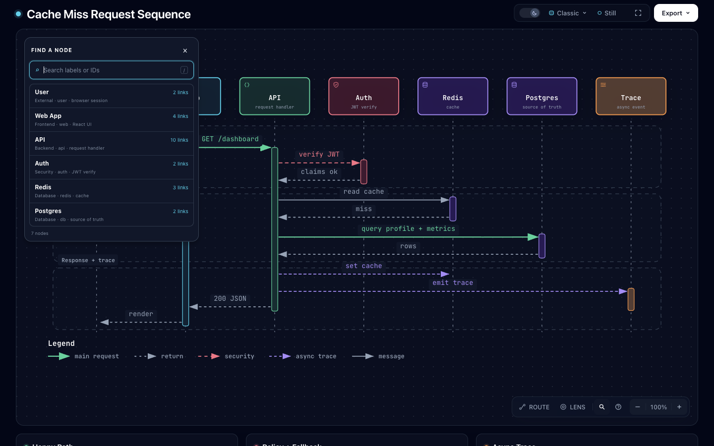

# Finder：按独立关系计数

基线：`dev@847146aeb93b492592adb78dc220f57e4a8b4636`。独立实验分支：`codex/lab-finder-link-count`。按用户授权仅推分支，不创建 PR、合并、发布或安装。

## 具体问题与改动

直接使用仓库原有的 `cache-miss-request.sequence.json`，未改输入。API→Redis 有读缓存和写缓存两条消息，Redis→API 还有缓存未命中的返回消息。基线 Finder 将相同起止端点合并，显示 Redis **2 links**，但 Passport 正确列出 **1 outgoing + 2 incoming**；API 则是 **9 links** 对实际的 **10** 条。

`viewer/node-finder.js` 现在优先按原有 `data-edge-key` 去重，无 key 时沿用 Passport 的端点加标签回退。这样独立的同端点、同标签关系仍分别计数，同一关系的多个 SVG 元素仍只计一次。没有新 schema、依赖、状态或图形布局代码。原有每节点扫描边的复杂度不变；没有进行性能或真人理解效率测量。

旧 SVG 如果既没有 key，又包含同端点同标签的多条独立关系，仍无法可靠区分，行为与现有 Passport 一致。本实验没有为缺失的身份数据创造身份。

## 实际产物

- [原始输入](cache-miss-request.sequence.json)：与仓库示例逐字节相同。
- [修复前 HTML](before.html) / [修复后 HTML](after.html)：可直接在浏览器打开，点击 Finder 后比较 API / Redis，再点击 Redis 看 Passport。
- [暗色修复前](evidence/before-finder-dark.png) / [暗色修复后](evidence/after-finder-dark.png)。同为 1440×900、Classic、Still、100% 视图。
- [亮色修复前](evidence/before-finder-light.png) / [亮色修复后](evidence/after-finder-light.png)。同样条件。
- [Passport 修复前](evidence/before-passport-dark.png) / [修复后](evidence/after-passport-dark.png)：均列出三条关系，自动聚焦为 163%。面板垂直位置有约 6px 差异，不作为逐像素相同的证据。
- [390×844 实际窄屏](evidence/after-finder-compact.png)：搜索 API 后，10 links 可读。整图小屏适配不是本实验的改动。

以上七张图均由 Ego 浏览器实际截图并逐张查看；未使用生成图片。前后 HTML 的 SVG 字节完全相同，证据见 [artifact-checks.json](evidence/artifact-checks.json)。



## 验证与失败记录

扩展现有 `test/finder-browser.test.mjs`，不新增测试启动器。对五类原生输入，直接由作者提供的关系列表计算期望值，验证可见徽标和无障碍名称。补充夹具覆盖同端点同标签、重复 key 的 SVG 元素、孤立节点、没有 key 的旧 SVG。已有键盘、Route、主题、窄屏与导出检查复用原套件。

- [Red](evidence/red-test.log)：原始代码在现成 sequence/API 上得到 9，期望 10；其余 7 个子测试通过。
- [Green](evidence/green-test.log)：9 项通过，0 失败、0 跳过。七种输入状态和其余交互记录保存在 [green/observations.json](evidence/green/observations.json)。
- [核心 CLI 与关系元数据](evidence/core-relationships-test.log)：20 项通过，0 失败、0 跳过。
- [生成物与 golden 检查](evidence/generated-test.log)、[产物静态检查](evidence/render-output.json) 通过。
- 重建 template、15 个开发示例、15 个打包示例、legacy web-app、Gallery 及 ZIP。官方 Node 22.23.3 / zlib 1.3.1-e00f703 两次 ZIP 构建字节一致；归档模板及全部 20 个 HTML 示例与源文件一致。归档 SHA-256 见 [artifact-checks.json](evidence/artifact-checks.json)。
- 第一个补充夹具错误使用了不支持的 sequence 自消息，且 y 越界；第二次调整仍未给图例留够空间。保留 [第一次拒绝](evidence/rejected-fixture.log) 和 [图例拒绝](evidence/rejected-fixture-legend.log)。最终使用支持的跨参与者消息和 620 高度，不改校验规则。第一次 npm 启动实际选中 Node 26；最终红绿与核心验证均固定官方 Node 22。
- 复用锁文件 SHA-256 相同的既有依赖，未安装软件。没有跑完整测试库存、所有浏览器套件、跨平台 CI 或 WebM 编码；本地通过不代表已集成或已发布。

已有库依赖可用时，从仓库根目录复现：

```sh
node archify/renderers/sequence/render-sequence.mjs experiments/finder-link-count/cache-miss-request.sequence.json /tmp/finder-count.html
ARCHIFY_CHROME='/Applications/Google Chrome.app/Contents/MacOS/Google Chrome' node scripts/run-tests.mjs --require-files test/finder-browser.test.mjs
node scripts/run-tests.mjs --require-files test/core-smoke.test.mjs test/relationship-lens.test.mjs
npm run test:generated
```

将 Node 22 放在 PATH 前端；ZIP 还要求官方 bundled zlib。浏览器过程的独立脚本与原始输出见 [evidence/browser](evidence/browser)，其中机器绝对路径和当时 TaskSpace ID 是观察记录，重放时需替换为自己的已授权空间与路径，不应直接认领该 ID。

## 调研来源、许可与去重

- [Jless `e6cdef719c7319020391d6bbf838ab272ce44cf0`](https://github.com/PaulJuliusMartinez/jless/tree/e6cdef719c7319020391d6bbf838ab272ce44cf0)，Paul Julius Martinez，[MIT](https://github.com/PaulJuliusMartinez/jless/blob/e6cdef719c7319020391d6bbf838ab272ce44cf0/LICENSE)。[搜索源码](https://github.com/PaulJuliusMartinez/jless/blob/e6cdef719c7319020391d6bbf838ab272ce44cf0/src/search.rs) 分别处理正则匹配数量与折叠容器中可见的定位目标。这个身份与展示层级的区分引出对 Archify 计数口径的核对。没有复制 Jless 代码，没有安装或运行 Jless，不声称实现其 JSON 浏览器。
- 实际改动复用 Archify 自己的 Passport 身份规则，沿用本仓库 Apache-2.0 许可。fx/gron、Finder context、authored relationships 已有研究，不另开同类阅读器或 path-copy 方向。
- 开始前核对 329 条远程分支，较第 32 批只变化研究总账自己的 head：[分支差异](evidence/branch-dedup.json)、[完整 heads](evidence/remote-heads-before.tsv)。
- GitHub 检索及固定引用见 [source-dedup.json](evidence/source-dedup.json)。相关 [Draft #795](https://github.com/tt-a1i/archify/pull/795) 在 `879300698a51ef78fcab40bf4e98b89968760fb0` 处理关系查询不可用，仍按端点对计数；本实验不推进其被暂停的产品范围，也不修改该分支。

结论：这个小修复有现成输入和实际页面中的错误数字作为证据，适合保留为独立可审查分支。通用 JSON 导航或导入器没有足够新增价值证据，本批不实现。
