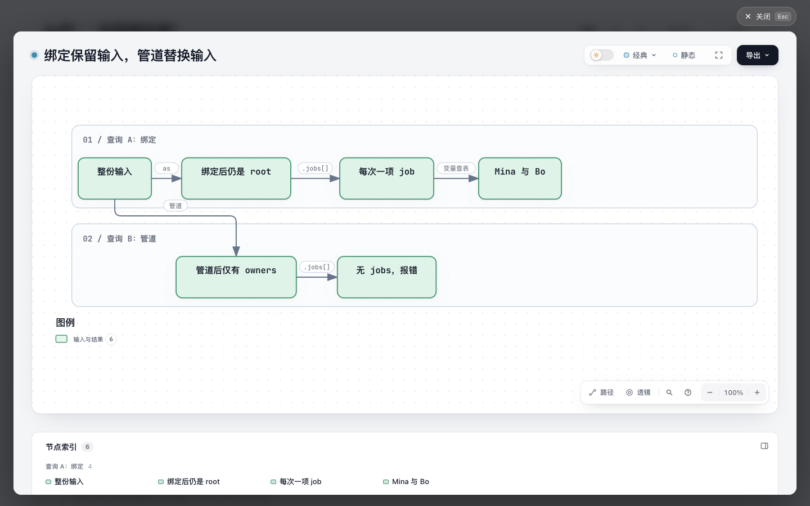
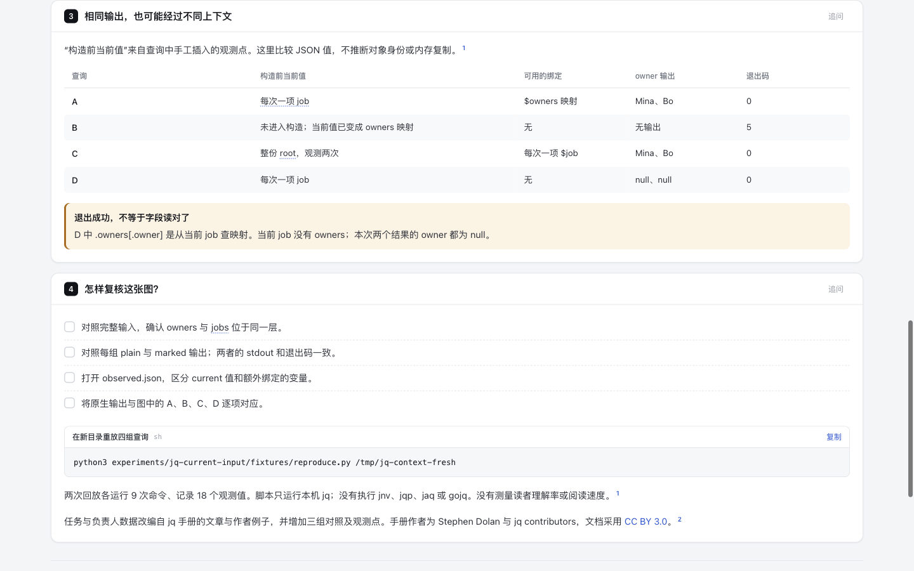

# jq: what does `.` mean at this point?

Bounded reading experiment based on four queries over one small task/owner fixture. It reuses Archify's explainer and guided diagrams; no jq interpreter, parser, importer, or product runtime is added.

## Evidence and value

The two correct queries produce identical JSON, while their current inputs differ before constructing the result. A third query fails with exit 5. A fourth exits 0 but produces `owner: null` twice. An output-only preview cannot show the different intermediate inputs. A guided diagram may help a reader locate the context they accidentally replaced; reader comprehension and speed have not been measured.

`/usr/bin/jq --version` reports `jq-1.7.1-apple`. Its exact binary SHA-256 and all commands, elapsed times, exit codes, stdout and stderr are in `evidence/native-{1,2}`. This is not an assertion that the Apple binary equals the upstream tag. Each replay has one version command and eight query commands. Plain/marked output bytes and exit codes match; removing only the added DEBUG lines leaves the same stderr. Across fresh replay directories, all 18 paired output streams match after the explicitly recorded run-root replacement.

Markers were manually inserted in separate `.marked.jq` files. They expose values at those selected points, not every VM instruction or a general execution trace. Each run records 18 observations across four independent query executions. Two observations of an equal object do not prove object identity, copying, or memory allocation behavior.

## Reproduce

Requires an existing `/usr/bin/jq` with `debug(msgs)` support and Python 3; the script does not install anything. Use a fresh destination:

```sh
python3 experiments/jq-current-input/fixtures/reproduce.py /tmp/jq-context-fresh
```

Raw stdout is authoritative. `observed.json` is extracted from manually added DEBUG lines. The example uses authored public data, not a user's repository content.

## Source and attribution

- jq 1.7.1, commit `71c2ab509a8628dbbad4bc7b3f98a64aa90d3297`: Stephen Dolan and jq contributors. Code is MIT; documentation is **CC BY 3.0**, as stated in `upstream/jq/COPYING`. [Manual](https://github.com/jqlang/jq/blob/71c2ab509a8628dbbad4bc7b3f98a64aa90d3297/docs/content/manual/v1.7/manual.yml), [CC BY 3.0](https://creativecommons.org/licenses/by/3.0/). The task/owner fixture and first query adapt the manual's post/author binding example, changing names and values. The contrasting queries, markers and Chinese explanation were added for this experiment. Documentation adaptations retain that attribution and CC BY 3.0 notice; there is no claim of upstream endorsement.
- [jq issue #1326](https://github.com/jqlang/jq/issues/1326) remains open, but was created in 2017 and last updated in February 2017. It establishes historical reader difficulty, not current frequency. Its proposed language changes are not adopted. The pinned 1.7 manual already explicitly explains binding input semantics.
- jnv `9871ba34b611e3c1c559fdcb8d0bc227397c280e`: MIT, copyright 2024 jnv authors. README and Cargo manifest describe an interactive JSON viewer with **jaq**. Source-only screening; jnv was not run.
- jqp `c0c3a857231679bb6e8fb7dc7d57f8283d93d41a`: MIT, copyright 2022 Noah Gorstein. README and Go manifest describe an interactive playground using **gojq**. Source-only screening; jqp was not run.

All nine upstream files are complete and byte-verified against Git blob identities and lengths, with SHA-256 in `sources.json`. Their licenses remain alongside them. Native jq evidence must not be attributed to jaq, gojq, jnv, or jqp.

## Decision and limits

Accept only a fixed teaching artifact using existing Archify capabilities. Defer a generic step evaluator, query editor, engine adapter, and automatic trace importer: each needs language semantics and engine/version compatibility beyond these four cases. The manual plus native diagnostics is the lower-cost baseline. The artifact's additional value is a visible current-input comparison, not a demonstrated improvement over that baseline.

No live installation, release, site publication, PR, or merge is part of this experiment. The authorized delivery is an isolated `codex/` remote branch.

## Artifact and visual verification

Open [explanation.html](explanation.html), or serve the checkout with an existing Python HTTP server. The authoritative source is `candidate.explainer.json`. Regenerate with an existing compatible Archify development environment and Node 22:

```sh
node archify/bin/archify.mjs finalize explainer experiments/jq-current-input/candidate.explainer.json experiments/jq-current-input/explanation.html --repo-root . --json
python3 experiments/jq-current-input/audit.py
```

The first Markdown draft compiled successfully. Its default workflow legend called the value nodes “Agent logic”; this was misleading for the query comparison. The final JSON uses the existing per-artifact legend override “输入与结果”, removes decorative icons, and labels lanes A/B. No renderer or default was changed. Both first-draft writing warnings were resolved; the initial Markdown, HTML, receipts and two screenshots remain in `evidence/`.

Final validate/deliver/check all passed, with no diagnostics. Explainer's automated browser gate is **not run**. Separately, six retained Ego scripts visited the actual generated HTML, inspected all six guided steps and their matching highlighted node IDs, ended the tour, opened the full native diagram, checked the corrected legend, read the pinned input source card, inspected all four queries and the four-row result table, and switched themes. All 13 PNGs were visually inspected. These are artifact checks, not proof of reader comprehension or an upstream TUI test.

At 1440×900 the diagram and its labels fit, and the code/table are readable. The sixth step's description is below the initial fold; it requires scrolling. At 390×844, page scroll width remains 390; the diagram thumbnail is small and the 544px table requires horizontal scrolling. The full narrow interaction path was not accepted or tested. See `evidence/visual-review.json` for the exact observations.

Initial remote inventory contained 332 heads. Neither research hub had jq/jnv/jqp findings under the bounded searches. The issue search matched closed #48 solely because its reproduction uses `gh --jq`; it concerns missing packaged examples and does not duplicate this context-reading experiment. The corresponding jq PR query found no matches. One unqualified search was rejected with HTTP 422; that failure and the corrected query are retained. Task-view remains at `a3fa21767bfaeb3077fdda08bddb7249366caa93`; existing task-view work is not repeated.




