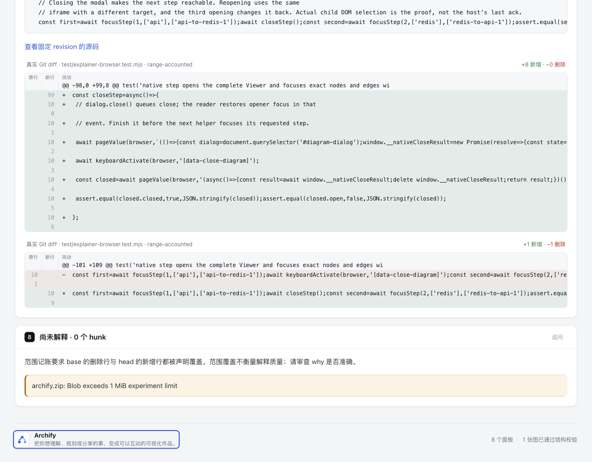

# 键盘门禁：多走几步，末尾控件本来可达

修正实际Tab遍历的提前停止。相同HTML在base的浏览器门禁报30条末尾控件未达；继续真实Tab后，50个初始目标全部可达。本分支只修检查器，不改Reader、作者图、布局或PR代码。

## 固定问题与同源证据

基线 `82c7e0f089a02a4d514714adf37dc2061682da5f`。来源是[task-review-map手写布局派生](https://github.com/tt-a1i/archify/blob/dcedd53856b82d3e403a9651dca0e15840496942/experiments/task-review-map/pr-1097/authored-layout/README.md)，不是执行PR #1097源码或测试。固定HTML复制为[pr1097-authored-layout.html](fixed-inputs/pr1097-authored-layout.html)，625,151 bytes，SHA-256 `bf30fb5bda006c2d4a961bae4a0677c26aba91ec42379a816e5b7ffff15f28e6`；本次未改一个字节。

base先枚举50个初始控件，只发送`count+3=53`个Tab。页面还有6个动态SourceCard链接和9个原生PRE/DIV滚动焦点，未计入初始控件数。1280px下，第53步只有42/50，但第65步已达50/50；1440px下64步完成。原30条是8+7+8+7个缺失观察，来自浅/深色×两个宽度，不是30个独立坏控件。

最小无JS触发：[native-scrollers.html](fixed-inputs/native-scrollers.html)只有First按钮、4个不写tabindex的原生滚动PRE、Last按钮。base计2个控件，5步后误报Last；第6步真实Tab可达。它没有陷阱或自定义焦点代码。

[派生证据账目](evidence-summary.json)保留base失败、新结果及原始receipt hash；完整raw文件在checkout外，不公开本机路径，也不覆写旧实验的失败。

## 最窄修复

`archify/explainer/browser-check.mjs`冻结初始必达元素的真实DOM身份。动态clone即使复制qaKey，也不能冒充原目标；后续隐藏/移除目标不会缩减要求。

遍历记录真实焦点身份和document.hasFocus。到达新的必达目标后，重置循环判断，允许不同SourceCard opener复用浮层链接。普通anchor/button/summary在没有新目标进展时重复，才提前报告focus-cycle。INPUT日期子字段、SELECT/textarea及frame/shadow/container等可能遮住内部焦点的host不作这一强判，继续同一有限预算；没有递归frame或UA shadow模型。

所有Tab与radio ArrowRight统一计步。工作上限为`初始目标数 + min(初始DOM元素数, 1024) + 3`，从实际静态文档规模预留额外焦点工作，不用任意倍数把失败变pass。无限新焦点仍会耗尽预算；此时fail保留，并写“reachability unconfirmed”，不能声称已证明不可达。diagnostic保留termination、steps、stepLimit、count与reached，修法只提示检查真实键盘顺序/焦点处理再验证。

成功仍要求全部初始目标被真实键盘到达；没有程序化focus补齐目标，没有屏蔽诊断、删控件或调整tabindex。短寿命CDP闭包保存身份，finally释放，不新增Reader全局状态或产品schema。

## 验证结果与负例

- canonical Node 22.23.2 / zlib `1.3.1-e00f703`：完整`test/explainer-browser.test.mjs`在v3算法上19/19、零skip。最后仅窄收budget诊断措辞/measurement后，重跑相关10子case及父测试，11/11、零skip；不为文字变化重跑全仓。
- 正例包括原生滚动区、真实SourceCard、多opener复用浮层、iframe、closed shadow、原生date子字段、radio箭头。
- 负tabindex、真实Tab trap、隐藏/clone初始目标、无限新增焦点仍失败；work有限。review曾发现iframe及date父activeElement重复的新误报，已补正例并保守修复，未隐藏该过程。
- core smoke19/19。首轮因新WT缺parse5而未收集成功，保留raw失败；比对root package-lock字节相同后临时复用已安装依赖补跑，未下载或改lock，依赖link已移除。
- 在**同一个原HTML**上调用本地`runBrowserCheck`，4个视口/主题均50/50，分别65/64/65/64步，diagnostics=0；来源HTML hash保持不变。这是新浏览器观察，不是重新deliver或四gate finalize，不补造current delivery provenance。
- canonical ZIP双构建逐字相同；与base inventory相同，只有`archify/explainer/browser-check.mjs` entry变化，解包源码与最终源码逐字一致。解包模块的原生滚动正例/真实trap负例均保持预期。

聚焦选择保护的是可达性结果与负例，不断言某个tabindex实现字符串或自动布局坐标。仅测试直接责任文件及core smoke，没有全仓/fullsuite、全浏览器矩阵或Windows结论。ZIP是本分支新打包，不解决历史PR mapping中的ZIP未知项。

## 实际图片：外观没有改

协调Agent在既有EgoSpace4对相同HTML直接Tab65步，于1280×1000浅色视口到达footer，已实际查看下图。[原始Tab轨迹](screenshots/actual-tab-trace.json)与[capture绑定](screenshots/capture.json)保留该观察。不是before/after视觉改版，也不是鼠标点击或程序化focus补达。



图片中另有diff行号换行问题，由独立分支诊断；本分支不修它。agent实际观察不等于人类验收、阅读效率或PR代码正确性。

## 复现

使用可信的本repo checkout。以下只读取冻结HTML并运行Archify自身浏览器QA，不执行其中展示的PR代码。Node路径按本机工具链替换；raw输出目录每次新建。

```sh
ARCHIFY_EXPLAINER_BROWSER_TESTS=1 node --test test/explainer-browser.test.mjs
node --test test/core-smoke.test.mjs
KEYBOARD_EVIDENCE=$(mktemp -d)
node --input-type=module - "$KEYBOARD_EVIDENCE" <<'JS'
import fs from 'node:fs';
import path from 'node:path';
import {runBrowserCheck,findChrome} from './archify/bin/visual-check.mjs';
const result=await runBrowserCheck({
 artifactPath:path.resolve('experiments/keyboard-traversal/fixed-inputs/pr1097-authored-layout.html'),
 outDir:path.join(process.argv[2],'browser'),chromePath:findChrome()
});
fs.writeFileSync(path.join(process.argv[2],'result.json'),JSON.stringify(result,null,2),{flag:'wx'});
console.log(result.exitCode,result.receipt.status);
process.exitCode=result.exitCode;
JS
```

原始HTML的3个静态gates证据由原实验提供；本分支的`runBrowserCheck`重测HTML本身，不把复制后的文件伪称current delivery。最低触发与真实trap可替换artifactPath单独检查；它们是普通HTML，public inspector结果与Explainer完整交付门禁需区分。

## 相关工作与仍未通过的事情

核查了[#898](https://github.com/tt-a1i/archify/issues/898)（Native toolbar方向键）、[#1068](https://github.com/tt-a1i/archify/issues/1068)（Explainer窄屏toolbar initiative）、[#1015](https://github.com/tt-a1i/archify/pull/1015)（SourceCard等阅读扩展）及[#1097](https://github.com/tt-a1i/archify/pull/1097)（pie行号及后续modal测试同步）。本轮搜索未发现同一个`count+3`遍历预算修复；这些工作不是本修复已经合入的证据。实现范围由维护者在本研究会话明确授权，未另发GitHub消息。

原task-review输入依然`mappingComplete=false`、mapping exit1，`archify.zip`因1MiB限制unresolved，PR tests/build未运行。本分支通过键盘检查**不能改写为PR通过、完整mapping或ZIP内容已核实**。原README/receipt不回填，原HTML完全不变。

源代码与本实验原创fixture遵循本仓MIT；固定HTML来源与原mapping内容见上游实验记录。远端CI、合并、发布和安装未执行；本地commit/push状态以协调者最终回报为准。
