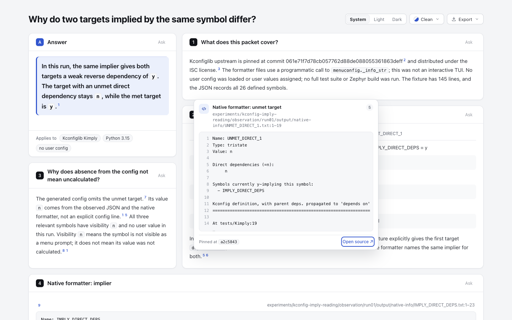

# Transfer check: complete Kconfig reading pages

The existing checker candidate handles the Kconfig pages without editing their HTML. Current dev reports 28/52 keyboard traversal diagnostics; substituting the existing candidate checker makes both browser checks pass across 1280×900 and 1440×900, light/dark. The genuine Tab trap still fails. This adds evidence to the existing direction, not another checker implementation.

This is an explicitly derived runtime comparison: `d5d979493bba650b3995836afd379cd249f2d0dd`'s `archify/` tree versus the same tree with only `archify/explainer/browser-check.mjs` from `f9fc38cbc19f5bb2725fd54d957e182831eb1eb9` substituted. All 238 runtime file identities were recorded before and verified after execution; only that module differs between arms. It is not a Git merge, refreshed release ZIP, complete finalization or full current-dev integration test. The candidate branch's product code and ZIP were not changed.

## Fixed inputs and results

The two complete pages come byte-for-byte from [Kconfig experiment 6cf0b813](https://github.com/tt-a1i/archify/tree/6cf0b8138ced63f7a991d4c2c621e3f3dd2cce2f/experiments/kconfig-imply-reading). They preserve the complete 145-line fixture, 26 observed values, three native formatter outputs, generated config and original ISC license. No Python observation was rerun. Archify-derived scripts and the pre-existing trap fixture follow this repository's Apache-2.0 license; the embedded Kconfiglib source retains its separate ISC notice. Source revision and attribution remain in both HTML files.

| Input | Current dev | Current dev + existing checker | Preserved bytes |
| --- | --- | --- | --- |
| Native evidence baseline | 35/42 initial targets reached; 28 diagnostics over four views; exit 1 | 42/42, 52 steps, limit 329, complete in all four; exit 0 | SHA-256 `dc6ee6dadbf3b6b2e13558a26ae8dd496bd1b640a32481bdfcdeaa2489d6f32e` |
| Explanation comparison | 42/55 reached; 52 diagnostics over four views; exit 1 | 55/55, 74 steps, limit 428, complete in all four; exit 0 | SHA-256 `60b73e6a59074e12c94be141f9b49d72223950c4a6d12661462b8d8c183a97ef` |
| Existing Tab trap | Last target remains missing | 1/2 reached, focus-cycle at 2 steps, limit 12; still fails | Complete original fixture retained |

The two full pages use `runBrowserCheck`. The small trap uses the existing `inspectPublicHtml` API at 1280×900 because it is ordinary HTML, not a complete native diagram or Explainer. This is not an additional full-page gate pass. The harness ran serially with Node 22.23.2 and Google Chrome 156.0.8078.48; stderr was empty. Per-call seconds are diagnostic runtime only, not an authoring or reader-speed comparison. Full receipts and compact outcomes are saved in `evidence/`.

The source diagnosis predicts the result: dev stops at initial target count + 3 despite dynamic source-card links and a browser-native scroll stop consuming additional Tabs. The existing candidate still requires all initial targets and bounds its work. Reaching static targets does not prove every dynamic action usable, so the actual source-card interaction was checked separately.

## Actual source-card keyboard path

The same unchanged explanation HTML was opened in Ego at 1440×900 and 390×844 CSS pixels. Native Tab reached the unmet-target citation in its comparison panel after 20/21 presses, then entered the card's Open source link. Escape hid the card, returned to exactly that citation and retained the measured scroll position. The next Tab reached the adjacent met-target citation and opened its card. No `focus()` call, mouse click or external-link navigation supplied those results. The archive contains the full action trace and both images; this checks one targeted citation path, not AT support or every popup interaction.



[390px actual focus capture](screenshots/card-mobile.png). The narrow-view toolbar overflow and awkward table wrapping remain separate existing concerns. This candidate does not change those pixels. The images show the original Reader, not a new visual design.

## Reproduce without replacing the old evidence

Use a trusted checkout with both pinned commits, an existing Node 22.23.2/Chrome and already available repository dependencies. The following creates a new temporary comparison and runs the same browser entry points. It does not install software. `reproduce.mjs` adds a runtime-root argument and hash preflight to the executed harness; the exact original harness remains in `evidence/executed-harness.mjs.txt`.

```sh
kconfig_transfer="$(mktemp -d)"
mkdir "$kconfig_transfer/base" "$kconfig_transfer/candidate"
git archive d5d979493bba650b3995836afd379cd249f2d0dd archify | tar -x -C "$kconfig_transfer/base"
cp -R "$kconfig_transfer/base/archify" "$kconfig_transfer/candidate/archify"
git show f9fc38cbc19f5bb2725fd54d957e182831eb1eb9:archify/explainer/browser-check.mjs > "$kconfig_transfer/candidate/archify/explainer/browser-check.mjs"
for kconfig_arm in base candidate; do
  ln -s "$PWD/node_modules" "$kconfig_transfer/$kconfig_arm/node_modules"
  ln -s "$PWD/archify/node_modules" "$kconfig_transfer/$kconfig_arm/archify/node_modules"
done
cp -R experiments/keyboard-traversal/kconfig-transfer-d5/fixed-inputs "$kconfig_transfer/inputs"
cp experiments/keyboard-traversal/kconfig-transfer-d5/evidence/setup.json "$kconfig_transfer/setup.json"
node experiments/keyboard-traversal/kconfig-transfer-d5/reproduce.mjs "$kconfig_transfer"
```

Outputs must go to a fresh directory. The `.mjs.txt` Ego record contains historical space/path placeholders and is an inspection record, not an unattended replay script. To reproduce UI observations in your own browser, use native Tab to the comparison's unmet-target citation, Tab into its source card, Escape, then Tab to the next citation.

## Evidence and limits

`manifest.json` binds the public files except itself. Large JSON is deterministic gzip; `gzip -dc FILE.json.gz` reads it. `public-copy-map.json` binds original/public/stored identities and records path-only redaction. HTML and PNG bytes are unchanged. The 238-file setup inventory is a source-identity check, not a test suite. Original raw records remain outside the repository; public copies are archival evidence, not relocated live delivery receipts.

The Kconfig branch's original failed finalize receipts remain true for its original runtime. This comparison does not overwrite them or claim complete finalization under a merged current branch. It supplies a previously missing transfer case for the existing checker. No new product code, PR, full suite, ZIP build, hosted CI conclusion, human reading study, live installation or contributor-branch edit was made for this packet.
