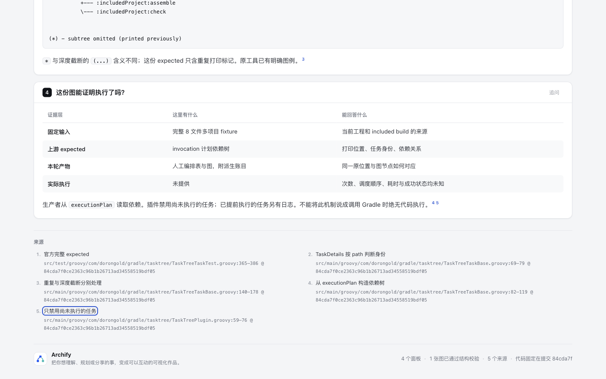
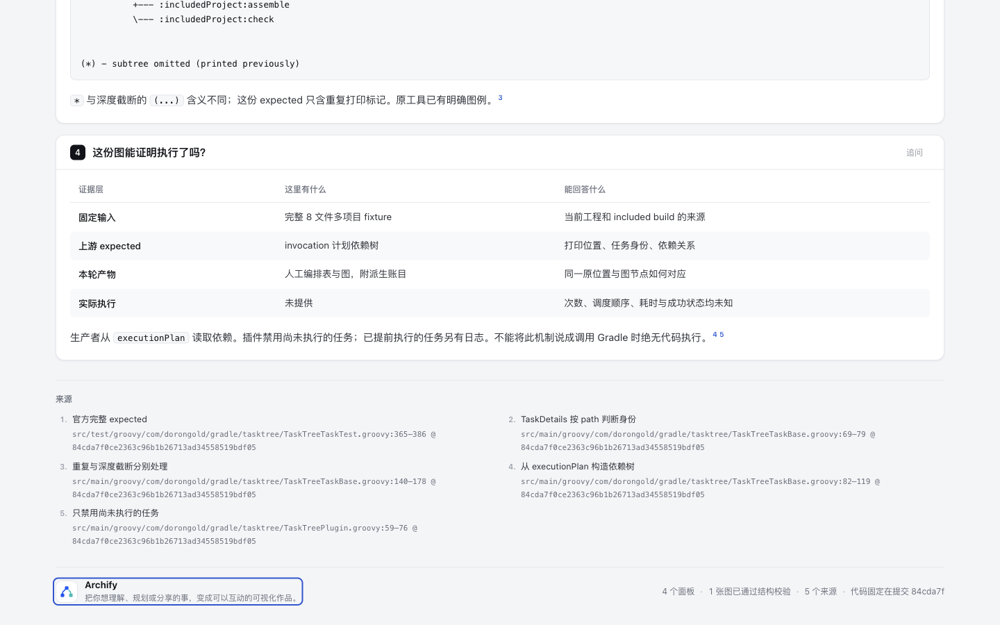
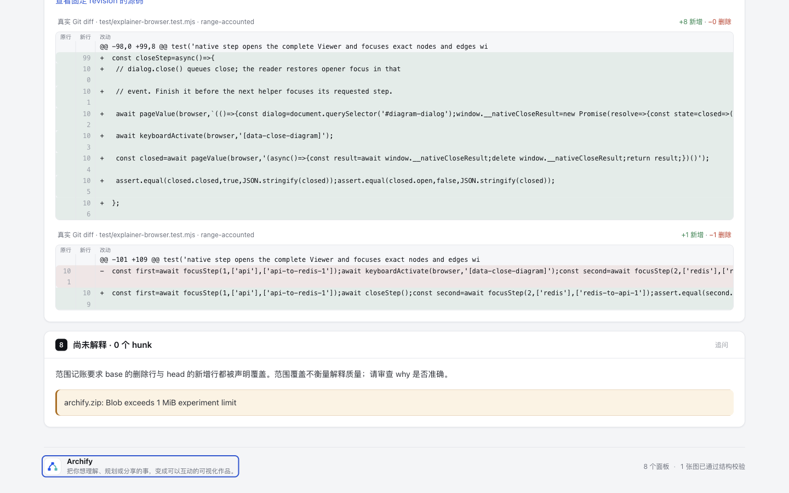

# Keyboard traversal：固定 dev10b4 刷新

基线为 `10b4dd5c5f2264baa315ee65a9b4cc23c13ea5f0`，正常 merge 到原 `codex/lab-keyboard-traversal`，原候选 `d930863147cd6adfb5d4275f011c06caf4b24f92`。本目录是新基线证据；历史八份实验文件保持原字节及原始身份，不改写旧结果。

本轮继续只修浏览器 QA 的初始 DOM 身份与额外 Tab stop 工作预算，不改 Reader、Viewer、HTML、焦点顺序、schema 或 gate 的成功条件。新 dev 的 dialog `closeStep` 等待及其它行为保留。只要有初始目标未真正到达就失败；clone 不能冒充原目标，隐藏/移除也不减要求，预算耗尽仍 fail 并写可达性尚未证实。没有通过程序化 focus 补齐目标，也没有扩大可接受的错误范围。

## 同一 HTML 的两个独立比较

1. [旧 PR1097 页](../fixed-inputs/pr1097-authored-layout.html)：625151 bytes，SHA `bf30fb5bda006c2d4a961bae4a0677c26aba91ec42379a816e5b7ffff15f28e6`，来自 [task-review-map@dcedd538](https://github.com/tt-a1i/archify/tree/dcedd53856b82d3e403a9651dca0e15840496942/experiments/task-review-map/pr-1097)。仍是原布局派生的阅读产物，不是执行 PR 源码或测试。`mappingComplete=false`、ZIP unresolved 不变。
2. [Task occurrences 页](fixed-inputs/task-occurrences.html)：682434 bytes，SHA `d10eeda28faccc4c8f95bed699e5e4c67b259006d7f3a2d66af92122aa9a3b48`，逐字来自 [task-occurrences@caffb4aa](https://github.com/tt-a1i/archify/blob/caffb4aabb13b04a77bb9475866ad65465d79b20/experiments/task-occurrences/output/explanation.html)。它解释上游提交的 expected output；不是本轮 Gradle 执行或自然用户工作负载。

两臂读取完全相同文件，未重新渲染、更换页面标签、删控件或后处理 HTML。base 由 `git archive` 固定 dev10b4 产品代码运行；candidate 由合并后的产品代码运行。两臂各实际调用 `runBrowserCheck`，另用同一真实 `inspectPublicHtml` 记录四个 width/theme 的到达数和步数。原始收据与日志保留在 checkout 外；[evidence-summary.json](evidence-summary.json) 只公开选取字段与原件 hash，不冒充原始 CLI receipt。

| 页面 | dev10b4 | candidate | 意义 |
| --- | --- | --- | --- |
| PR1097 | 30 条 keyboard diagnostics；1280为42/50、1440为43/50 | 0 diagnostics；四臂50/50，1280为65步、1440为64步 | 继续真实 Tab 可以到达原来的末尾控件 |
| Task occurrences | 16 条 keyboard diagnostics；四臂37/41 | 0 diagnostics；四臂41/41，48步 | 本次实际复现的新内容页提前停止误报 |

四臂是 1280/1440 × light/dark，height 900。30 与16分别属于不同页面，各为多个 viewport 中同类缺失观察的总数，不是46个独立坏控件。baseline 不提供 steps/stepLimit，未从外部补造这些字段。候选记录的工作上限分别995和624；实际完成后即停止，没有把预算用完当成功。`runBrowserCheck` 成功不是重做 deliver/finalize，不表示这些复制文件有本次 current delivery provenance。

## 聚焦结果与真实负边界

- 官方 Node 22.23.2，bundled zlib `1.3.1-e00f703`。合并后完整 `test/explainer-browser.test.mjs` **19 passed / 0 failed / 0 skipped**，包含新 dev 的原生 close 等待、source-card/native正例和既有 traversal 十个子 case。
- 原生滚动区域、动态 SourceCard、复用浮层链接、frame/closed shadow、日期子字段、radio 仍可到达；负 tabindex、真正 Tab trap、隐藏/clone 初始目标、无限新焦点仍按各自失败合同受保护。
- 把最终 traversal 测试复制到临时原 dev 产品树运行，得到4 pass/7 fail（含父测试）。其中原生滚动区和 SourceCard 是可达性误报，隐藏目标暴露身份要求的差异；trap/budget/radio 的失败涉及旧结果缺少新增 measurement/termination 字段，不能称为三个额外可达性缺陷，也不把父测试计作独立问题。原始失败日志完整保留。
- core smoke **19/19**。Viewer、brand marks、validators、release identity 四项生成/身份命令退出0；没有据此声称全量 golden、四份 docs freshness 或全仓通过。最初误用根 scripts 路径调用 brand/validator，出现 module-not-found；按包内真实命令修正后通过，错误日志保留，没有修改产品绕过。
- 未安装依赖或改 lock；临时复用既有依赖 symlink，完成后移除。无全仓 suite、hosted CI、Windows、全浏览器、AT 或人类验收结论。聚焦测试通过不排除所有异步 race；没有更改 dev 的 close 等待来消掉失败。

## 包与交付边界

唯一 merge 冲突为 `archify.zip`，最终以正常源码构建解决，没有选取旧二进制替代新 dev。两次 canonical 构建逐字相同，235个成员，CRC通过；与固定 dev 的 ZIP inventory 相同，仅 `archify/explainer/browser-check.mjs` 的 bytes 不同，且逐字等当前源码。新 dev 的其他包内容和法律声明全部保留。[ZIP摘要](zip-summary.json)。精确解包模块另外实际通过原生滚动正例和真实 trap 负例。

本次没有共享生成 HTML 改动，checker 不嵌入这些页面；没有为了刷新 gate 修改既有页面。软件包不是对 PR mapping 的 ZIP 内容审查。原始来源和许可记录继续见历史实验及两个固定内容分支；本次产品软件沿用新 dev 的 Apache-2.0/保留 notices，未复制第三方实现。

## 实际截图

Root 已在既有 Ego / Chromium、1440×900、light 下实际操作并逐图查看三张 PNG。先真实 pointer 点击 h1 设置 BODY 起点，随后只按 Tab：task 页第42–46次分别到五个页脚来源、第47次到品牌；旧 PR 页第63次到品牌。没有程序化 focus、ArrowRight、外链激活或本次 checker 执行。[派生 capture](screenshots/capture.json) 和 [安全轨迹投影](screenshots/tab-observations.json) 记录原件指纹；原始轨迹仍留在 checkout 外。

这与检查器起点/动作不同：1440 下 checker 的 task48步/PR64步仍单独保留，不能用 root 的47/63改写或替代；两者不是重复运行同一测量。三图只证明相同 HTML 的真实 Tab 可以到末尾，没有视觉改版。旧 PR 图里仍有历史 diff 行号换行，本分支没有引入或修它。没有阅读收益、AT 或人类验收结论；历史截图继续绑定原候选。

| task 页最后来源 | task 页品牌 |
| --- | --- |
|  |  |



## 复现

使用 canonical Node 与现有项目依赖，不安装 live Skill。原始输出放全新 checkout 外目录；页面文件只读，浏览器 QA 会运行 Archify 页自身脚本，不执行其中展示的 PR/Gradle 程序。

```sh
ARCHIFY_EXPLAINER_BROWSER_TESTS=1 node scripts/run-tests.mjs --require-files test/explainer-browser.test.mjs
node scripts/run-tests.mjs --require-files test/core-smoke.test.mjs
node scripts/generate-viewer.mjs --check
node archify/scripts/generate-brand-marks.mjs --check
node archify/scripts/generate-validators.mjs --check
node scripts/check-release-identity.mjs
bash scripts/build-zip.sh '<first-fresh.zip>'
bash scripts/build-zip.sh '<second-fresh.zip>'
```

实际 `runBrowserCheck`/`inspectPublicHtml` 参数、原件指纹及两页分开结果见摘要。本地验证对应上述冻结源码与产物，远端 CI 需另核，不能挪用新 dev 原有 CI。本轮验证不构成合入 dev、release 或 live 安装。
