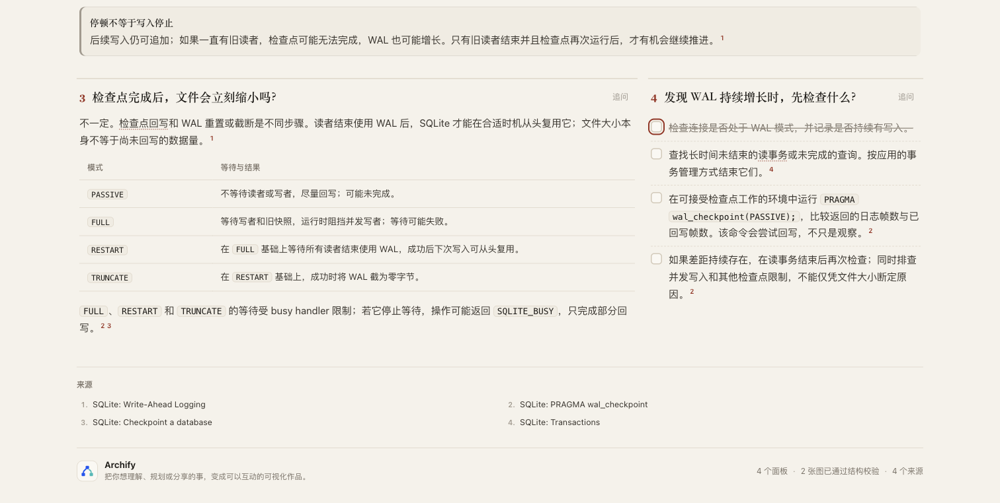
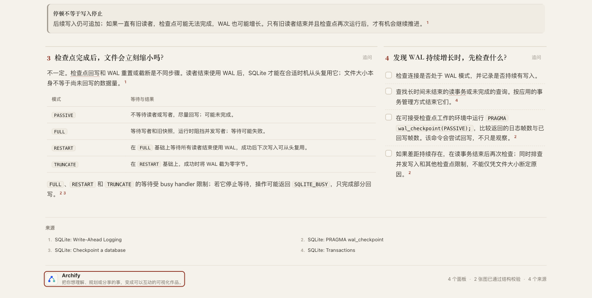

# SQLite 页面上的键盘检查器迁移验证

2026-10-29。相同 HTML 在固定 dev 检查器下报告 28 项键盘遍历诊断，换入既有修复后四个视图都到达 43/43 个初始目标，完整 browser-check 返回 pass。真实 Tab 陷阱仍失败。**只补既有方向的证据，没有修改检查器、Reader、输入页面或 ZIP。**

## 固定输入与比较范围

本批开工核对 336 个远程 head，发现已经存在的 [Explainer reading laboratory](https://github.com/tt-a1i/archify/tree/0f36a3a9af85f87c694b801f445cf9ae8750e8e0/docs/experiments/explainer-reading)。该实验的两个独立作者产物中，SQLite 页面保留了 28 项键盘诊断；原报告明确没有证明 #1124 能修复它。本批使用其完整页面填补这一验证缺口，不重复实现阅读页面或编辑来源分支。这是另一作者任务的产物，不是自然用户事故或真人阅读实验。

- 输入：[完整 HTML](fixed-inputs/candidate.html)、[原稿](fixed-inputs/candidate.archify.md)，来自 `0f36a3a9af85f87c694b801f445cf9ae8750e8e0` 的 `docs/experiments/explainer-reading/sqlite/`。HTML 933,398 bytes，SHA-256 `3e305088b843be9e60c3a6442c63d717217fd266df975eb2cf4aab48de540073`，Git blob `6bda2c91719dbf2d8c7172cc70a1eac1c1d9c27b`。
- 基线：`5ecbd1bfdbf83ea747072112493c940e707569cb` 的完整 `archify/` 运行时快照。
- 比较臂：同一快照，仅替换 `archify/explainer/browser-check.mjs` 为既有 `3254fda4fcd61a101cc09e6b68fbdbb4d2779604` 的文件。
- [前后清单](evidence/run--setup.json.gz)记录 238 个运行时文件；运行前后 hash 一致，两臂恰好一个文件不同。依赖复用已存在且锁文件匹配的目录，没有安装。Node 22.23.3，Chrome 156.0.8078.49。

这是一份明确组合的临时运行时比较，不是 Git 合并、当前分支完整集成、重新生成／finalize、ZIP 或 CI 验证。来源仍是 [Archify Apache-2.0](https://github.com/tt-a1i/archify/blob/0f36a3a9af85f87c694b801f445cf9ae8750e8e0/LICENSE)，HTML 中已有的作者与软件通知原样保留；页面链接的 SQLite 文档没有被本批重新审计，也没有实际执行 SQLite 命令。

## 实测结果

每臂一次完整 `runBrowserCheck`，覆盖 1280×900、1440×900 的浅／深色四种状态；没有失败后修改输入或算法重跑。

| 输入与调用 | dev 原检查器 | dev＋既有检查器修复 |
| --- | --- | --- |
| SQLite 完整页面，四种状态 | 每种 36/43；合计 28 条 `explainer/browser-keyboard-traversal`；exit 1 / fail | 每种 43/43；55 步，预算 555，termination=complete；诊断 0，exit 0 / pass |
| 既有真实 Tab 陷阱，`inspectPublicHtml` 1280×900 浅色 | 1/2，ok=false | 1/2，2 步，预算 12，termination=focus-cycle，ok=false |

28 是四种状态各缺 7 个观察目标，不是 28 个独立损坏控件。基线回执没有 steps、stepLimit、termination，汇总保留 null；不把源码估算冒充观测值。小型陷阱是普通 HTML 的 inspector 结果，不是完整页面门禁。完整原始记录的归档副本见 [outcomes](evidence/outcomes.json)、[copy map](evidence/public-copy-map.json)，命令 stderr 为空。脚本整体退出 0 只表示比较执行完成，不能掩盖基线及负例的失败。

## 实际键盘操作与图片

Ego 浏览器在实际 1512×762 CSS 像素、浅色页面从 BODY 起点发送原生 Tab：55 步到页脚，43 个初始目标均被观察到。第 41 步进入首个清单项，空格将 unchecked 改为 checked，再按空格恢复。没有程序化 focus、添加 tabindex、鼠标补达或打开外部链接。完整 [DOM 观察轨迹](screenshots/keyboard-observation.json)与[执行脚本归档](screenshots/capture.mjs.txt)保留；脚本内本机输出目录被替换为占位符，原始／公开脚本 hash 见 [capture metadata](screenshots/capture.json)。





两张实拍均已打开检查。它们显示同一原页面，没有视觉改版；这一个桌面路径不证明移动端、辅助技术、所有动态交互或真人理解效果。自动门禁本轮没有请求截图，以上来自独立 Ego 操作。

## 复现与核验

在包含两个固定 commit 的可信 checkout 中，准备已有依赖、Node 22 和 Chrome，从仓库根运行以下命令；目标目录必须不存在。`setup.sh` 检查锁文件和固定输入 hash，不下载依赖。按本机位置调整其 Node 路径。

```sh
bash experiments/keyboard-traversal/sqlite-transfer-5ec/setup.sh /tmp/archify-sqlite-transfer-new
```

[reproduce.mjs](reproduce.mjs)是实际执行的比较程序。[setup.sh](setup.sh)在实测搭建脚本之后补入锁文件和输入 hash 的预检，最终脚本通过 shell 语法检查；没有重复浏览器运行。原样执行的搭建脚本也保存在 evidence 中。大 JSON 用确定性 gzip 归档，`gzip -dc FILE.json.gz` 可读；公开回执中的本机路径经替换，因此是证据副本，不是能直接交付到另一目录的实时回执。原始输出保存在仓库外。

`manifest-sha256.json` 绑定本目录除自身外的公开文件。已有 Kconfig 与最初实验的失败回执不回填，来源分支也不改变。没有新产品代码、测试套件扩写、全仓测试、打包、发布、安装或新 PR；已有 #1124 的分支仅增加此证据包。结果支持继续审查既有小修复，尚不是合并或全面可访问性验收。

AI assistance：Codex 组织核验与文档，gpt-6.1-terra（medium）执行隔离对照和归档；不代表人类审阅。

完整 staged whitespace 检查有 24 项，全部来自逐字节保留的来源 HTML；[原始诊断](evidence/whitespace.json)以无损 JSON 行数组保留，未清理输入。排除此 HTML 的其余 staged 文件检查通过。
