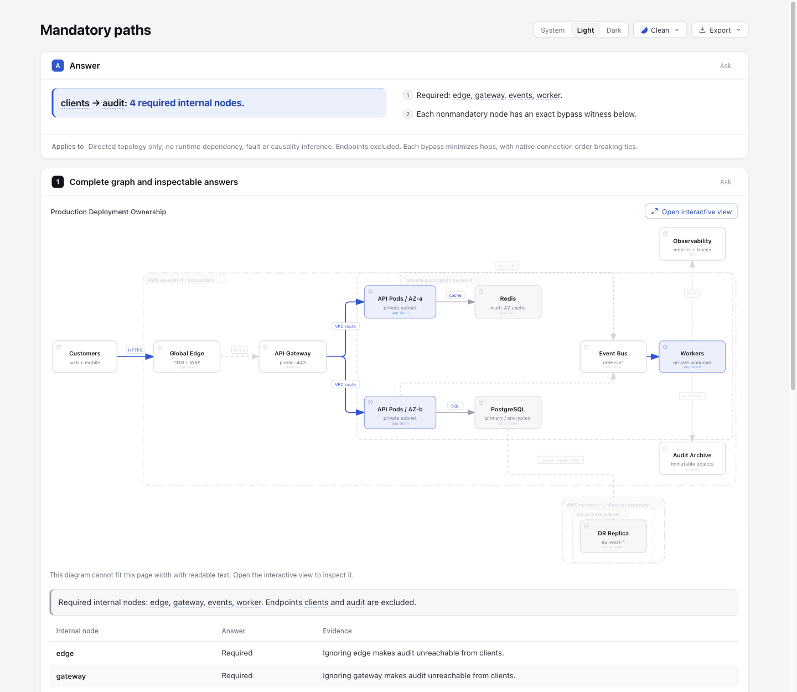

# Mandatory paths — isolated offline experiment

Given a complete native Architecture JSON and two distinct node IDs, answer which **internal nodes occur on every directed path** between them. This is a topology answer, with no fault, causality or runtime dependency claim.

```sh
node experiments/mandatory-paths/cli.mjs input.architecture.json clients audit /tmp/mandatory-paths-output
node --test experiments/mandatory-paths/mandatory-paths.test.mjs
```

Use supported Node 22 for the recorded verification. No install, shared schema or Viewer changes are included.

The CLI uses existing `prepareExplainerDiagrams` semantic extraction, verifies complete authored node/edge coverage and refuses native `id || key` identity collisions. All explicit `connection.direction` values are unsupported under the current schema; omit the property. Unknown endpoints, equal endpoints, malformed JSON and non-Architecture inputs are errors. An originally unreachable endpoint is a successful `status: "unreachable"` answer, with no internal-node classification; it differs from a reachable query with no required internal nodes.

An independently authored BFS first checks reachability, then ignores each internal node in turn. A node is required exactly when that removal makes the endpoint unreachable. Every nonmandatory node gets one deterministic shortest-hop bypass, breaking ties in native connection order and retaining the original edge objects, IDs and keys. Cycles terminate; parallel relationships are retained. Complexity is `O(V(V+E))`; no graph-size performance claim is made. This does not classify membership in simple paths or enumerate paths.

Each output directory contains the original bytes (`input.architecture.json`), unmodified native render (`full-native.html`), `answer.json`, and a normal native `explainer.json` / `explainer.html`. The complete presentation graph only adds stable unique `e-index` IDs where absent, preserving authored IDs. `answer.json` explicitly maps original keys and IDs to presentation targets. The CLI records actual subprocess commands, stage stdout/stderr, delivery and finalize receipts beside these files. The public renderer uses `standard` quality.

Compare the [unaltered native graph](evidence/reachable/full-native.html) with the derived result below. This is an offline exploration using existing native presentation; no Viewer behavior changes.

The [reachable artifact](evidence/reachable/explainer.html) answers `clients → audit`: required internal nodes are `edge, gateway, events, worker`. Avoiding `api_a` uses original keys `0,1,3,7,8,10`; avoiding `api_b` uses `0,1,2,6,8,10`. Redis, PostgreSQL, replica and observability remain in the complete graph and are only described as nonmandatory. The [unreachable artifact](evidence/unreachable/explainer.html) answers `audit → clients` separately.

## Evidence and provenance

Base: `6ca6a5c84439b57ea22e0630fe306e1d91587a6e`. The complete 12-node/12-edge fixture is the repository's authored [production-deployment example](../../archify/examples/production-deployment.architecture.json), unchanged byte-for-byte (SHA-256 `610a5614667e8f108bdcf1769c9d7af5c3ce0fb62be3ea50550b10eb752e4bda`). It is an authored example, not a runtime observation. The independent coordinator oracle is retained in [fixtures/full-fixture-oracle.json](fixtures/full-fixture-oracle.json).

The algorithm was written here, independently of upstream implementations. The native extraction/presentation wrapper adapts this repository's `experiments/shared-reach` wrapper at its isolated checkout; it has no runtime import from that experiment. Research references: [NetworkX immediate dominators](https://github.com/networkx/networkx/blob/2acf1590f82757c01a57b81b8c5dfb79e60aa416/networkx/algorithms/dominance.py) (BSD-3-Clause), [petgraph dominators](https://github.com/petgraph/petgraph/blob/c32a86b1b8c5c198079efc9149ea2fcf956b8f6c/src/algo/dominators.rs) (MIT OR Apache-2.0), and the eight-node topology described in [rustworkx's dominance test](https://github.com/Qiskit/rustworkx/blob/6565c2d1d6573198f067a6a015d1c097011e13bf/tests/digraph/test_dominance.py) (Apache-2.0). The small topology is a contract comparison, not an upstream implementation or binary execution. No Slither AGPL or igraph GPL code/fixtures were copied. New code follows the repository's Apache-2.0 contribution terms.

[verification-summary.json](evidence/verification-summary.json) is a public derived summary with exact source and artifact digests. Raw local absolute-path commands and receipts stay outside this checkout; they were not edited to look portable. The first test run rejected an invalid numeric authored ID before reaching the intended collision boundary; the corrected test uses legal duplicate authored IDs. Both runs are preserved in the local execution record.

Nine focused tests protect the full independent oracle, longer bypasses beyond the original shortest route, cycles, directed-versus-undirected distinctions, the eight-node reference topology, unreachable versus reachable-empty results, native parallel identity, presentation mappings, query failures and the real CLI/finalize path. This is local behavior evidence, not browser, visual, human acceptance, performance, install or release evidence. The original author-test summary predates the browser and independent review evidence below. Its README hash is a historical stage binding, not the hash of this packaging revision. The author-test phase did not commit or push; remote delivery is recorded separately.

## Recorded browser and independent review



Compare the [original native graph](evidence/reachable/full-native.html) and its [screenshot](browser-evidence/full-native-classic-light.png) with the [reachable result](evidence/reachable/explainer.html). The root agent inspected actual Ego browser pixels: [pointer selection for avoiding api_a](browser-evidence/bypass-api-a-light.png) visibly routes through api_b; Tab from api_a focuses api_b and Enter opens the [api_a route avoiding api_b](browser-evidence/bypass-api-b-keyboard-light-final.png). Escape returns focus to the triggering witness. Independent target binding verifies the exact native edge keys; iframe readiness was confirmed before the final keyboard capture.

[Dark overview](browser-evidence/reachable-overview-dark.png) and [light overview](browser-evidence/reachable-overview-light-final.png) were inspected. The [unreachable result](evidence/unreachable/explainer.html) and [screenshot](browser-evidence/unreachable-light.png) explicitly have no bypass links. At a [390px narrow desktop viewport](browser-evidence/reachable-narrow-dark.png), client375/scroll400 shows top-toolbar overflow; scope text wraps normally and the table scrolls at client317/scroll324. This remains a known limitation, not mobile acceptance. Native inline graph reports cannot-fit-readable, so the interactive view is needed.

All nine original PNGs are preserved. Two are superseded: the earlier overview captured during finalization, and the blank keyboard capture taken before new iframe paint. The blank file is a failed capture and cannot support acceptance. See the [browser evidence notes](browser-evidence/README.md) and [derived root observations](browser-evidence/root-observations.derived.json). No touch, AT, cross-browser or human acceptance is claimed, and public finalize browser-check did not run.

The [independent review](review-evidence/README.md) passed 49,154 bounded queries and 61,448 matching bypass witnesses using a separate simple-path oracle. Its initial byte-comparison failure and subsequent receipt-comparison mistake are retained; corrected provenance-aware binding passed without a source fix. The [author verification summary](evidence/verification-summary.json) and independent final-binding remain historical snapshots; this packaging revision did not rerun tests or regenerate HTML. Prepared HTML retains native sourcePath/baseDir and digest provenance into temporary generation directories; those artifact bytes are intentionally unchanged. JSON/log public derivatives use explicit placeholders and retain original hashes, never pretending to be original receipts.

AI disclosure: Codex (configured gpt-6.1-sol) implemented the isolated CLI, tests, output preparation and evidence packaging. A separate Codex agent performed the read-only correctness review; the root Codex agent operated the real browser and inspected screenshots. Human review has not been recorded. Scope and fixed-source research are recorded in the [Mandatory paths scout at research commit 2d47cb5](https://github.com/tt-a1i/archify/blob/2d47cb5e5994c1f7ca5b6b0fd4608261a2ab176a/docs/research/2026-10-28/scouts/mandatory-paths.md). This remains offline exploration with no shared Viewer change, product adoption, live installation or product release.
