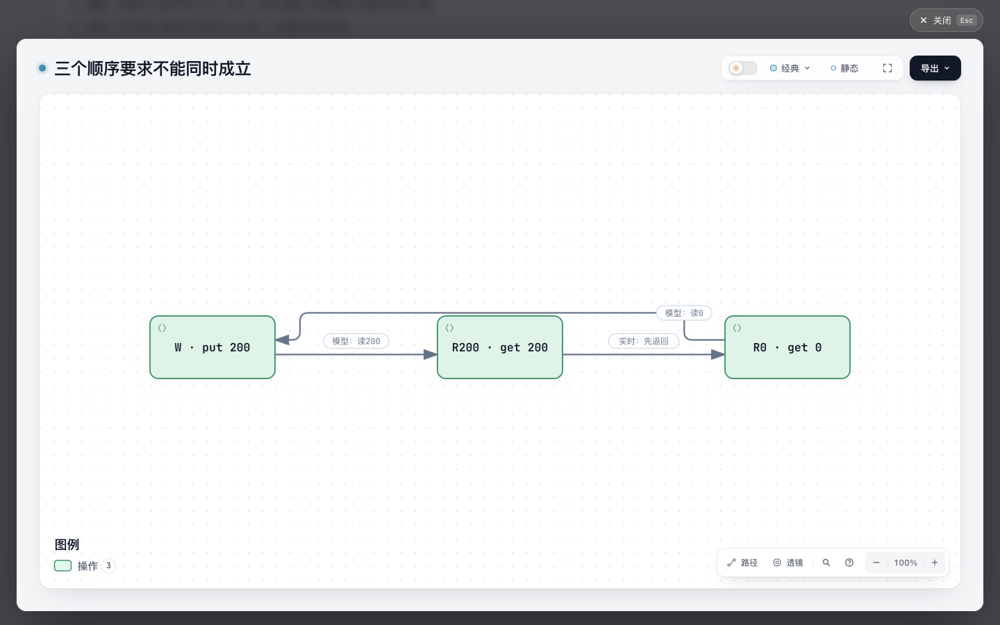

# 操作顺序约束：文字与图的对照

2026-10-29 跟进：[同输入 Porcupine 原生执行与交互对照](native-comparison/README.md)已完成。原六事件实际返回 Illegal；仅将最后一次读取改为 200 的对照返回 Ok，原生页面显示相应状态变化。下文“未运行 Porcupine”保留的是初轮事实；新证据没有改动两份旧 HTML，也没有证明约束图比文字或原生视图更易理解。

[三句文字基线](baseline.html) · [文字加约束图](explanation.html) · [源稿](candidate.archify.md) · [独立复核](audit.py)

当前图版已用现有原生字段把图例改为“操作”。下方八张历史截图仍绑定旧版 `4d0d21c6`；新版本已完成四阶段自动检查、[独立静态复核](legend-label-review/review.md)及[手动交互与三张新截图](legend-label-review/manual-review.json)。

Porcupine README 的说明例中，一次长写覆盖两次读取，但实时顺序与寄存器模型无合法排列。两个页面共用同一六行事件、初态、模型、三句解释和三候选枚举；后者增加三节点约束图。图边表示必须先于，带实时或模型依据，不表示调用、死锁或因果。事件位置是 ordinal，不是时间。上游 README 声明 checker 返回 false；本轮未运行 Porcupine。

这是固定内容实验，潜在价值是让读者一眼看到不同依据组成的矛盾；是否比三句文字更容易理解，尚未有读者比较。若无增益就保留文字，不主张新增共享功能。没有通用 parser、checker、上游依赖、schema 或 Viewer 修改。

来源 [Porcupine README @ 97cd067defd99df172053ba7f4ca5bbae57fe446](https://github.com/anishathalye/porcupine/blob/97cd067defd99df172053ba7f4ca5bbae57fe446/README.md#L56-L162)；完整原文和 [MIT 许可](upstream/LICENSE.md) 原字节保留于 upstream。README SHA-256 `4e79c7c7abe2ffc1d7888d7f24f91bf61f6f247d1041e54976c5045fbbdb3a58`，许可证 SHA-256 `a017c16b0beadd6686670ad3609a0130570e02fd8bd4f2d0ad18f46cedf76d1c`。README 的第三方 Jepsen 日志未复制。

## 复核与运行

基线 Archify `e837dc4cb83042d2b6c596e039692e25ec62c2da`，Node 22.23.3。`audit.py` 核对上游六事件字符串的相对顺序、模型关键字符串和结果声明，独立枚举硬编码模型的三个候选，以及图版源稿的限定语、原生 JSON 中三条边和图例标签。它不解析或绑定页面中的事件表、枚举表，也不校验基线共用段落；这些在本次独立源码复核中逐项核对。它不是通用模型检查器，也不执行上游。

```sh
python3 experiments/operation-order/audit.py
/opt/homebrew/opt/node@22/bin/node archify/bin/archify.mjs finalize explainer experiments/operation-order/candidate.archify.md experiments/operation-order/explanation.html --quality standard --json
/opt/homebrew/opt/node@22/bin/node archify/bin/archify.mjs finalize explainer experiments/operation-order/baseline.archify.md experiments/operation-order/baseline.html --quality standard --json
/opt/homebrew/opt/node@22/bin/node archify/bin/archify.mjs browser-check experiments/operation-order/explanation.html --json --require-provenance
/opt/homebrew/opt/node@22/bin/node archify/bin/archify.mjs browser-check experiments/operation-order/baseline.html --json --require-provenance
```

以下验证及实际对照保留 `4d0d21c6` 的历史身份；当前图例修正见末节。两次 finalize 的 validate、deliver、check 均通过，未请求 browser-check；首稿未改，保存在 draft-1。图版有三条写作提示、基线有两条，限定说明刻意保留。自动检查不证明视觉质量或用户收益。

单独对两个生成 HTML 执行 `browser-check --json --require-provenance`，均返回 pass、0 diagnostics、current provenance。图版 HTML SHA-256 `50127c55650797a2713ca2d09bcb74f0e14396db9fd9c9f4eb37da83918e459a`；基线 HTML SHA-256 `23f9b8bac86f37e888e6067f3ad4fa000d3de5a86797a4227f74c314faf58de6`。原始 receipts 含本机路径，留在 `/tmp/archify-operation-order-receipts/`；公开的[验证摘要与原件摘要](evidence/verification.json)是选字段派生记录，不冒充原始 receipt。

## 实际对照与决定

协调者实际打开两页、查看八张原始截图，并操作图版的主题、交互图和 Escape。详见[图片、范围和独立审查](root-review/README.md)。同为 1440×900 时，基线文档高 1526px、图版 1805px；文件分别为 156572 / 541210 bytes。新增图版块带来 279px 阅读长度和 384638 bytes 文件体积。

图把三条不同依据的约束画成可见环；三句文字与枚举表已能解释矛盾。390px 下文字基线仍直接可读，图版的小预览提示打开交互图。原生图的默认“后端”图例也不适合操作节点，应计为该表达复用的局限，不能据此扩展共享 schema。

本轮保留独立实验分支供比较，暂不创建 Draft PR 或提出共享功能。没有读者实验、理解速度或偏好结论；后续只有在更复杂的真实阅读任务中出现具体缺口时再评估。AI assistance：GPT-6.1-Terra 制作与调研，GPT-6.1-Sol 独立复核及浏览器观察。


## 图例标签修正

历史截图绑定 `4d0d21c6`，其默认图例为“后端”。本次使用已有原生 `meta.legend.entries.backend.label` 将它改成“操作”；不修改共享 renderer 或 schema。简写不能表达这一字段，改用 `@diagram` 引用完整原生 JSON，作者需要维护更多内容（原来 7 行指令和节点/边，现在是完整 JSON），这是一项内容维护成本，不是新功能。

直接序列化简写编译器返回的单列 spec 时，finalize 失败：两条边标签与节点重叠。简写原流程还会尝试自动三列候选；此次显式指定旧图实际采用的三列位置，再明确中文 locale（外部 spec 不继承页面 locale）。以实际 `prepareExplainerDiagrams` 捕获旧图渲染输入：将新 JSON 的 output / quality 归一为运行时值、移除 legend 后，两份原生 spec 完全相同。最终 SVG 与旧图逐字比较，**仅图例文字及其 data 标签从“后端”变为“操作”**；原始编译 spec 与新文件并非只差图例，布局与 locale 也有差异。两版共同正文没有变化，基线 HTML 与源稿的 SHA-256 未变。首轮失败和中间缺少中文 locale 的成功产物证据均留在 `/tmp/operation-order-legend-evidence/`。

最终图版的 finalize validate、deliver、check、browser-check 均通过；保留三条原有写作提示。固定模型 audit 通过，原始结果及浏览器 receipt 在同一临时证据目录；[派生验证摘要](legend-label-review/verification.json)记录最终文件摘要与检查，不冒充原始结果。[独立静态复核](legend-label-review/review.md)确认实际内嵌 SVG 只有两处标签值变化，外层标题与无障碍名称保持一致。当前图版为 537543 bytes，基线仍为 156572 bytes；旧页面高度不重新归因给新文件。

原 Ego 研究空间缺失后，用户于 2026-10-27 明确允许重建；重建空间返回 id 4。协调者以实际点击打开交互图，检查明暗主题下的“操作”图例与三条约束，再按 Escape 关闭，焦点回到“打开交互图”按钮。三张原始截图均为 1440×900，已逐张查看；[文件哈希、范围和操作记录](legend-label-review/manual-review.json)绑定本次 HTML。新页面实际宽 1440px、高 1805px；未重做手机或阅读效率对照。图是否提升阅读效率仍无证据，维持仅研究分支、暂不开 Draft PR 的决定。


