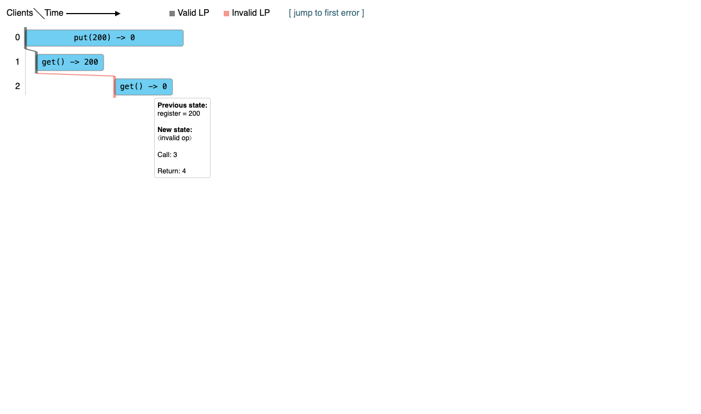
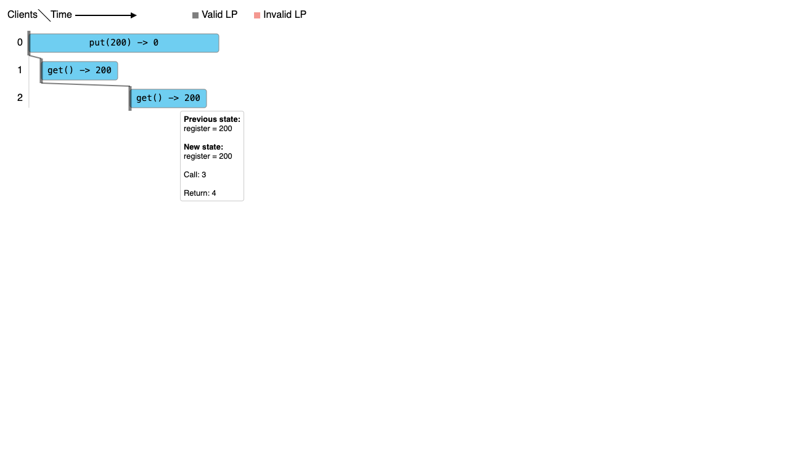

# Native Porcupine baseline for operation-order

2026-10-29, Batch 56. This closes the original experiment's “upstream checker not run” gap. It does not establish reader benefit or add an Archify checker.

## Fixed source and model

The experiment and current upstream head both pin **anishathalye/porcupine@97cd067defd99df172053ba7f4ca5bbae57fe446**. [sources.json](sources.json) identifies 11 exact files: every non-test root Go source, go.mod, the three embedded visualizer assets, README and MIT license. Each file was checked against its Git blob and byte length.

[build-probe.py](build-probe.py) extracts the register input type, model and second six-event example directly from the fixed README into [main.go](main.go). Init, Step and Hash remain the original definitions. DescribeOperation/DescribeState add human-readable native labels only. The put response 0 is an original placeholder; this model always accepts put and sets the register to the supplied value.

The second case copies the original events and changes only event ordinal 5 / index 4, operation ID 2's return value, from 0 to 200. It is an authored positive control, not another production trace.

The existing Go **1.27.2 darwin/arm64** compiled and ran the native package. GOPROXY/GOSUMDB were off, GOTOOLCHAIN was local, GOWORK was off and -mod=readonly was set. The package has no external module requirements; the harness uses a local module replacement. No package or toolchain installation occurred.

## Actual execution

| Input | CheckEvents | CheckEventsVerbose | Found sequence of operation IDs |
| --- | --- | --- | --- |
| Original six events | false | Illegal | maximal partial [0, 1] |
| Only last read changed to 200 | true | Ok | complete [0, 1, 2] |

[results.json](results.json) contains all twelve event records, both API results, partial/full sequences, toolchain and the 5-second verbose timeout. These are actual native results, not README expectations restated as execution. No timeout occurred; Unknown and incomplete histories were not tested. No live distributed system or Jepsen logs were run.

[run.log](run.log) records the first execution. A second native execution produced byte-identical results.json and both HTML files; [replay-check.json](replay-check.json) preserves before/after SHA256 and command/environment, with [replay.log](replay.log). Its elapsed duration includes compiler/cache overhead and is not a benchmark.

## Actual native UI

Open the generated standalone pages: [original](generated/original.html) and [positive control](generated/read-200-control.html). They were emitted by upstream VisualizePath, with embedded upstream JavaScript/CSS and generated data. The browser DOM exposed no external script/style URLs.

For the original, hovering the last read shows **Previous state: register = 200**, **New state: invalid op**. Clicking it retains a bold selected border after the pointer leaves. For the control, the same operation shows previous/new state both 200; the error jump link is inactive. The native UI already answers where this attempted continuation fails.





The native diagram's Time label is not measured wall-clock time here. CheckEvents converts event positions to zero-based indices. Thus native Call 3 / Return 4 correspond to the existing Archify table's event ordinals 4 / 5. The HTML contains an additional monotonic 0,100,…,500 rendering map. Neither these values nor linearization-point placement are observed internal execution instants or latency samples.

A chosen partial sequence explains this state transition; the native checker result, model and complete history support Illegal. Do not treat one highlighted path alone as a proof covering arbitrary models or all schedules. The original model's full three-edge contradiction remains an authored explanation, not a cycle emitted by Porcupine.

## Failed attempt and inspected scope

The first text-target hover failed because the native transparent target rectangle intercepted pointer events. [02-inspect-hover.log](browser/02-inspect-hover.log) preserves the error and observed DOM. The next script used the actual target-rect/data-index attributes; no page code was changed. All five PNGs were opened and inspected at 1291 × 762. This was mouse hover/selection testing, not a keyboard or accessibility audit.

The existing [audit.py](../audit.py) passed. It independently checks the fixed text/model and original three candidate orders; it is not the native checker. [existing-artifacts.json](existing-artifacts.json) binds the unchanged two Archify HTML files, their two source drafts and the diagram JSON. Their earlier rendering/browser results are historical evidence, not new runs here.

## Reproduce

From this directory, using an existing compatible Go toolchain and Python:

```sh
python3 verify.py
python3 build-probe.py
GOTOOLCHAIN=local GOPROXY=off GOSUMDB=off GOWORK=off go run -mod=readonly .
python3 -m http.server 8876 --bind 127.0.0.1
```

Open /generated/original.html and /generated/read-200-control.html. Hover the operation on client row 2 and compare previous/new state. Save fresh evidence separately if the toolchain changes. Stop the server when done.

All required upstream source files are committed; [fetch-sources.py](fetch-sources.py) is an optional exact-source recovery command, not a prerequisite or installer. It checks the fixed Git blobs. The captured Ego scripts reference the original absolute paths and owned space 3/page p1; adapt those for another owned session/output directory.

[verify.py](verify.py) checks archived sources, literal source extraction, exact event delta, native results, embedded visualization data, DOM observations, replay hashes, PNG dimensions and unchanged prior artifacts. It does not rerun Go/browser by itself. No Archify product suite, full upstream test suite, CI, reader timing or comprehension test was run.

## Value and disposition

The native view provides operation selection and model-state feedback for this same input. Archify's fixed handout can put raw events and three differently justified constraints together, but the native baseline further limits any claim that a new interactive reader is needed. Keep this as a bounded content experiment and comparison; do not add a parser, solver, shared renderer or general concurrency model.

The owned server was stopped and the research page returned to about:blank. [context.json](context.json), [remote-heads.tsv](remote-heads.tsv) and [NOTICE](NOTICE.md) retain duplicate-check scope and attribution. Only the existing experiment branch is advanced; no new PR, merge, release, publication or installation.
