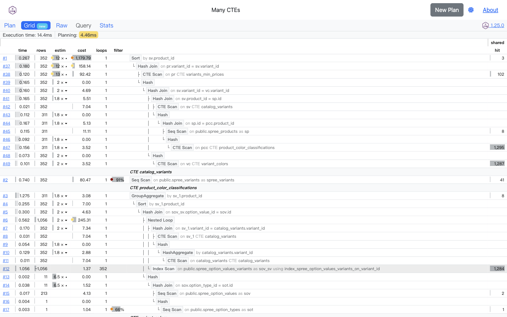
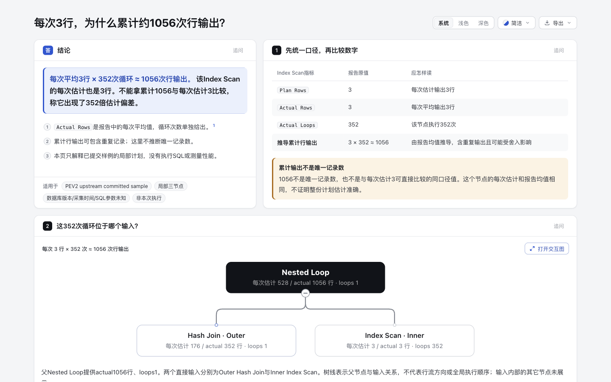

# PEV2 原生对照：保留讲解样例，不扩展计划解析器

2026-10-29，复看原实验 `91e2ffadb5cd46fc72d5da978a4b83f8c7dfe521`。**PEV2 已经显示累计行数、循环次数和平均值近似提示；本实验的增量是为一个阅读问题手工组织三节点、原字段、算式和来源。** 不能宣称 Archify 首次解决了循环计数，也没有证明它比完整计划查看器更高效。

## 同一输入与实际原生行为

运行的是官方 [v1.25.0 单文件版](https://github.com/dalibo/pev2/releases/tag/v1.25.0)，该 tag 解析到本实验已经固定的 `e41d4e8b3006c479f9364d68a5d538d81cb7d110`。原生页面显示 1.25.0。发布资产 SHA-256 与下载字节匹配；没有自行构建，因此不声称完成了源码到发布资产的可复现构建验证。

在本机回环地址打开 HTML，选择 **Sample Plans → Many CTEs → Submit**。这里 Submit 调用本地 IndexedDB，不是托管服务的上传按钮。内置输入框和 Raw 页文本分别读回，均为 67418 bytes，SHA-256 `a1c79b5782086474c73bd5ad2f7dd3265d73663f9030f5769638a4c2633cf6b4`，与 [原计划](../upstream/plan_many_ctes.json) 完全一致。Query 和 Comments 输入框均为空。

| 对应节点 | 原生 Grid rows / loops | 原生估计偏差显示 | 本实验保留的原字段 |
| --- | --- | --- | --- |
| #6 Nested Loop | 1,056 / 1 | 低估 2× | Plan Rows 528，Actual Rows 1056 |
| #7 Hash Join / Outer | 352 / 1 | 低估 2× | Plan Rows 176，Actual Rows 352 |
| #12 Index Scan / Inner | ~1,056 / 352 | 空白，没有 352× 警告 | Plan Rows 3，Actual Rows 3 |

这些编号只绑定此份计划在此版 PEV2 中的节点，不是跨计划身份；原 JSON pointer 仍以主 README 为准。



点击 Grid 的 #12 后，General 显示 **Rows: ~1,056 (Planned: ~1,056)** 和 **Loops: 352**。警告图标悬停后说明：多次循环的行数是平均值，因此累计量不能精确还原。原生已经提供这一限定。


固定源码 [plan-service.ts](https://github.com/dalibo/pev2/blob/e41d4e8b3006c479f9364d68a5d538d81cb7d110/src/services/plan-service.ts#L279-L295) 同时将 actual 和 planned 行数乘以观测到的 Actual Loops；[估计倍率](https://github.com/dalibo/pev2/blob/e41d4e8b3006c479f9364d68a5d538d81cb7d110/src/services/plan-service.ts#L408-L428) 使用原 actual / planned。因此 General 的 Planned ~1,056 是按实际循环数换算后的显示量，**不是原 JSON 中 Plan Rows 的值，也不是独立预测总循环次数得到的估计**。此节点原始均值都是 3。

Misc 页没有重复显示这些行数字段，符合 [notMiscProperties](https://github.com/dalibo/pev2/blob/e41d4e8b3006c479f9364d68a5d538d81cb7d110/src/services/help-service.ts#L288-L299)；完整原值仍可在 Raw 查看。本轮已读回 Raw 的完整字节，不能把 Misc 未列出误称为原生丢失字段。

## 保留与放弃的方向

保留既有固定内容：把每次估计 3、每次平均 3、循环 352、累计约 1056 并排讲清楚；让父节点和 Outer 的 2× 差异也可见；将“可重复输出、不是唯一记录数、局部不代表整体准确”写在阅读路径里，并用 digest + occurrence pointer 回到完整报告。



原有 [独立 Tree](../output/plan-row-counts.html) 也重新打开并截图，见 [archify-tree.png](archify-tree.png)。两份 HTML、作者输入和树模型均保持原字节；没有重绘截图或重建生成文件。

不新增 PEV2 adapter、通用计划 reader、时间归因、并行聚合或性能诊断。原生可以探索完整计划；Archify 的三节点样例是人工选材，不能把删去其余上下文后的简洁当作普遍阅读优势。没有独立读者任务、计时、理解正确率或调优收益证据。

## 复现

保留原实验的渲染步骤即可复现 Archify 内容。复看原生产物无需安装 PEV2 或数据库：

```sh
demo_dir=$(mktemp -d)
curl --fail --location https://github.com/dalibo/pev2/releases/download/v1.25.0/pev2.html --output "$demo_dir/pev2.html"
python3 - "$demo_dir/pev2.html" <<'PY'
import hashlib, pathlib, sys
data = pathlib.Path(sys.argv[1]).read_bytes()
assert len(data) == 1308080
assert hashlib.sha256(data).hexdigest() == 'a9c992a85aa111b4442ece08b1f1abcd92f5a651cb41fc9510a74ad4b3bba99f'
print('verified PEV2 v1.25.0 release bytes')
PY
python3 -m http.server 18750 --bind 127.0.0.1 --directory "$demo_dir"
```

打开 `http://127.0.0.1:18750/pev2.html`，在 1440×900 视口选择 Many CTEs，Submit，Grid，#12，General 的警告图标，再查看 Raw。无需连接 PostgreSQL。端口已占用时另选空闲端口，结束后停止自己的预览服务。

不要使用重定向后的 explain.dalibo.com 托管表单代替本地步骤。本轮最初的演示链接跳转到了该服务，未填表或提交。单文件版仍会查询 GitHub 最新版本元数据，不能称为“完全没有联网”；本次 Resource Timing 观察到该版本检查请求，固定 [VersionCheck.vue](https://github.com/dalibo/pev2/blob/e41d4e8b3006c479f9364d68a5d538d81cb7d110/example/src/components/VersionCheck.vue) 与此一致。未运行 SQL、上传计划或安装 live Skill。

## 证据和许可

[capture.json](capture.json) 绑定发布资产、输入、原有 HTML 和四张本次实际浏览器 PNG；图片均由 Codex 逐张查看。它记录观察，不冒充原始浏览器日志或自动验收报告。完整研究记录另保留了失败定位：一次 href 正规化误用、一次不匹配的 Misc selector、一次误等候 Misc 行数字段；滚轮缩放尝试未观察到节点宽度变化。这些不是 PEV2 产品缺陷证据。

本次只补说明与证据；原 render / finalize 结果在主 README 的既定版本复用，没有重跑产品测试、上游测试或远程 CI。没有创建 PR。AI 协助为 Codex 来源核对、原生页面操作、截图检查和文档整理，没有人类验收声明。

PEV2 来源与样例由 Dalibo 提供，保留 [PostgreSQL LICENSE](../upstream/LICENSE)，Copyright (c) 2019, Dalibo。本文截图用于该固定版本的比较与署名；没有把上游功能视为 Archify 原创。发布 HTML 仅保留本地校验副本，未将其所含第三方依赖改标为项目单一许可证。
