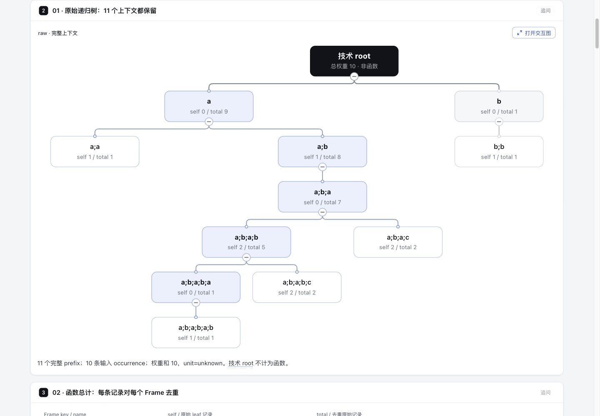

# 递归上下文、函数总计与原始样本

一份可分享的解释实验：完整 prefix `a;b;a` 的 node total=7，函数 a 的 total=9；全部 a 上下文 total 相加18不能代替函数总计。原生 Tree 保存11个上下文，Explainer 把每个节点接到完整贡献记录、原始位置和明确返回入口。没有改产品、schema、Viewer、lockfile 或上游 profiler。

## 固定输入与对照

上游为 [speedscope `fe804e6281cf847713448c2c3e0faec3e1f62b2d`](https://github.com/jlfwong/speedscope/tree/fe804e6281cf847713448c2c3e0faec3e1f62b2d)。两份是上游随仓 fixture，不是本轮采集的 workload；没有运行 speedscope 或其测试。

| 原件 | 大小 | SHA-256 |
| --- | ---: | --- |
| [recursion.txt](fixtures/recursion.txt) | 96 B | `5e6da30ddbe1e66f4e8a326236f2c9016484c61a6a7022b60389d94920fc4a57` |
| [simple-sampled.speedscope.json](fixtures/simple-sampled.speedscope.json) | 458 B | `6a4508cd712ee7a1a80929009d4a1b212cadfafd30831722ae6f195601f8967c` |
| [完整 MIT License](fixtures/LICENSE-speedscope) | 1067 B | `6244b13e9bf25cfd42d81c939d6c535d932596e8c320050234f2c2ac5a6f36a0` |

完整原件与 Jamie Wong 署名/MIT全文随实验保留。原文没有裁剪；源 fixture、派生 ledger 和按源码规则重建的结果分开保存。固定GitHub URL是URL-only来源声明，并非Archify已经验证的Git excerpt。

[baseline.html](output/baseline.html) 是两完整原输入与完整许可的普通文本页，下方放同一算法派生的完整 raw/JSON/flattened 账目；没有 Tree 或上下文导航。它是阅读表现的对照，不是上游 speedscope Viewer 截图，不证明性能或理解速度。[candidate.html](output/candidate.html) 使用既有 native Tree + Explainer；[candidate.explainer.json](output/candidate.explainer.json) 和三份 [raw](output/raw.tree.json) / [flat](output/flat.tree.json) / [JSON](output/json.tree.json) 原生spec全部由输入生成，没有手填权重。

当前冻结输出：

| 文件 | bytes | SHA-256 |
| --- | ---: | --- |
| baseline.html | 20093 | `c5d99514b65aa429bf7648b8bf200eaf7f882189816891aa3faa0831c50b0605` |
| candidate.explainer.json | 74840 | `a7c851ac9b936965a7e5bce72b9c77a4a03a40946b2d3143083d1590652c1500` |
| candidate.html | 1661053 | `5d03c4718122850733b5db2e72d6fb8148c5faa3b9dd55dbf31e685862996c42` |

## 身份、权重与折叠

- Frame：folded原件按完整帧名作key；JSON按shared.frames的index作key，同名显示值不会合并。
- Context：namespace + 完整frame key prefix；raw/flat/JSON分别命名。技术root不是函数。所有11 raw prefix都保留。
- Occurrence：R01…R10保持源行1…10，R04/R08虽同文仍是独立记录；J01…J05保持原始JSON pointer，J01/J02不合并。JSON samples全部在源第11行，weights在第12行，不能编造每个样本各自一行。
- raw共10条、权重和10、unit=unknown；JSON共5条、权重和14、unit=seconds。14seconds是采样赋权，不能当5次调用或精确执行14秒。

[ledger.json](output/ledger.json) 完整保存context与Frame的self、total、selfRows、total贡献rows、源位置、逐行折叠trace、全部open/close/null-layer事件，以及raw双c上下文到flat c的映射。JSON occurrence literal是源数组槽位的派生序列化；字节真值仍是完整原件。

离线脚本对相邻栈比较LCA、先close后open；重复Frame push null，关闭null层不会leave或移除外层Frame。按累计权重差累计折叠节点，再把原Frame self/total覆盖回去。此处坐标是权重坐标，不是时间戳。折叠留下4个prefix；节点self可以变化，函数表保持a1/9、b5/9、c4/4。

完整四行源码注释反例也保留：`a 1`、`a;b;a 1`、`a;b;a;b;a 1`、`a;b;a 1`。折叠节点a;b self=3，而函数b self仍为0；测试会抓到错误地从折叠叶子重算Frame self的实现。此反例是[固定 profile.ts:311–328](https://github.com/jlfwong/speedscope/blob/fe804e6281cf847713448c2c3e0faec3e1f62b2d/src/lib/profile.ts#L311-L328)注释，不冒充新采集fixture。

## 阅读闭环与限制

主图、函数总计、折叠对照、JSON权重在前；全部贡献与明细在后。38个raw `(prefix,occurrence)` 成员关系全部保留为紧凑表格行，不以裁剪去降低页面长度。flat与JSON也保留全部贡献及独立回链。

1. preview的`a;b;a` hover/focus后，来源卡“阅读这段”到`contrib-raw-p06`；这里列全R04…R10，权重和7。
2. R04到`detail-raw-p06-r04`，读完整`a;b;a;b 1`、原始行4与完整原件入口。R08是另一个独立detail。
3. “返回 a;b;a 入口”到`entry-raw-p06`；旁边“打开此精确prefix”打开原生Viewer的`raw-p06`。

这是固定prefix入口的完整往返。普通block anchor不保证恢复任意旧DOM焦点；全屏Viewer后来选中的节点不反向同步父页贡献。关闭Viewer回的是打开它的当前链接，不能宣称自动回最初preview。没有新增桥接状态、后处理脚本或全局Viewer状态。

## 验证与已知 checker 缺陷

Archify base为`6ca6a5c84439b57ea22e0630fe306e1d91587a6e`，Node v22.23.3，复用字节相同lockfile对应的既有依赖，未安装。

- 焦点测试7/7，零失败/零skip。独立常量oracle覆盖全部raw/flat/JSON self、total与归属、Frame去重、四行overwrite反例、原始source位置/unknown单位、重复记录、同名不同index、38对完整回链与所有真实targets。选这些测试是为了防止误导读者的数字和身份错误；不冻结自动布局坐标，也不重跑无改动的产品全仓suite。
- 当前candidate的public finalize：validate/deliver/check通过，显式`--browser-check`失败；共68条`explainer/browser-keyboard-traversal`，是17个末尾控件 × 4个视口/主题观察。没有别的诊断。独立`check --require-provenance`也通过。
- 首次横向图实际只有8.54px字，保留原失败后改为down布局，仍保留全部11 prefix。当前public gate的readability、containment、native interactions、references、无JS与print检查通过；这不等于人工视觉验收。
- 已读[开放PR #1124](https://github.com/tt-a1i/archify/pull/1124) head `3254fda4fcd61a101cc09e6b68fbdbb4d2779604`，它修同一`controlCount+3`预算遗漏原生滚动焦点/动态来源卡的问题；2026-10-28查得尚未合并。本实验没有复制其checker修复或减少控件刷绿。
- [完整独立Tab轨迹](output/keyboard-traversal.json)：在**相同HTML字节**继续发送真实Tab，四组1280/1440 × light/dark观察均在第448步仅428/445个初始目标，第468步445/445全部到达，missing为空。每步保留真实DOM身份、控件/额外焦点、owner、href与初始预算处计数；不调用focus()补达、不改tabindex/控件/HTML。它证明本页原诊断受预算影响，但**不把public browser-check失败回执改写为pass**。

[verification.json](output/verification.json) 是去除本机绝对路径的派生摘要，不是原始receipt。原始stdout/stderr、所有失败、完整CLI/browser receipts保留在协调会话指定的外部证据目录，包括早期label默认值错误、nodeBlocks不能引用comparison row、locale fallback、旧evidence-path conflict。最后使用新的out-dir重跑，未覆写早期失败。原始delivery sidecar留在本地供strict check使用，因含本机路径而不公开提交。

协调者随后在同一个 Ego TaskSpace 12 对冻结candidate与baseline完成真实浏览器观察，9张PNG均已查看，未编辑图片。这是Agent验收记录，不是人类review。浏览器证据与独立静态审查见下一节；较早的output/verification.json仍保留当时“pending root Ego inspection”的派生状态，不将其回填成新的原始receipt。没有CI、commit、push、merge、发布、安装或阅读效率结论。此处仅P1；未实施P2。

## 冻结产物的真实浏览器与独立审查



主图绑定冻结candidate `5d03c471…996c42`，1440×1000浅色。全9图、每张图独立的candidate/baseline绑定、原始与公开文本的bytes/hash，以及脱敏说明均在[证据manifest](evidence/manifest.json)。baseline截图绑定baseline `c5d99514…0b0605`，不能当candidate图。[协调者观察边界](evidence/browser/ROOT-ACCEPTANCE.md)与[图片绑定](evidence/browser/image-bindings.json)保留完整说明。

桌面实际闭环：focus raw-p06 → 真实Tab进入来源卡“阅读这段” → Enter到完整R04…R10贡献段 → 指针打开R04 → 看到完整原行4及另一个同文R08原行8 → 固定返回`entry-raw-p06`。这个block回链到达同prefix入口时activeElement是body，没有恢复最初preview焦点。随后从精确prefix链接打开原生Viewer，raw-p06 passport可见；Escape关闭并把焦点还给该链接。见[来源卡](evidence/browser/candidate-prefix-source-card.png)、[R04/R08详情](evidence/browser/candidate-r04-detail-light.png)、[精确prefix Viewer](evidence/browser/candidate-exact-prefix-viewer.png)及对应JSON观察。raw-p08/raw-p11到flat-p04链接也实际打开，只有[最终flat图](evidence/browser/candidate-flat-exact-context.png)是这组三次打开的截图证据；空的snapshot substring不是passport回执。[JSON树与表](evidence/browser/candidate-json-tree-light.png)及DOM核读保留J01/J02不同pointer与源第11/12行。

390×844深色时，[raw预览](evidence/browser/candidate-raw-mobile-dark.png)明确提示太小并给交互Viewer入口，DOM仍保留包括技术root的12个节点，文档没有横向溢出。打开Viewer与Escape回opener实际可用。不过[窄屏Viewer图](evidence/browser/candidate-mobile-viewer-dark.png)中共享base Viewer底部toolbar被裁剪，overview文字在缩放操作前仍小。本实验不修这个共享缺陷，也不声称移动Viewer完整可用；桌面是主要接受面。

[独立只读Agent审查](evidence/review/REVIEW.md)及[最终差异绑定](evidence/review/final-delta.json)未发现数据正确性、完整性、静态固定回链的阻塞问题；[另一套Python原bytes oracle](evidence/review/independent_oracle.py)记录[535项断言通过](evidence/review/independent-oracle.json)，没有import作者生成器。数量不是535项产品能力。公开脚本中的本机路径已换为占位符，重放前需配置路径与审查快照；它是明确脱敏的审查记录，不冒充原字节或新运行。审查者没有亲自运行浏览器或接受截图，浏览器观察由协调者另记；两者都不能代替人类review。

原始JSON/text中含本机路径的材料仍保留在checkout外；公开副本只替换路径，并在manifest分别列原始与公开hash/bytes。PNG原字节复制。public browser-check仍保持fail68，独立继续Tab仍为445/445，不因图片和审查完成而刷成pass。

## 复现

从仓库根目录，使用已准备好的可信依赖与Node22：

```sh
node experiments/profile-contexts/generate.mjs
node --test experiments/profile-contexts/profile-contexts.test.mjs
PROFILE_EVIDENCE=$(mktemp -d)
node archify/bin/archify.mjs finalize explainer experiments/profile-contexts/output/candidate.explainer.json experiments/profile-contexts/output/candidate.html --browser-check --out-dir "$PROFILE_EVIDENCE" --json
node archify/bin/archify.mjs check experiments/profile-contexts/output/candidate.html --require-provenance --json
node experiments/profile-contexts/traverse.mjs
```

也可运行`node experiments/profile-contexts/verify.mjs`，顺序执行上述工作并把每阶段stdout/stderr放到新的临时目录。base checker未修复时该脚本仍exit1，并如实写明public gate失败；不会把独立继续Tab观察当作门禁豁免。生成只读固定fixture，不联网或执行fixture中任何代码。原始receipt不被搬移成新的provenance声明。

## AI 与许可

OpenAI Codex参与源码阅读、离线算法、测试、页面内容和README编写；实际分配模型为配置的gpt-6.1-sol。独立审查与浏览器观察均由Agent执行，人类验收由维护者后续完成，当前未声称已有人类review。新实验代码遵循仓库贡献许可；两份speedscope原件及完整MIT声明按各自上游许可保留。
