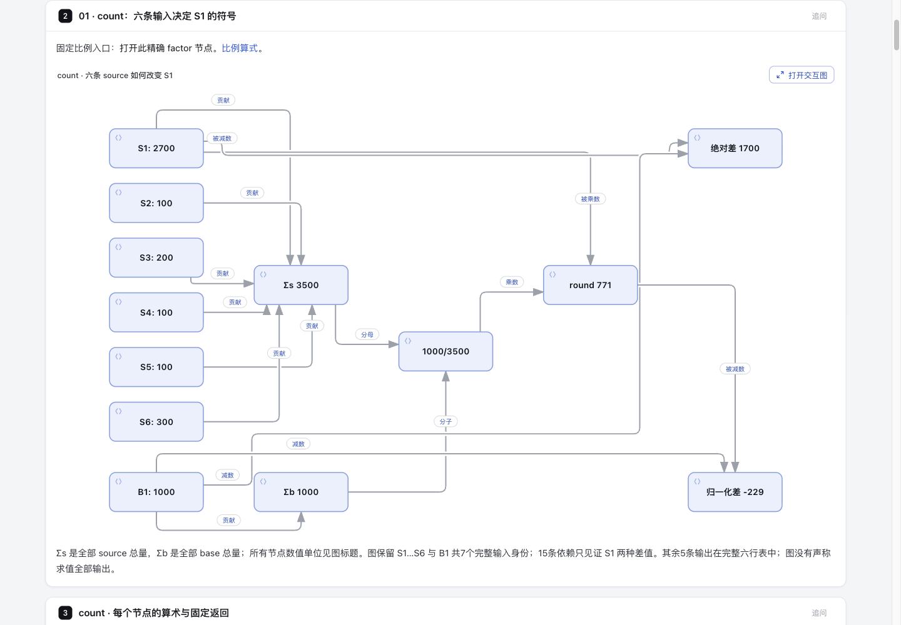

# 六条 source 如何让 S1 的归一化差变成负数

S1 的绝对差为 **+1700 count / +608878600 ns**；先归一化整个 source，再减同栈 B1，得到 **−229 count / −369 ns**。归一化比较的是缩到同样总量后的分布，不证明绝对资源下降或性能改善。这个独立离线实验用 native Architecture + Explainer 展示完整算术依赖，没有修改产品代码、schema、Viewer、lockfile、package 或 live installation。

[候选页面](output/candidate.html) 包含两张固定 metric 的 S1 算术见证图，以及报告分母分支图。每张见证图保留全部 S1…S6、B1 七个输入身份和15条依赖；它解释 S1 两种差值，完整六行输出在邻表。边表示值依赖，不是程序调用、执行顺序或测得 trace。没有动态 metric selector。

[文字基线](output/baseline.html) 是完整escaped prose与ledger文本dump，保留原block/node记号，没有native图、来源卡或渲染后的可点击导航。它是完整数据对照，不是上游pprof UI，也不是与candidate同等交互的UX benchmark。没有裁剪数据来制造对照，也没有读者计时或正确率实验，不能宣称阅读提速。

## 固定输入与许可

上游固定为 [google/pprof `dbd0ed30aa888a30e21ba83b9831ac0e80d41022`](https://github.com/google/pprof/tree/dbd0ed30aa888a30e21ba83b9831ac0e80d41022)。完整 fixtures、golden 和 Apache 正文在 [fixtures](fixtures/LICENSE-pprof)，逐文件来源、bytes/hash 在 [manifest.json](output/manifest.json)。历史 fixture 采集现场及函数符号未知，没有补造函数名、业务故事或本轮 workload。

| 上游完整原件 | bytes | SHA-256 |
| --- | ---: | --- |
| internal/driver/testdata/cppbench.contention | 1551 | `e0f3035db93cd3bb384590b224ca2b26d79aca41e71042a32c351a6d3e34d2d4` |
| internal/driver/testdata/cppbench.small.contention | 821 | `0d1f47b05eb6664827672b360eb122f13daec15765eb76eed1d77ed9e788516f` |
| profile/testdata/cppbench.contention.string | 2025 | `a552baca08d20d75945171f9d1ff08f5f9df12a0d7099ce88c9b894358015552` |
| LICENSE | 11358 | `cfc7749b96f63bd31c3c42b5c471bf756814053e847c10f3eb003417bc523d30` |

完整 Apache 正文与上游署名见 [NOTICE](NOTICE)。没有复制上游实现；只在固定 fixture 形态上独立重建算术，拒绝将它解释为通用 pprof/protobuf importer。固定 SHA URL 是 URL-only 来源，不冒充 Archify 已验证的 Git excerpt。

## 图格式选择

初稿使用原生 Dataflow。在1440×1000浅色浏览器中，关键数值副标题仅约8.26px；移到主标签后数字约11.80px，但关键角色仍偏小。首次完整页面的公共浏览器检查保留314条失败诊断（键盘164、可读性138、图适配6、图中文字6），不能以静态三阶段通过代替读图结果。

随后用相同count的13个节点、15条关系做一个原生Architecture探针；节点身份/标签、关系身份/端点/方向/标签逐项一致。一次布局即通过四阶段检查；真实1440×1000浅色图主标签13.75px、关系标签10px，完整七个输入和S1两种结果同屏。最终采用该布局呈现两metric和分母图，移除Dataflow的手工通道路由，保留全部算术与原件。探针通过不代表完整页面通过，最终页面结果另记。

这是固定内容的格式选择，没有修改共享renderer、schema、字体规则或检查器；没有跨项目可读性或作者效率结论。原Dataflow源码、产物和失败回执保留为历史材料，最终活动spec仅使用Architecture。

完整页面把原先挤占原生图横向空间的steps移到紧随其后的详情panel，释放图宽；全部步骤、35个preview节点的真实详情target和固定返回入口保留，没有把独立probe通过冒充完整页面接受。最终两张算式图各13节点/15关系，报告分母图9节点/8关系。Architecture的位置、布线、legend及target同步是此固定内容实验的实际维护成本，不能将它称为Dataflow自动布局或无成本格式替换。

## 三种分母与完整身份

原始两列是 delay cycles 与 observed contentions。按 period=100、hz=3201000000，unsampled count=observed×100；ns=int(cycles×100/(hz/1e9))。这里截断，随后 Normalize 的逐值 math.Round 是另一道运算。count 不是函数调用次数。

source 总量为3500 count / 690508213 ns；base 为1000 count / 3124 ns。比例分别是1000/3500和3124/690508213；先逐值 round，再减 B1。原始 source 6条、base 1条，完整 leaf→caller 地址均保留；source共79个地址位置、40个唯一 corrected location，base有13个位置。两份原件各12条 maps 全部保留。pprof 将 raw 地址减1；显示地址没有被当作跨版本函数身份。

| 栈 | source count / ns | scaled count / ns | 绝对差 count / ns | 归一化差 count / ns |
| --- | --- | --- | --- | --- |
| S1 | 2700 / 608881724 | 771 / 2755 | 1700 / 608878600 | -229 / -369 |
| S2 | 100 / 23992 | 29 / 0 | 100 / 23992 | 29 / 0 |
| S3 | 200 / 179943 | 57 / 1 | 200 / 179943 | 57 / 1 |
| S4 | 100 / 17778444 | 29 / 80 | 100 / 17778444 | 29 / 80 |
| S5 | 100 / 75976 | 29 / 0 | 100 / 75976 | 29 / 0 |
| S6 | 300 / 63568134 | 86 / 288 | 300 / 63568134 | 86 / 288 |

只有 S1/B1 全栈与 labels 匹配。其余5条在这个 base 输入里缺失，比较贡献补0，不声称现实中从未执行。S2/S5 虽然 delay=0 ns，count=29，不能删掉。scaled source 总和1001 count / 3124 ns；净差1 count / 0 ns，是逐样本 round 所致。

[ledger.json](output/ledger.json) 分开保存原始输入、完整 corrected locations/maps、六行比较投影和实际合并身份。`-base` 无标签，S1 与负B1合并成一条，所以有6个 signed 完整stack样本；`-diff_base` 给负B1保留 `pprof::base=true`，它与S1不能先合并，内部是7条。六行比较表只是忽略 base 角色标签的算术 projection。

限定无 focus/ignore/mean、无额外 divide_by。`report.New` 在地址聚合前计算 total：`-base` 对 merged signed 样本逐个 abs 后求和；`-diff_base` 取 base 标签子集。

| 设置 | count denominator | ns denominator |
| --- | ---: | ---: |
| absolute -base | 2500 | 690505089 |
| absolute -diff_base | 1000 | 3124 |
| normalized -base | 459 | 738 |
| normalized -diff_base | 1000 | 3124 |

缩放用 sourceTotal 作分母；报告百分比用上表集合总量；净差1/0从未当分母。S1 同一分子的算术比率分别为 -229/459 与 -229/1000、-369/738 与 -369/3124，不冒充运行过的 pprof 格式化UI。全部输入共享 corrected leaf 0xbccc96，后续 flat 地址聚合会相消为1/0；不能用它替代完整stack差分或画伪函数热点树。

## 阅读闭环与可读性

focus / hover native 图中的 factor → 来源卡“阅读这段” → 全部六项 sourceTotal → S2 完整原行及全部地址 → 完整含 maps 原件 → 明确返回 count/delay factor 入口 → 入口内 native node 链接打开精确 factor。

入口是独立真实 prose block；没有把 comparison row 或 steps item 冒充 nodeBlocks target。静态 block 回链只到固定入口，不保证恢复任意旧 DOM focus；Viewer 内改选不反向同步父页。最终035的精确Viewer opener返回已由root实际Ego观察，范围见后文；静态block回链仍不恢复任意旧DOM焦点。

首次 native 生成失败暴露 runtime row 只能0…4（schema未表达），后续使用合法 row + yOffset 保留全部7输入。fan-in 标签与 B1 长减法边按真实诊断修正，没有改共享 checker。初稿 key values 放 sublabel；协调者真实1440截图测得只有8.26px，不满足算式阅读目标。后续把关键数字改 main label，输入间距114压到72px，保持全部依赖。旧失败图与旧HTML由协调者保留，最终视觉验收仍以冻结字节的独立记录为准。

## 复现与验证边界

从仓库根目录，使用准备好的可信依赖与Node22：

```sh
node experiments/profile-normalization/verify.mjs
```

或分步：

```sh
node experiments/profile-normalization/generate.mjs
node --test experiments/profile-normalization/profile-normalization.test.mjs
node archify/bin/archify.mjs finalize explainer experiments/profile-normalization/output/candidate.explainer.json experiments/profile-normalization/output/candidate.html --out-dir /tmp/profile-normalization-evidence --json
node archify/bin/archify.mjs check experiments/profile-normalization/output/candidate.html --require-provenance --json
```

`verify.mjs` 不启动浏览器；每次使用新的外部临时证据目录，保留原始stdout/stderr/receipts，输出便携派生摘要 [verification.json](output/verification.json)。local delivery sidecar 含绝对路径，留在checkout供 strict check，受实验级 `.gitignore` 排除。浏览器 gate 和真实 Ego 阅读闭环由协调者单独运行，不会把静态 check 称为视觉验收。可在完成后另跑相同 finalize 加 `--browser-check`，必须使用新的 `--out-dir`；保留失败，不能靠关闭 gate 刷绿。

当前5/5焦点测试通过，零skip：完整原件/golden六行/40location对应，分类型舍入与符号翻转，完整stack匹配反例，6/7合并身份及四组报告分母，以及真实 block 返回与 native 输入依赖。它们保护可能误导读者的数值、身份和来源遗漏；没有布局快照、suite 数量填充或无改动产品全仓重跑。

Archify base=`6ca6a5c84439b57ea22e0630fe306e1d91587a6e`，Node v22.23.3。原 root/package lock 与缓存 checkout 的锁字节相同（root `7cec877e…d39f3`，renderer `5ee16783…015c`）；只在本实验 worktree 临时链接既有依赖，没有安装。两处临时 `node_modules`、`archify/node_modules` symlink 已由root明确仅unlink移除，未删除其目标依赖。复现需自行准备可信依赖；没有安装、更新或改动live Archify。

## 最终静态字节与独立审查

最终冻结candidate为 **1,776,392 bytes**，SHA-256 `035db27d3cac4cda94258f839116cc7e72db39cafa5ddb734184118e8e4c0a94`；baseline为98,898 bytes，SHA-256 `0668f1f91c1c77e81fd55ff0a479f77fcd676675ea2143e35e40940d7197c214`。Explainer JSON为79,369 bytes，SHA-256 `dcdda473b220acb17f6b7280f96a24d695b4cf41be9436fa50ad1f295e274ca7`；generator为28,738 bytes，SHA-256 `20df1edce8366dbb8d4cc1347bdbd40c4a6b4c32b3a23845e0eaf32f60c8d030`。

[独立审查](evidence/independent/REVIEW.md)、[最终数据与target检查](evidence/independent/final-frozen-review.json)与[最终证据绑定](evidence/independent/final-evidence-binding.json)没有发现算术、完整原件、合并标签、依赖方向或固定来源回链的阻塞问题。它们依据先于候选建立的 [独立原bytes推导](evidence/independent/DERIVATION.md) / [完整推导账目](evidence/independent/derivation.json)，没有import作者实现来生成oracle，也不代表人类接受。

最终CLI run的 [5项测试日志](evidence/cli/tests.stdout)为5 pass、0 fail、0 skip；[static finalize](evidence/cli/finalize.stdout)的validate/deliver/check通过，该次没有请求browser-check，并保留8条 `explainer/writing-paragraph-length` 非阻塞warning。[strict check](evidence/cli/check.stdout)为ok。不是零warning，也没有以关闭browser参数把完整gate称为通过。

单独请求完整browser gate的最终035收据仍 **FAIL164**，全部为 `explainer/browser-keyboard-traversal`；[公开失败摘要](evidence/public-browser/final035-browser-summary.json)保留全部164诊断与原收据hash/bytes，[finalize失败摘要](evidence/public-browser/final035-finalize-summary.json)保留failedStage。没有readability、fit或text失败不等于真实视觉接受。早期Dataflow的314诊断（键盘164、可读性138、fit6、text6）也见 [历史失败摘要](evidence/history/dataflow-browser-summary.json)，旧HTML继续留在外部，仅公开 [历史身份](evidence/history/dataflow-artifact-identities.json)，不为包装重复搬入大页面。

### 旧658真实Tab观察与legend-only复用

[完整真实键盘轨迹](evidence/keyboard/keyboard-traversal.json)及[四组摘要](evidence/keyboard/keyboard-summary.json)明确绑定旧HTML `65815f7d59d26476c20ea833b06102419a24c77729973fac6fa172ffe14c8234`：1280/1440 × light/dark原预算285步只达到241/282个初始target；继续到334步才282/282、missing=[]。只发送真实Tab及原生radio ArrowRight，不调用focus()补达、不改tabindex或控件；每组41项预算漏达共164，解释本页public诊断而不是把FAIL改成PASS。

[legend spec delta](evidence/independent/legend-spec-delta.json)只有三处Architecture legend从通用角色改为“算术输入与运算”。[最终差异绑定](evidence/independent/final-delta.json)核对ledger/baseline原字节不变，195个DOM IDs与354项静态交互/preview属性及次序不变；354不是动态QA的282个初始可见target。旧Tab轨迹不改artifact SHA，不冒称最终035重新跑过该延长轨迹；最终035独立public gate仍重现相同164失败，复用仅限上述已核相同控制结构。此次证据包装没有重跑CLI、测试或浏览器。

## 最终035的真实Ego与原PNG



Root使用Ego TaskSpace16在冻结035页面实际操作，并逐张查看 [12张原PNG](evidence/browser/image-bindings.json)；PNG直接复制、未改色/裁剪/编辑。[接受范围摘要](evidence/browser/final3-acceptance-summary.json)及 [来源卡](evidence/browser/final3-chain-1.json)到 [原件/返回/Viewer](evidence/browser/final3-chain-6.json)记录具体动作。root的实际链以hover和指针为主：count factor→来源卡“阅读这段”→factor算式→全部六项sourceTotal→S2完整原行/地址→含全部12 maps的完整source→明确count factor入口→native factor。静态block返回时activeElement是BODY；native Viewer的Escape回打开它的精确链接，不能扩大成任意DOM恢复栈或Viewer反向同步。

[桌面delay](evidence/browser/final3-delay-light.png)与count图在1440×1000浅色均显示全部七输入、完整13个标签和两种S1结果；main label13.75px、关系标签10px，delay factor3124/690508213实际完整可见。[分母图](evidence/browser/final3-denominators-light.png)的all-abs、tagged-abs、numerator三个节点分别hover→“阅读这段”→准确解释块→返回图，见 [三条实际链](evidence/browser/final3-denominator-chain.json)。[六行结果深色](evidence/browser/final3-results-dark.png)保留S2/S5的delay0/count29。文字基线的 [原图](evidence/browser/final3-baseline-light.png)与 [DOM观察](evidence/browser/final3-baseline-observation.json)显示的是完整escaped dump，不作为相同交互能力的对照。

390×844深色 [preview](evidence/browser/final3-mobile-dark.png)给出too-small fallback与native Viewer入口；[Viewer](evidence/browser/final3-mobile-viewer-dark.png)可打开factor，Escape回opener，[返回观察](evidence/browser/final3-mobile-return.json)保留真实状态。不过共享base底部toolbar仍裁切，不能称mobile全部通过。父页面的一次evaluate受sandboxed iframe跨源限制失败，没有使用其返回值；native factor状态由原图与 [Viewer snapshot](evidence/browser/final3-viewer-snapshot.txt)支持，不冒称提取到iframe内部runtime IDs。另一次section-number permalink点击被pointer interception拦住，后来普通导航链接成功；没有把首次失败隐去或称所有pointer targets已逐一验证。

Root另用显式focus＋Enter打开Viewer，但没有证明完整自然Tab或键盘only来源卡链；真实自然Tab仍属于旧658独立轨迹，按已核legend delta复用，public FAIL164不变。lens仍显示通用组件类别“后端”，legend已是“算术输入与运算”，未为文案修改共享renderer。没有读者速度测量、人类接受、触摸/AT或跨平台结论。TaskSpace16已finish keep=[]一次，无保留页面；包装者没有使用Ego或重开该space。

### 原件与公开副本的边界

[逐文件source-copy index](evidence/source-copy-index.json)记录原始/公开bytes与SHA，区分原字节副本、路径脱敏副本及选字段摘要。15份root JSON和两份snapshot一起保存，其中含大CSS文本的mobile观察完整保留；仅两份snapshot需替换机器路径，原始指纹仍在索引。复制的root summary内hash属于原始source文本，不能误当已脱敏副本的hash。[图片绑定](evidence/browser/image-bindings.json)另列12张PNG的IHDR尺寸与candidate/baseline身份；没有再复制同字节candidate或baseline HTML。

最终public browser原收据保留在外部，原件6,359,227 bytes及SHA见 [全部164诊断的公开选字段摘要](evidence/public-browser/final035-browser-summary.json)；公开摘要明确省略大体积成功DOM观察数组，不冒称完整原receipt。历史Dataflow/658只保留必要失败计数、代表诊断与原件指纹，不复制历史大HTML或审查snapshot。含本机路径的原日志留在原执行目录，公开副本使用占位符，不能作为仍可执行的原始provenance；candidate/fixture绑定SHA均保持原值。

[证据入口](evidence/README.md)与 [包装清单](evidence/packaging-index.json)记录此次只做复制、脱敏、摘要、链接和字节核对，未重跑测试/CLI/renderer/browser。独立审查内旧README hash是其历史阶段身份，不回写为本README。root报告 [#1124远端复核及依赖清理](evidence/browser/root-follow-up.derived.json)：PR仍open、未合入、head3254fda4，dev/main不变，新实验分支尚无远端；该记录是root消息派生，不是包装者的新API原件。没有CI、commit/push、merge、release或安装结论。

## AI 与维护成本

OpenAI Codex（配置的 gpt-6.1-sol）参与源码阅读、原创建模、页面、测试与文字。独立审查和真实浏览器观察由协调者分别记录；当前不声称人类review。主要维护成本是一份固定legacy reader、每metric算术和labels身份，加三份Architecture spec的位置/布线/legend及Explainer详情target同步；不是继续维护初稿Dataflow活动spec。没有引入产品抽象、依赖或状态系统。test-value 与 archify-review 指导本轮比例适当的测试/成本评估；未修改这些 Skills。
