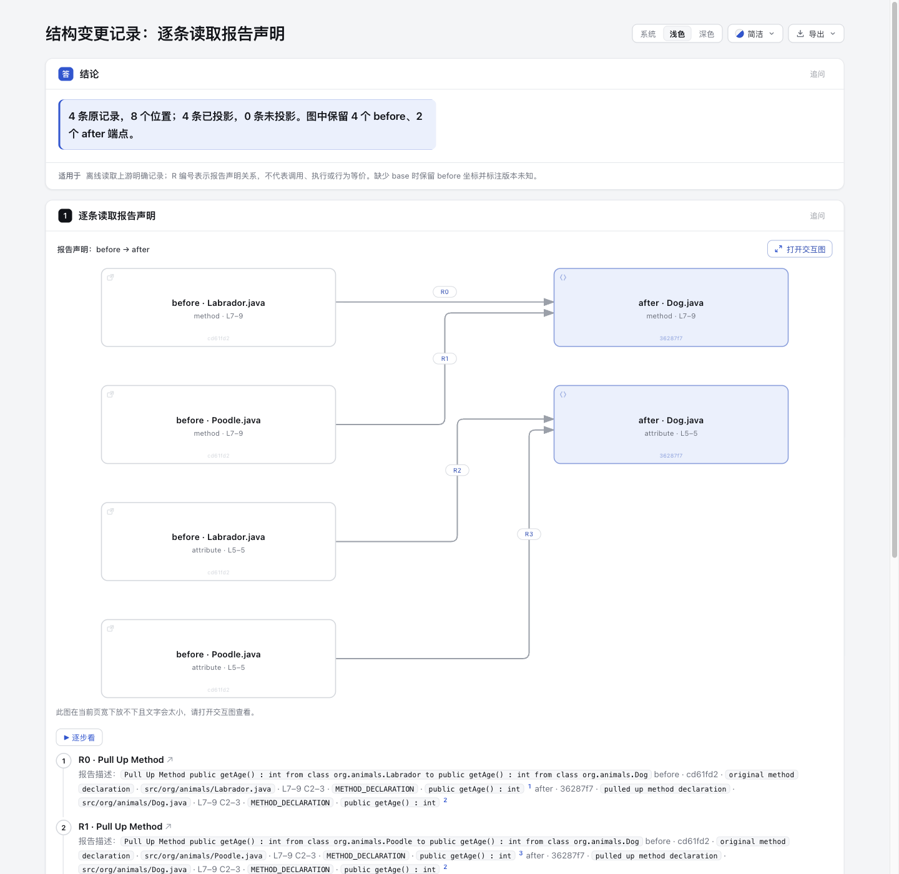

# Offline refactoring record projection · experiment 56

Read a complete RefactoringMiner JSON report as supplied. This experiment projects explicit upstream statements into a native Archify Explainer; it does not detect refactorings, fetch source code, infer renames, prove behavioral equivalence, or infer a PR's comparison range.

- [Known-base reading page](output/known-base/index.html) · [full JSON reading baseline](output/known-base/baseline.html)
- [Unknown-base reading page](output/unknown-base/index.html) · [complete original input](fixtures/refactoring-toy-example-commit-expected.json)
- [Derived execution summary](evidence.json) · [known-base complete ledger](output/known-base/ledger.json)

The sample retains **4 records, 8 location occurrences, 4 before endpoints, 2 after endpoints, and 4 independent edges**. R0/R1 share the Dog method target; R2/R3 share the separate Dog field target. R0–R3 are report statements, not call or execution directions. The left methods/fields belong to distinct Labrador and Poodle files despite equal `codeElement` strings.

## Input provenance and license

The complete 3180-byte fixture was retrieved verbatim from [this fixed RefactoringMiner raw URL](https://raw.githubusercontent.com/tsantalis/RefactoringMiner/de0a67f9f690914e6c1ac1ed1b2a850c4ff6068d/src/test/resources/commandline/refactoring-toy-example-commit-expected.json). SHA256: `abb1a93274946a7db8bd81de10feb925a3fc5a8107788390e44766028e3a381d`. Output `input.json` files preserve those exact bytes. `ledger.json` is explicitly derived and records the source byte count/hash; it also retains the entire parsed report, extra fields, and each original record. It is not presented as raw detector output.

The fixed [TestCommandLine.java](https://github.com/tsantalis/RefactoringMiner/blob/de0a67f9f690914e6c1ac1ed1b2a850c4ff6068d/src/test/java/org/refactoringminer/test/TestCommandLine.java#L109-L125) associates this input with an **@Disabled historical expected test**. This experiment did not run RefactoringMiner and does not establish that its current version reproduces these records. The full [RefactoringMiner MIT license](fixtures/RefactoringMiner-LICENSE) is preserved from [the same fixed repository revision](https://raw.githubusercontent.com/tsantalis/RefactoringMiner/de0a67f9f690914e6c1ac1ed1b2a850c4ff6068d/LICENSE); license file SHA256 `448e37db6cdb74dfcd65e44cb3fa07f74a8c96428104624b7666a5a16f6b6765` (1075 bytes).

The report explicitly identifies `danilofes/refactoring-toy-example.git` and child `36287f7c3b09eff78395267a3ac0d7da067863fd`; it does **not** supply base. The known-base [identity manifest](fixtures/identity.json) binds input SHA256, exact repository string and child to the independently researched unique parent `cd61fd2a70828030ccb3cf46d8719f8b204c52ed`, with the [commit API evidence URL](https://api.github.com/repos/danilofes/refactoring-toy-example/commits/36287f7c3b09eff78395267a3ac0d7da067863fd). The [unknown-base manifest](fixtures/identity-unknown-base.json) keeps the fixture provenance but deliberately sets base to null. Manifest mismatch rejects the input; there is no online identity lookup.

The toy repository has no confirmed license. Its six source files remain **URL-only**, without downloaded or embedded Java content. Two revisions coexist only as native source entries `{id,title,url}`; they are external references, not verified code excerpts. The prior research's independent source oracle is:

| File | Parent fixed URL | Child fixed URL |
| --- | --- | --- |
| Dog.java | [parent](https://github.com/danilofes/refactoring-toy-example/blob/cd61fd2a70828030ccb3cf46d8719f8b204c52ed/src/org/animals/Dog.java) | [child](https://github.com/danilofes/refactoring-toy-example/blob/36287f7c3b09eff78395267a3ac0d7da067863fd/src/org/animals/Dog.java) |
| Labrador.java | [parent](https://github.com/danilofes/refactoring-toy-example/blob/cd61fd2a70828030ccb3cf46d8719f8b204c52ed/src/org/animals/Labrador.java) | [child](https://github.com/danilofes/refactoring-toy-example/blob/36287f7c3b09eff78395267a3ac0d7da067863fd/src/org/animals/Labrador.java) |
| Poodle.java | [parent](https://github.com/danilofes/refactoring-toy-example/blob/cd61fd2a70828030ccb3cf46d8719f8b204c52ed/src/org/animals/Poodle.java) | [child](https://github.com/danilofes/refactoring-toy-example/blob/36287f7c3b09eff78395267a3ac0d7da067863fd/src/org/animals/Poodle.java) |

Oracle: the parent subclasses each declare `age` at L5 C14–21 and `getAge` at L7–9 C2–3; the child Dog has the corresponding field/method ranges. This is a source-reading oracle from prior research, not Java compilation, detector execution or an equivalence proof.

## Reproduce

Run from the repository root with existing repository dependencies. No npm install, live Skill install, root/schema/renderer/lock modification, or package rebuild is required. The implementation used Node 22 at `/opt/homebrew/opt/node@22/bin/node`. The commands below use `node` for portability:

```sh
node experiments/refactoring-records/project.mjs experiments/refactoring-records/fixtures/refactoring-toy-example-commit-expected.json experiments/refactoring-records/output/known-base experiments/refactoring-records/fixtures/identity.json
node archify/bin/archify.mjs finalize explainer experiments/refactoring-records/output/known-base/explainer.json experiments/refactoring-records/output/known-base/index.html --quality standard --json
node experiments/refactoring-records/project.mjs experiments/refactoring-records/fixtures/refactoring-toy-example-commit-expected.json experiments/refactoring-records/output/unknown-base experiments/refactoring-records/fixtures/identity-unknown-base.json
node archify/bin/archify.mjs finalize explainer experiments/refactoring-records/output/unknown-base/explainer.json experiments/refactoring-records/output/unknown-base/index.html --quality standard --json
node --test experiments/refactoring-records/project.test.mjs
```

Generic usage: `node experiments/refactoring-records/project.mjs INPUT_JSON OUTPUT_DIR [IDENTITY_MANIFEST]`. Omit the manifest to keep base explicitly unknown. Standard CLI finalize is a separate visible operation; the importer itself only writes data, the baseline and a readable summary. A direct `input.json` link in the baseline opens the original report.

## Scope and acceptance

Only one commit, the two Pull Up types, and exactly one location on each side are projected. Other types, zero/multiple endpoints, and multi-commit reports retain full original records with explicit unsupported reasons; no Cartesian products and no empty graphs. Empty reports produce an explanation and ledger. Invalid JSON or missing required report/location structures produces a nonzero diagnostic. No provider framework: fixed source links are generated only for full report-head / manifest-base SHAs and the supported GitHub repository shape; unsupported repositories remain in the original ledger.

Endpoint identity includes side, revision or explicit unknown-before, complete file path, all four range coordinates and kind. This deduplicates identical locations within a side; it is not a persistent cross-version symbol identity. Each occurrence remains an independent record and edge. Layout is a small explicit two-column diagram; large reports, broader refactoring kinds and schema-limit handling need separate evidence and may not fit this experiment. The complete ledger still preserves extra fields, but preserving a field does not mean understanding it.

Record titles use native steps targets selecting one exact edge and its endpoints. Closing/Escape returns to the invoking step. Arbitrary diagram-to-record navigation is outside the existing Reader contract. There is no duplicated comparison table or new Reader interaction.

The implementation agent ran **6 focused tests**, all passing: the independent complete fixture oracle; same-name path/range separation and repeated records; unsupported records/multi-commit preservation; absent-base coordinates and no before URL; malformed input/manifest mismatch; actual offline CLI plus public finalize and rendered edge target bindings. These protect record loss, erroneous merging, fabricated version links and unusable native targets without freezing layout coordinates. The shared-target regression specifically requires both citations on R1/R3 after endpoint deduplication. Both final pages passed public standard finalize validate/deliver/check with zero diagnostics. After browser inspection by the parent, a metadata-only native legend change labels the nodes before 声明 / after 声明 rather than architecture system categories. The 6-test result was reused at pre-legend projector SHA `9198b0e1fcc839bd8950b9c06006e79ac523df750823b5dbcaf5d681365b9c8e`; only legend metadata changed, and both final artifacts were regenerated and actually finalized/checked. Old artifacts/hashes and logs are retained separately; the earlier overview screenshot is not final evidence. Browser checks were **not run by the implementation agent**. The parent subsequently completed the separate real-browser observations described below; the CLI browser-check gate remains not-run. No detection-accuracy or reading-speed claim is made.

The first finalize attempt failed because native architecture meta lacked required output; it was corrected. The first test run found a mistaken HTML assertion expecting an unencoded edge string instead of the public JSON attribute; it was corrected to inspect decoded rendered targets. The parent review also found shared-target source citations were lost through object-reference lookup; using canonical record endpoint IDs and the new per-record citation assertion fixed it. Original execution and failure logs are retained locally under `/tmp/archify-refactoring-records-run-20261028`; public `evidence.json` is a derived summary without private paths. Generated CLI receipts containing local paths are retained with those logs rather than published here.

PR improvement check: applied project test-value in implementation mode; the focused tests cover distinct importer and native-target outcomes. Scoped complexity review kept one pure projector and one file writer, with original data as the source of truth. No shared framework, duplicate record table, detector adapter abstraction or cross-version source model was added. Dependencies were reused through temporary test symlinks only after both lockfiles matched byte-for-byte; no dependencies were installed.

AI disclosure: Codex using the configured GPT-6.1 Sol agent implemented the isolated importer, tests, manifests, native artifacts and documentation under user direction. Human acceptance is not claimed. This implementation task did not merge, install, release or deploy the experiment. Remote branch delivery is tracked separately by the parent session.


## Real browser evidence and final binding



The parent inspected all nine original PNGs with `view_image`. [The primary final light overview](browser-evidence/overview-light-final.png) is 1440 × 1400, 173243 bytes, SHA256 `b4d06c353e16f0299b5f9737bc8674dc8b1a2d3b31a438da8fd24bbf7010b6ea`. All nine images are copied byte-for-byte without beautification, cropping or failure removal; [their provenance index](browser-evidence/index.json) records original/public hashes, byte counts and dimensions. Public JSON/TXT are explicitly derived copies with private local paths replaced; original logs remain local. [The browser observation summary](browser-evidence/root-observations.json) and [final artifact binding](browser-evidence/final-source-binding.json) describe the precise scope.

Root verified the complete baseline text matches the 3180-byte input. R0 keyboard Enter opens Labrador method → Dog method; R1 pointer opens Poodle method → the same Dog method. Escape returns focus to each originating record. These are actual visible interactions plus exact step targets and independently checked prepared edge binding; **iframe nativeFocus runtime IDs were not extracted**. All four known-base DOM records retain two citations; the unknown-base page shows 版本未知 and only the two after-source URLs. The native legend now visibly says before 声明 / after 声明.

The 390px dark desktop viewport showed page client/scroll width 375/375, while the R1 record had local width 317/321. Full paths, roles and columns remained readable in the screenshot. The inline diagram reports cannot-fit-readable; root used the interactive viewer for selection inspection. This is not touch/mobile-device, assistive-technology, cross-browser or human acceptance, and no reading-speed advantage was measured.

Two image limits must remain explicit: [overview-light.png](browser-evidence/overview-light.png) predates the legend fix and is historical, not the final overview. [shared-target-source-card.png](browser-evidence/shared-target-source-card.png) shows the record details after the transient card disappeared; it **does not depict a visible SourceCard**. The exact child Dog.java L7–L9 URL-only card was instead checked through the preceding UI snapshot and [source-card.json DOM observation](browser-evidence/source-card.json). The first R0 snapshot attempt reported “Page changed during snapshot”; the next snapshot succeeded in the same browser space before capture. These limits and failure are retained.

[The independent review](independent-evidence/review.md), [receipt](independent-evidence/receipt.json) and [binding](independent-evidence/binding.json) apply to final projector SHA `e8171be679a8e5c1e6b531450618002c1440169de8f82b849fdd8eb4dc75376d`. Independent variant checks, actual offline CLI and public finalize were rerun after the legend-only change; the author’s six-test run remains reused from the earlier logic-identical source. A rebuild in a different directory has different raw HTML bytes: only `prepared.sourcePath`, `prepared.baseDir` and `prepared.digest` were normalized for the separately reported equality comparison. Raw HTML equality is explicitly false.

Final known-base HTML SHA256 is `1c4caabe26ab0af88a5463de38564391b67bbc84111471af599bcecf351052ce`; unknown-base is `caee35eef44b8b39fb9049ca3ae82681b6d169a614a64345de3bd4ce77110306`. The [packaging index](packaging-index.json) inventories current files, preserving prior author-stage README/evidence hashes as history. This packaging step changed only evidence and documentation; source, tests and all output artifacts were byte-checked unchanged. It did not rerun tests or browser operations.
