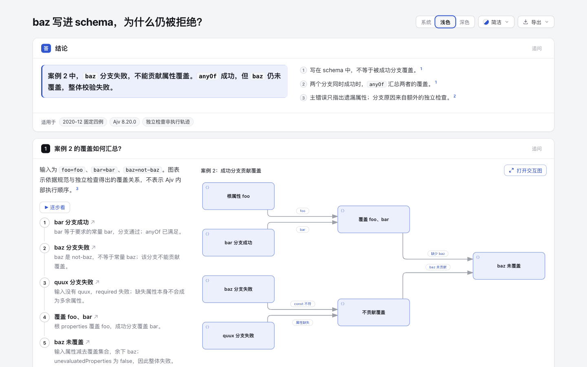
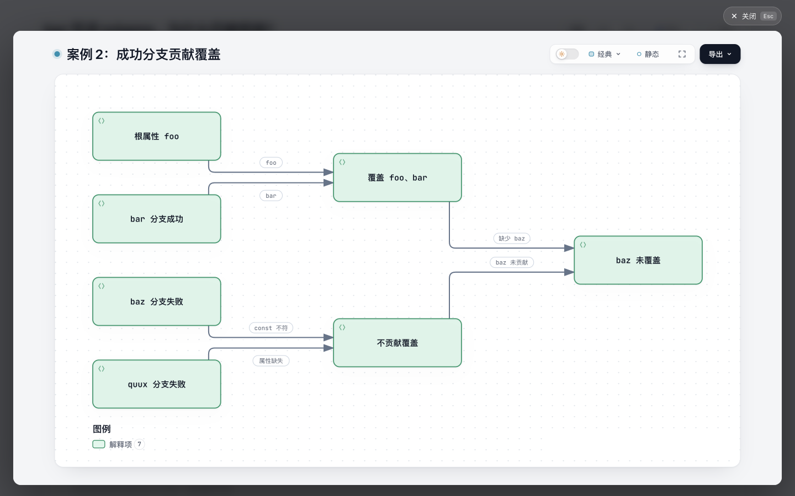

# 成功分支的属性覆盖：固定四例阅读实验

本实验解释一个具体问题：`baz` 明明出现在 schema 中，为什么整体校验仍拒绝它？案例 2 的 `baz` 分支失败，不能贡献覆盖；`anyOf` 本身成功，但 `unevaluatedProperties:false` 仍拒绝未覆盖的 `baz`。

这是低维护成本的内容候选：复用现有 Archify 原生图和 Explainer，没有修改产品代码、公共 Viewer、schema、校验规则、依赖、发布包或图库。是否帮助真实读者更快理解，尚未验证。只交付远程分支，不创建 PR。

## 阅读入口

- [解释页](explanation.html)：五步阅读、四例对照、主错误和来源。
- [同源原文视图](raw-records.html)：完整 schema、四个完整输入和两种配置的原始记录。这是本实验编写的阅读包装，不是 Ajv 官方 UI。
- [原生图](coverage.html)：独立查看布局、图例及缩放。
- [最终可编辑输入](candidate.explainer.json)、[原生图输入](coverage.architecture.json)、[完整观察](evidence/observations.json)。





## 来源、许可与去重

[JSON-Schema-Test-Suite 固定原件](https://github.com/json-schema-org/JSON-Schema-Test-Suite/blob/89e83a74014617ffbe79a56d83d14d054cd11417/tests/draft2020-12/unevaluatedProperties.json) 的完整 `/11` 组（`unevaluatedProperties with anyOf`），四例及顺序均保留。`fixture.json` 仅重新格式化，不改变 schema 或输入。完整上游文件在 `upstream/unevaluatedProperties.json`；[MIT 许可全文](upstream/LICENSE)，Copyright (c) 2012 Julian Berman。下载文本与存档逐字相同，见 [字节核对](evidence/source-byte-check.json)。

语义依据为 [JSON Schema 2020-12 Core](https://json-schema.org/draft/2020-12/json-schema-core) 的 `anyOf`、annotation 和 `unevaluatedProperties` 规则。本机引擎为 Ajv 8.20.0，固定对应上游 [0fba0b8](https://github.com/ajv-validator/ajv/commit/0fba0b8e649909613cfce0999b149cd08f4a4987)；未复制 Ajv 实现。Archify 生成物包含原有软件声明。

开始前与推送前分别核对 330 个远程 heads；两个既有研究总账没有 `unevaluatedProperties` 方向。相关 issue / PR 关键词检索均为 0，既有 ajv-errors 保留错误的方向未被重复实现。[来源与有界检索记录](evidence/source-index.json) 和 heads 原件保留检索范围，不声称全库绝无概念重叠。

## 实测与推导边界

| 案例 | 额外输入 | 成功分支 | 未覆盖属性 | 官方期望 / 本机结果 |
| --- | --- | --- | --- | --- |
| 1 | 无 | bar | 无 | 通过 / 通过 |
| 2 | baz=not-baz | bar | baz | 失败 / 失败 |
| 3 | baz=baz | bar、baz | 无 | 通过 / 通过 |
| 4 | baz=baz, quux=not-quux | bar、baz | quux | 失败 / 失败 |

四例均有 `foo=foo, bar=bar`。`strict:false`，`allErrors:false/true` 分别运行，其他 Ajv 默认设置不变。共 8 次完整校验、24 次独立分支校验、8 次独立 anyOf 校验和 8 次独立根 properties 校验。全部完整结果与官方期望相同，输入未被修改。

案例 2/4 的完整主 errors 只报告 `unevaluatedProperties`；额外独立校验才提供 `const` / `required` 原因。覆盖集合由固定 schema、成功分支和规范规则推导，并核对剩余属性与主 errors 一致。**独立检查不是 Ajv 内部执行轨迹，推导集合也不是原生 annotation 导出。** 该投影不支持任意 schema、引用、递归或动态作用域。

原文视图和解释页来自同一四例、同一主结论与同一观察包，没有为解释页删掉不利案例。原文显示完整 JSON，解释页组织成摘要、图和表；这不是排版完全相同的盲测，也没有测量读者速度。

## 复现

从仓库根目录使用已有 Node 22 和已有 Ajv 8.20.0。若本工作区已有依赖：

```sh
node experiments/schema-annotations/reproduce.mjs
node archify/bin/archify.mjs finalize explainer experiments/schema-annotations/candidate.explainer.json experiments/schema-annotations/explanation.html --json
ARCHIFY_CHROME='/Applications/Google Chrome.app/Contents/MacOS/Google Chrome' node archify/bin/archify.mjs finalize architecture experiments/schema-annotations/coverage.architecture.json experiments/schema-annotations/coverage.html --quality showcase --json
```

若只重跑 Ajv 观察，可把已有依赖所在的 `package.json` 绝对路径作为 `reproduce.mjs` 的第一个参数。脚本会重写观察包和原文 HTML；生成物复现需要仓库既有构建依赖。这里没有安装步骤。本次使用已有锁文件相同的依赖，临时链接在提交前移除。

最终记录使用官方 Node **22.23.3**、Ajv **8.20.0**。首次新工作区默认选中 Node 26.12.0，原始记录完整保留；两个版本的 `runs` 数组一致，不把此事扩展为支持矩阵。Node 22 最终再运行通过，见 `evidence/reproduce-final.log`。

## 检查结果与未覆盖范围

- 最终 Explainer：validate / deliver / check 通过，0 diagnostics；其 finalize **没有执行 browser-check**。独立原生图四项检查均通过，含真实 Chrome browser-check。
- Ego 实际页面：五步计数从 1/5 到 5/5，首尾聚焦截图；结束后恢复；原生交互图打开并结束加载；深浅主题、完整四例表、错误区、第一项复核 checkbox 均操作验证。
- 1440×900 的最终桌面与原文包装无页面级横向溢出。390×844 正文 scrollWidth=390；656px 的表格在 332px 容器内局部滚动。
- **窄屏限制**：图预览文字很小；原生图初始视口裁切右侧，缩小三次可到 25% 概览，但文字随之更小。保留两张原图；没有把它计为完整移动端验收，也未为此扩展产品代码。
- 步骤截图为 Ego 当轮默认 1291×762；不能冒充 1440×900 对照。其余截图的真实尺寸记录在 `evidence/image-dimensions.json`。所有 PNG 均来自真实页面并已逐张查看。
- 无完整产品测试库存、跨平台/跨浏览器 CI、导出视频测试或真实读者试验。此次仅新增实验输入与产物，因此未重建 ZIP / 图库。
- 全量 staged whitespace 检查记录了 59 条原始生成物 / 浏览器日志提示，原字节保留在 `evidence/whitespace-check.json`；作者 JSON、脚本和本说明的 scoped 检查通过。

`evidence/browser/` 保存实际检查脚本及输出；里面的绝对路径和 TaskSpace 3 是本次会话证据，重播需改为自己的工作区和已授权研究空间。

## 作者修订与成本

保留全部三次 finalize 记录。首稿采用 compact Markdown，静态检查通过但有一条写作提示，桌面布局过高。第二稿改为独立显式几何输入，静态检查通过，但丢失了 compact 的逐节点来源映射。最终使用现有 JSON Explainer 合同，恢复全部七个 nodeSources，保留七个节点 id/文字/类型和六条关系 id/端点/文字，同时把误导性的默认“后端”图例改为“解释项”。这不是纯几何修订。

首稿 Markdown/HTML/截图、第二稿 Markdown/HTML/截图均在 `evidence/`。最终 JSON 输入是复现入口，旧 Markdown 仅为历史草稿。未修改 renderer 或导入器，新增维护责任限于这一固定四例及说明材料。

下一步只有在真实阅读任务显示价值后才考虑内容模板复用；目前不建议开发通用 JSON Schema 求值图或 annotation 导入器。
