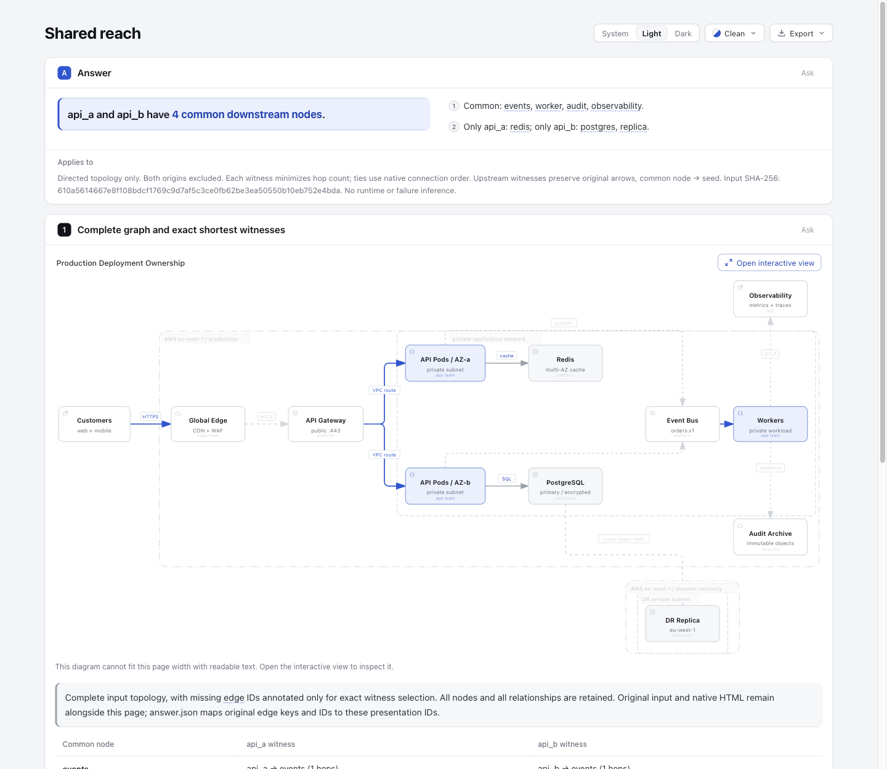

# Shared reach: isolated research experiment

This experiment asks a complete native Architecture JSON one bounded question:
which nodes are reachable from both selected origins (downstream), or can reach
both origins (upstream)? It returns two exact shortest-hop witnesses per common
node. This is directed topology analysis, not runtime dependency discovery,
common-cause diagnosis, a fault model, or code analysis.

All implementation, fixtures, generated artifacts, and evidence stay in this
directory. The experiment does not change the Archify renderer, Viewer, schema,
root tests, dependencies, or release ZIP. No live Archify installation is changed.

## Algorithm and identity

The adapter uses the existing `prepareExplainerDiagrams()` native validation,
render and check pipeline and consumes its `entry.semantic`. Before accepting
that semantic graph, it checks every authored component and every connection
against the extracted node IDs and original connection-index keys. Because the
native extraction uses `id || key` as its Map key, colliding identities are
rejected rather than silently analyzing a graph with missing edges. Parallel
connections are not collapsed by their endpoints.

One breadth-first search per origin produces minimum-hop witnesses. Equal-hop
choices use native connection order. Both selected origins are excluded from all
answer sets, including when cycles return to them. Upstream BFS traverses incoming
edges internally, then emits witnesses in the original arrow direction:
`common → … → seed`. An empty intersection is a successful empty answer.

The current native schema only accepts omitted `connection.direction`. Explicit
`forward`, `both`, and `none` are all rejected with an unsupported-direction
diagnostic; the experiment does not normalize them or decide #1139 semantics.

`answer.json` retains the exact input byte hash, query, complete native semantic
nodes and edges, each origin's reachable set, intersection, side-only sets, and
every witness's node IDs plus exact edge key/ID objects.

The current Explainer schema requires letter-leading edge target IDs. Original
anonymous native edges have numeric semantic IDs (their connection-index keys),
which that schema rejects. Therefore the Explainer uses a **complete topology
presentation copy**, adding stable `e-<index>` IDs only where an authored ID is
missing. Existing IDs are preserved; a deterministic suffix avoids collisions
with an authored ID. `answer.presentation.edgeTargets` explicitly maps original
key, original ID (or null), original semantic ID, and presentation ID. This is
identity annotation, not a witness-only projection; every component, connection,
boundary, style and authored route remains present. Steps select exact annotated
edges, while the table prints original paths and hop counts. The original raw
JSON and original native HTML are retained separately alongside the Explainer.
No HTML is post-processed or presented as a canonical mutated original.

## Public fixture and independent oracle

The fixture is copied without modification from
`archify/examples/production-deployment.architecture.json` at dev commit
`6ca6a5c84439b57ea22e0630fe306e1d91587a6e`.

SHA-256: `610a5614667e8f108bdcf1769c9d7af5c3ce0fb62be3ea50550b10eb752e4bda`.
It has 12 components and 12 connections.

For `api_a` and `api_b`, the independent downstream oracle is:

| Common | A edge keys | B edge keys |
| --- | --- | --- |
| events | 6 | 7 |
| worker | 6, 8 | 7, 8 |
| audit | 6, 8, 10 | 7, 8, 10 |
| observability | 6, 8, 11 | 7, 8, 11 |

Only A: `redis`. Only B: `postgres`, `replica`.
The upstream intersection is `clients`, `edge`, `gateway`.
These expected values were supplied independently of the implementation.

## Reproduction

Use the repository's already-installed root and `archify/` dependencies. During
this local run, package-lock bytes were checked equal before linking the existing
installed dependency directories from the original worktree. No package install
or lockfile change was performed.

From the repository root:

```sh
node --test experiments/shared-reach/shared-reach.test.mjs
node experiments/shared-reach/cli.mjs experiments/shared-reach/fixtures/production-deployment.architecture.json api_a api_b downstream experiments/shared-reach/evidence/downstream
node experiments/shared-reach/cli.mjs experiments/shared-reach/fixtures/production-deployment.architecture.json api_a api_b upstream experiments/shared-reach/evidence/upstream
node experiments/shared-reach/cli.mjs experiments/shared-reach/fixtures/production-deployment.architecture.json redis replica downstream experiments/shared-reach/evidence/empty
node archify/bin/archify.mjs render architecture experiments/shared-reach/fixtures/production-deployment.architecture.json experiments/shared-reach/evidence/full-native.html --quality standard
```

The experiment CLI retains `input.architecture.json`, writes original
`full-native.html` via public render, writes ordinary Explainer JSON, and calls
the unchanged public `archify finalize explainer --quality standard` command. Its exact command, exit status, stdout and
stderr are recorded alongside each answer. It does not start a browser. Public
finalize's receipt reports whether its automated browser stage ran; root's real
browser interaction and screenshot review are separate evidence.

## Inspiration and provenance

The question was inspired by GID and BitBom. The independently implemented
experiment follows the fixed-source review [Shared reach revisited](https://github.com/tt-a1i/archify/blob/8589fe4350d27a2d4e9dfbe0b43a43a6bab9274f/docs/research/2026-10-28/scouts/shared-reach-revisited.md):

- [GID](https://github.com/tonioyeme/graph-indexed-development-cli/tree/08c7dc9d793ab6afa5b741d093116ddfca151dc2), `tonioyeme/graph-indexed-development-cli` at
  `08c7dc9d793ab6afa5b741d093116ddfca151dc2`: the `common-cause` query uses set
  intersection, but that command's name is not evidence of failure causality.
  The source has an AGPL notice and commercial-license hint.
- [BitBom](https://github.com/bitbomdev/minefield/tree/699681d20fd3a671af21430806d6eaed695f1fc0), `bitbomdev/minefield` at
  `699681d20fd3a671af21430806d6eaed695f1fc0`: its AND reach-set query includes
  its origin. This experiment deliberately excludes both selected origins.
  The repository is Apache-2.0 licensed.

No external source code or external fixture was copied. The BFS implementation
here was independently written. The fixture comes from this Archify repository.

## Validation boundaries

Focused tests protect fixed known answers, original upstream arrow direction,
cycles and origin exclusion, parallel-edge identity and tie-breaking, empty
answers, invalid queries/inputs, unsupported directions, and public CLI finalize.
They do not repeat the full Viewer suite or a whole-repository test run.

Initial public finalize failure is preserved under `evidence/failed-numeric-targets/`:
the existing Explainer schema rejects numeric edge keys as `target.edges` IDs.
That failure must not be called a successful delivery.

Executed on the fixed base: the concentrated experiment test file passes
7 tests (see `evidence/tests.log`), and public finalize succeeds for downstream,
upstream, and empty-answer inputs. The checked gates are validate, deliver, and check.
`browserCheck.requested` and `browserCheck.ran` are both false in those receipts.
The fixed input SHA and both lockfile SHAs are recorded in
`evidence/dependency-and-fixture-hashes.json`. The initial focused test assertion
failure is retained in `evidence/tests-initial.log`; it was an over-specific
message assertion, replaced by the explicit unsupported-direction error code.
Public CLI rejections for same-node, unknown-node, and invalid query direction
are captured with their actual commands and nonzero status under
`evidence/rejected-queries/`. `evidence/verification-summary.json` indexes the
three successful finalize receipts and their artifact hashes. Its original
`pending-root-review` field records the implementation-stage snapshot; the later
root browser receipt below supplies the subsequent observations.

## Actual browser observations

Root Codex operated Ego Lite TaskSpace 9 against these unchanged HTML artifacts
and viewed all 13 original PNGs with `view_image`. This records Agent inspection,
not human acceptance. The main desktop image is an original 1440 × 1250 PNG,
158360 bytes:



Desktop pointer actions opened each origin's Observability witness, visually
following `api_a/api_b → events → worker → observability`. Escape closed the
native diagram and returned focus to the selected witness. Tab moved from A's
witness to B's, and Enter reopened the native view. The upstream page listed
`clients`, `edge`, `gateway`; the inspected B witness retained original arrows
`clients → edge → gateway → api_b`. The `redis`/`replica` page showed a successful
zero-common answer and no witness targets.

The existing single-source Reach baseline showed 5 downstream nodes for `api_a`
and 6 for `api_b`, retaining the complete 12-node/12-edge graph. The final settled
B baseline is [baseline-az-b-still-light.png](browser-evidence/baseline-az-b-still-light.png).
The earlier `baseline-az-b-light.png` remains a transition observation; it is not
substituted for the settled baseline. `downstream-path-b.json` records top-level
DOM only and does **not** establish the sandboxed iframe's highlighted state.
The actual path observations rely on native UI snapshots and the root's visual
inspection, as stated in [root-receipt.json](browser-evidence/root-receipt.json).

At a 390px dark viewport, measured client width was 375px and document scroll
width was 400px. Long scope/hash text clips; the native iframe needs horizontal
exploration and the selected path is not all visible initially. The complete
inline graph also reports that it cannot fit with readable text; root inspected
the desktop interactive view. These are retained limitations. Mobile, physical
touch, assistive technology, cross-browser, and reading-efficiency acceptance
remain incomplete. No time-saving or error-rate improvement was measured.

The root receipt preserves automation failures: an initial nonexistent baseline
HTML navigation, a parent-visible iframe-document timeout, a CDP traversal that
saw only top DOM, and a rejected snapshot locator-root call. They are not counted
as successful probes or hidden as product passes. Public finalize's automated
browser-check remains `not-run`, separately from the real Ego interactions.

## Evidence preservation and independent verification

Root's Node 22.23.3 verification summary reports 7 passed, 0 failed, 0 skipped,
4217.324167ms, using the concentrated test file. Its full stdout was not retained;
[root-receipt.json](browser-evidence/root-receipt.json) is the supplied summary.
The earlier implementation run's 7/7 log remains in `evidence/tests.log`.
The independent reviewer reported READY after checking 512 three-node directed
graphs, including self-loops, and 6144 origin/direction queries against its
transitive-closure oracle. That review checked common sets, witness endpoints,
original arrow direction and edge identities; it did not exhaustively verify
shortest-hop or equal-hop tie behavior. Root did not rerun that review probe.

[packaging-index.json](browser-evidence/packaging-index.json) lists every original
PNG's bytes, dimensions and SHA-256, all public derived record bindings, and the
unchanged source/HTML/input artifact hashes. All 13 PNGs are byte-for-byte copies
of the root captures. No image editing or HTML regeneration occurred during
packaging.

Local-path-bearing original JSON/command/receipt/log records were backed up
outside the checkout before publication. Their public copies are explicitly
**derived path-redacted records**, annotated with original byte counts and
SHA-256. Workspace paths use `<workspace>`, Node executable paths use
`<node-runtime>`, and native checker temporary directories use
`<temporary-directory>`. Stage results, failures, artifact SHA-256 and byte-count
values remain unchanged. These copies are not original receipt bytes and must
not be used as live provenance sidecars; reproduce into a fresh output directory
to obtain new native receipts. Files without local paths, including original
answer/spec/input JSON and all HTML, were left unchanged.

## AI disclosure and publication boundary

Codex (GPT-6.1 Sol) independently implemented the experiment adapter, CLI,
concentrated tests and documentation. A separate Codex reviewer supplied the
bounded graph review; root Codex performed the actual Ego actions and viewed the
original screenshots. Evidence packaging copied PNG bytes and derived public
records from private originals. No human review or acceptance is claimed.

Publishing this isolated experiment branch does not establish product
integration, a CI pass, human acceptance, release, deployment, or live
installation. Any later integration requires its own review and checks against
the target revision. Private original records remain outside the checkout;
temporary dependency symlinks are not experimental deliverables.
