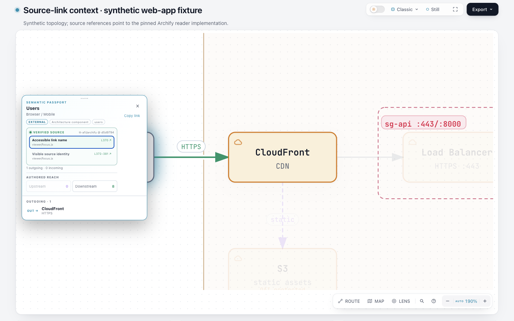
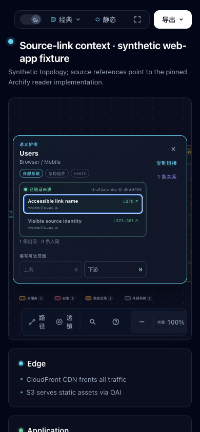

# Source-link context：同一文件的不同位置可以按名称区分

**范围：Native Passport 的源码链接名称。** 原来的两条链接虽然显示不同标签、行号，并指向不同位置，Chrome 的可访问名称却完全相同。本候选让名称包含原来可见的标签、行范围以及现有本地化的路径和版本说明。它没有加入字段、解析器或运行依赖。

这是源码检查发现并由真实浏览器复现的问题，示例拓扑为构造 fixture；不是自然用户事故、真实 Archify 系统架构或真人辅助技术验收。

| 同一文件的引用 | 基线名称 | 候选名称（省略共同路径说明） |
| --- | --- | --- |
| viewer/focus.js:370 | Open verified source viewer/focus.js at revision d5d9794 | Accessible link name, L370, … |
| viewer/focus.js:372–381 | 同上 | Visible source identity, L372–381, … |

原始 [Chrome AX、DOM 与键盘记录](evidence/browser/candidate-en-final.json) 保存完整名称。已有的 [W3C ARIA8 技术说明](https://www.w3.org/WAI/WCAG22/Techniques/aria/ARIA8)指出 aria-label 会覆盖链接的内容名称；这里恢复的是本来已可见的目的信息，不声称完成所有 WCAG 或读屏器认证。

## 可打开的完整产物

- English：[基线](artifacts/base-en.html) / [候选](artifacts/candidate-en.html) / [相同输入](inputs/en.architecture.json)。
- zh-CN 界面：[基线](artifacts/base-zh-CN.html) / [候选](artifacts/candidate-zh-CN.html) / [相同输入](inputs/zh-CN.architecture.json)。
- 在页面按 /，输入 Users，按 Enter 选中，然后 Tab 进入来源区。链接分别保留 #L370、#L372-L381。
- 源引用固定到 [Archify d5d97949 的完整 focus.js](https://github.com/tt-a1i/archify/blob/d5d979493bba650b3995836afd379cd249f2d0dd/viewer/focus.js)。引用只用于展示来源 UI，不声称构造示例中的 Users 组件由该代码实现。





截图是实际页面，名称差异应查看 AX 记录。两臂相机缩放状态不同，截图不能当逐像素视觉差分；静态 SVG 则已逐字节比较相同（[记录](evidence/static-svg-comparison.json)）。窄图是桌面 Chromium 的 CSS 视口，不是物理手机或触屏验证。

## 实现与成本

viewer/focus.js 复用 sourceName/sourceRange 同时构造可见行和可访问名称，继续使用 viewer.passport.source.open 翻译。原有 href、target、rel、referrerPolicy、验证流程和 local-only DIV 保持原样。生成模板从同一源码导出；既有多个 Native 图类型共享该 Passport，Explainer 不在此路径。

一个真实 AX 回归放在已有 repository-evidence-browser 测试中，包含同文件的单行、范围、文件级回退及 local-only，覆盖 en/zh-CN。既有导出测试也在本次通过的浏览器文件中。没有新增抽象、缓存或持久状态；未来维护成本主要是保持这一名称组合及既有翻译的含义。

## 验证与失败记录

- 新 AX 回归对未修改的 d5 模板先失败，原因就是两个名称相同；[原始失败](evidence/tests/baseline-stdout.txt)保留。
- 候选的来源浏览器测试 3/3，相关 evidence-types/semantic-passport 7/7，通过且未跳过。[命令与日志](evidence/tests/)是当次结果，未将重跑替换原失败。
- 首次 test:generated 的前置检查通过，随后有 **31 项旧生成输出失败**；完整 [stderr](evidence/tests/generated-stderr.txt)保留。最初执行者误报通过，经独立 review 纠正。后续更新状态见下方交付检查。
- 四份 HTML 均 deliver 成功，两份候选 require-provenance check 成功。初次 root 命令未同时记录 Node 版本；随后使用明确的 Node **22.23.3**，从冻结 d5 runtime 和候选分别重生成四份 HTML，全部与已拍摄的字节相同：[运行记录](evidence/node22-replay/run.json)。
- 实际 Ego 空间 32，桌面 1440×900/light 与窄窗口 390×844/dark。通过 Finder、Enter、Tab 到第一条来源，再 Tab 到第二条；两臂分别需要相同的 14/13 次 Tab。AX 中基线两个名称相同，候选两个名称不同，可见文字和 href 保持一致。没有用脚本 focus() 替代这条路径，也未打开外部链接。
- 先前空间 28 已不存在，库存确认后按用户此前授权重建。首次截图脚本在查询不支持的 Browser.getVersion 时失败（截图已产生），原脚本、日志、图片保留。另一次尝试重置相机以拍逐像素对照时关闭了 Passport，50 次 Tab 未再到来源，原失败保留；未把它当成功的匹配图片，也未修改产品绕过。reduce-motion 测试覆盖随后已恢复。
- [独立源码/字段审计](evidence/source-excerpt-audit.md)与[独立代码和测试 review](evidence/source-link-review.md)没有发现此局部修复的代码阻塞。review 发生在生成输出刷新之前，其失败结论保留历史范围。

## 复现

使用支持的 Node 和本机已具备的依赖；此任务没有安装依赖或修改 live Archify。下列输出放在新目录，避免覆盖归档产物：

```sh
node archify/bin/archify.mjs deliver architecture experiments/source-link-context/inputs/en.architecture.json /tmp/source-link-review/en.html --repo-root . --json
node archify/bin/archify.mjs check /tmp/source-link-review/en.html --json --require-provenance
ARCHIFY_CHROME="/path/to/chrome" npm run test:focus -- test/repository-evidence-browser.test.mjs
```

在 d5d979493bba650b3995836afd379cd249f2d0dd 的隔离源码树执行同一 deliver，可生成基线；本次 Node22 replay 的 argv、完整 stdout/stderr、收据与四份 HTML 哈希均已保存。浏览器脚本是当次操作记录，包含本机绝对路径和空间 ID，应先读记录再在自己的空间执行，不能直接冒用空间 32。

## 来源、排重与边界

代码及 web-app fixture 来自 Archify 的 Apache-2.0 基线，保留仓库 LICENSE/NOTICE。W3C 仅链接技术说明，未引入第三方实现。原生 LSP/调用位置研究带来的要求是区分具体源码位置，本次不接入语言服务器。

[排重记录](evidence/dedup.json)记录 315 个远程分支时点及关键词查询：已有 source-question-tour、line-notes、source-keyboard 不负责本路径。#1063 的托管平台支持、#1132 的关系证据、#1128 的 Markdown 行链接及 #1112 的长描述仍保持各自范围。没有新建 PR、合并、发布或安装；分支交付与正式集成、真人读屏使用及完整跨平台验收分开。

manifest.json 绑定本实验目录中除自身外的文件；copy-map.json 记录原始材料的复制关系。原始绝对路径是复现取证记录，不代表接收者的目录布局。

## 交付检查（生成更新之后）

31 项旧输出已按仓库脚本更新，之后 **test:generated 退出 0，stderr 为空**（[原始新日志](evidence/tests/refresh-generated-stdout.txt)、[退出码](evidence/tests/refresh-generated-exit.txt)）。15 对生成示例、派生 examples/web-app.html 与 archify.zip 已刷新；未修改它们的源 JSON、布局或测试预期。根复核对全部 32 个改动 HTML 文件提取 SVG 并与 d5 逐字比较，相同（包括无 SVG 的模板，详见 [逐文件记录](evidence/generated-svg-audit.json)）。ZIP 内模板与候选模板字节一致。

ZIP 按仓库要求使用临时官方 Node 22.23.2 / zlib 1.3.1-e00f703 构建，工具链取自官方源并放在临时目录；HTML 对照重放使用 Node 22.23.3，两者各自有版本记录。没有更换用户的全局工具链或安装 live Archify。生成输出检查通过不等于完整 suite、远程 CI、物理读屏器或人类接受；这些未在本次建立。原始 31 项失败、两次未成功的补充拍摄尝试和旧 review 范围全部保留。
