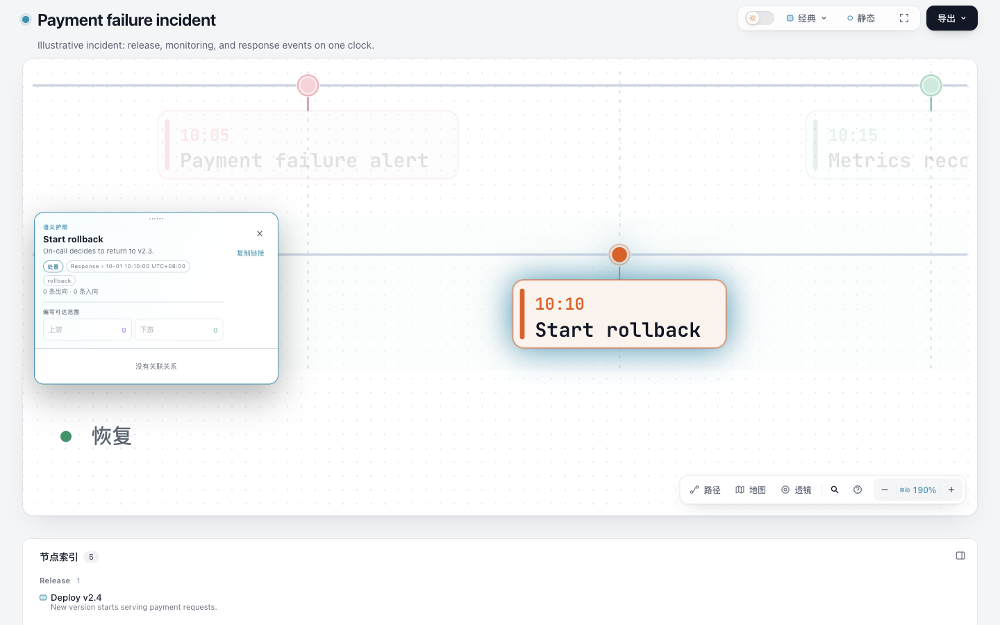
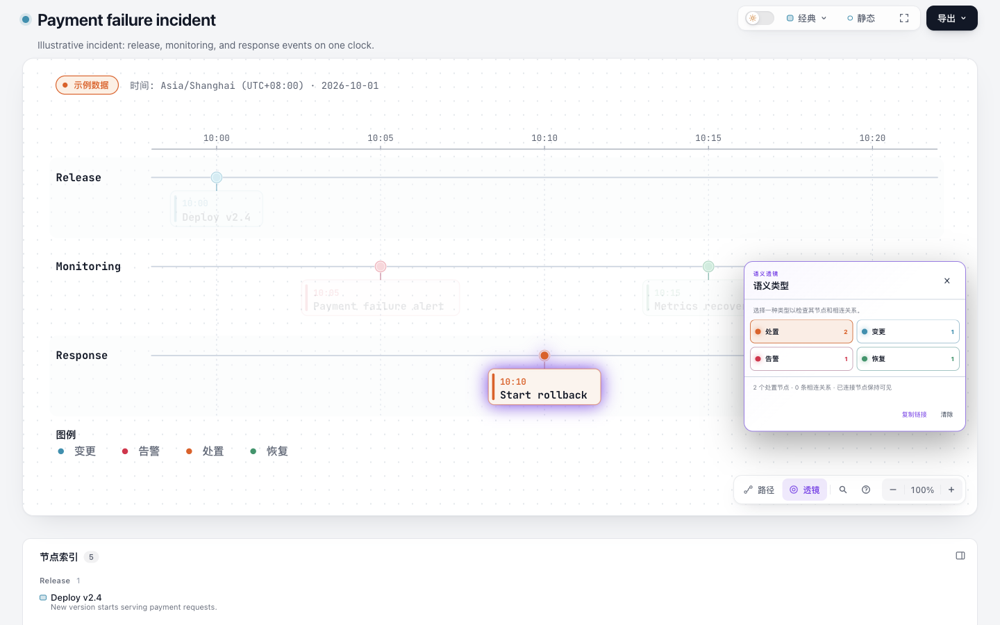

# Timeline 类型语义保真实验

本实验修正一个可直接观察的误导：同一事件在图例中是“处置”，进入查找器、节点详情或语义透镜后却显示“消息总线”。固定输入下，候选把 Timeline 的事件类型传给阅读界面；图形布局、颜色和时间计算保持原值。交付仅为独立远程分支 `codex/lab-timeline-kinds`，不创建 PR，不安装或发布。

## 来源与范围

基线为 [Archify dev d5d97949](https://github.com/tt-a1i/archify/tree/d5d979493bba650b3995836afd379cd249f2d0dd)。主输入来自该版本的 [payment-incident.timeline.json](https://github.com/tt-a1i/archify/blob/d5d979493bba650b3995836afd379cd249f2d0dd/archify/examples/payment-incident.timeline.json)，另一输入取自同版本 [Timeline README](https://github.com/tt-a1i/archify/blob/d5d979493bba650b3995836afd379cd249f2d0dd/archify/renderers/timeline/README.md) 的最小示例，只固定中文 locale 和输出名。两者是项目自带示例，不是自然用户任务。来源、输入及预算见 [experiment.json](experiment.json)，项目原许可见 [LICENSE](../../LICENSE)。本轮没有复制外部项目代码或素材。

前一轮 Tree 已证明“颜色类别写进节点类型”会造成错误阅读标签。本轮在九类原生渲染器中发现 Timeline 的同类路径，并以自己的分支和固定输入复现。Waterfall 也有类似机制，但服务、状态、跨度应如何分类尚未确定，留在研究记录中，没有混入本实现。

## 可见结果

| 固定输入 / 状态 | 基线 | 候选 |
| --- | --- | --- |
| rollback 节点详情 | 消息总线 | 处置 |
| 默认无 kind 的单事件 | 外部系统 | 事件 |
| 透镜四组 | 消息总线、前端、安全、后端 | 处置、变更、告警、恢复 |
| `#lens=messagebus` 旧链接 | 选择技术类别 | 仅在 Timeline 中恢复为 `timeline-action` |





两臂都在1440×900浅色页面用Finder搜索rollback并按真实Enter，目标矩形完全相同，见 [paired-ui.json](root-review/paired-ui.json)。默认类型、深色旧链接、390×844窄视口也有实际截图，逐张身份和验收状态见 [screenshots.json](root-review/screenshots.json)。共有14张，12张用于观察，2张因视口或动画状态不合条件保留但排除验收。窄视口是桌面CSS视口，不能代表真实移动设备。

## 实现与维护成本

- Timeline 节点输出 `timeline-default/change/alert/action/recovery`，共享阅读层从现有 `legend.timeline.*` 得到默认标签。新增覆盖键是 `viewer.kind.timeline.*`；显式新键优先，其次兼容旧技术类别的显式覆盖，最后用图例默认文案。旧Passport覆盖不改SVG图例。
- 同样保留旧Lens自定义文案、已注册locale和不支持locale的回退。旧hash映射只在带 `data-timeline-ui` 的图内启用；新复制链接使用Timeline token。
- 原调色板和CSS变量保留。原始 `data-node-kind` 值有意改变，用户自写的旧属性选择器需迁移；这不是零接口成本。
- 不增加依赖、输入字段、解析器或通用框架。改动集中在Timeline元数据、共享查看器的标签/兼容逻辑和现有本地化文件，生成的示例、画廊和ZIP随之刷新。

[产物比较](root-review/artifact-comparison.json)证明两个固定输入的内联SVG在仅移除 `data-node-kind` 后字节相同；主输入第一次生成候选与最终候选HTML也完全相同。这个“第一次生成”发生在两轮源码修复之后，不代表首份源码就通过。[示例比较](root-review/generated-svg-comparison.json)中13份非Timeline原生示例SVG字节不变，2份Timeline仅kind元数据改变，开发/打包示例对应相同。Passport短标签会改变卡片换行和高度，不能把SVG不变扩大为整个页面几何不变。

主HTML从863486到864606字节，增加1120字节；默认事件从853259到854354字节，增加1095字节。源补丁身份为 [final.patch](evidence/tests/final.patch)，SHA-256 `245ff00a1d814d715552384273b819a2ad1337a08eb64a80f5a4aa730bf188fb`，不包含其后的生成物刷新。

## 验证与失败记录

规范运行时Node22.23.2、zlib1.3.1-e00f703，实际浏览器Chrome156.0.8078.48。最终结果见 [final-checks.json](evidence/final-checks.json) 与 [独立代码审查](evidence/independent-review.md)。

- 最终五文件选择：379通过，0失败，0跳过；包括Timeline渲染/DST、语义透镜浏览器、查看器生成与i18n。
- 核心 `npm test`：19通过，0失败，0跳过；`npm run test:generated` 通过。
- 五次原生finalize均通过validate/deliver/check/browser-check，0诊断；自动流程的visualReview为not-requested，不能替代这里独立保存的实际页面检查。
- 首个源码候选21/22，因翻译键用连字符违反schema失败；修复为点式翻译键。随后自审发现未知locale错误变为声明的新locale，第二次修复恢复原回退。两次修复预算已用完，初版补丁及失败输出保留。
- 生成物检查首次因缺simple-icons失败；复用已有且版本相符的依赖后通过，两条借用node_modules链接均移除，没有安装。ZIP第一次包装器调用未执行构建，修正后两次构建一致，235项，排除实验目录及node_modules。提交后的干净源码重建另记在研究汇总分支。
- [采集记录](root-review/harness-notes.md)保留Ego空间重建、视口恢复、主题关闭面板、按钮名称及动画等待等失败和修正。公开日志仅替换用户主目录，原始/公开文件SHA映射见 [hash-mapping.json](evidence/hash-mapping.json)，原始副本留在本地临时证据目录。

不声称阅读耗时、生成速度或人类理解改善已经量化；没有自然任务对照、读者实验、AT、触摸或新hosted CI证据。Lens面板仍覆盖右侧事件，窄视口详情卡片仍遮挡大部分图。结论限于：这两个固定输入上的错误类别标签被修正，既有时间与SVG几何行为在所选检查中保持。

## 复现

在本分支根目录、Node22运行以下命令；使用项目已有环境，不执行安装：

```sh
mkdir -p /tmp/timeline-kinds-repro
node archify/bin/archify.mjs finalize timeline experiments/timeline-kinds/inputs/payment-incident.timeline.json /tmp/timeline-kinds-repro/timeline.html --json --browser-check --quality showcase --out-dir /tmp/timeline-kinds-repro
node archify/bin/archify.mjs finalize timeline experiments/timeline-kinds/inputs/default-event.timeline.json /tmp/timeline-kinds-repro/default.html --json --browser-check --quality showcase --out-dir /tmp/timeline-kinds-repro
```

打开输出HTML，切换到浅色、设1440×900，搜索rollback并按Enter，再打开语义透镜。基线复现需将上面的固定输入交给独立检出的 `d5d979493bba650b3995836afd379cd249f2d0dd` CLI；不要在当前目录反向修改源码。已保留 [baseline/timeline.html](baseline/timeline.html)、[candidate/timeline.html](candidate/timeline.html)、[baseline/default.html](baseline/default.html)、[candidate/default.html](candidate/default.html)，可直接离线对照。

如已有项目测试依赖，可按CONTRIBUTING使用focused workflow运行上述五文件，或直接检查保存的完整命令、标准输出、标准错误和退出状态。不同机器的Chrome字体与导出库可能改变HTML/PNG字节，需同时核对运行时、输入和可见行为。
